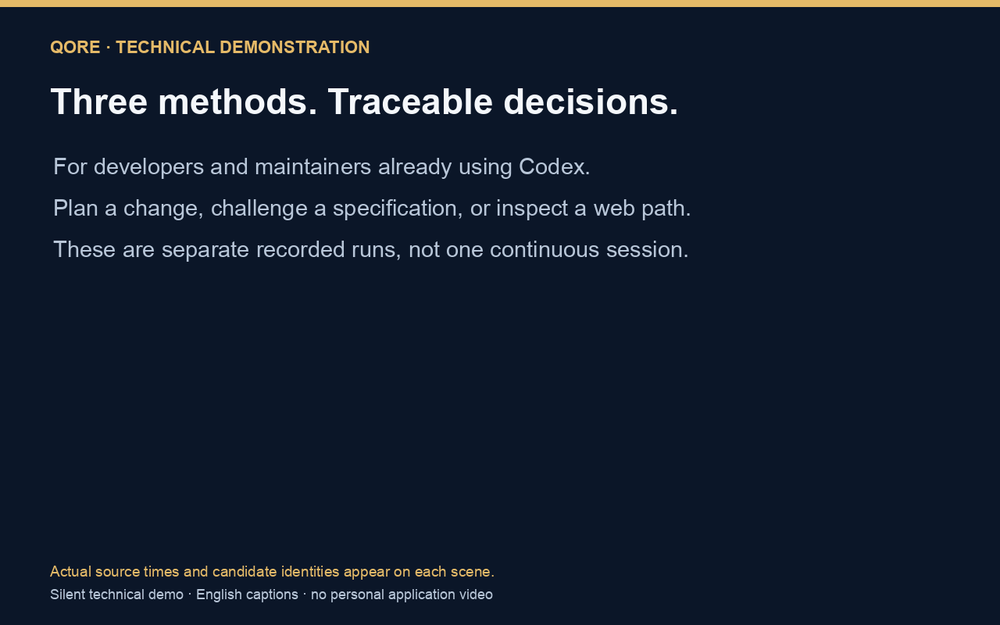
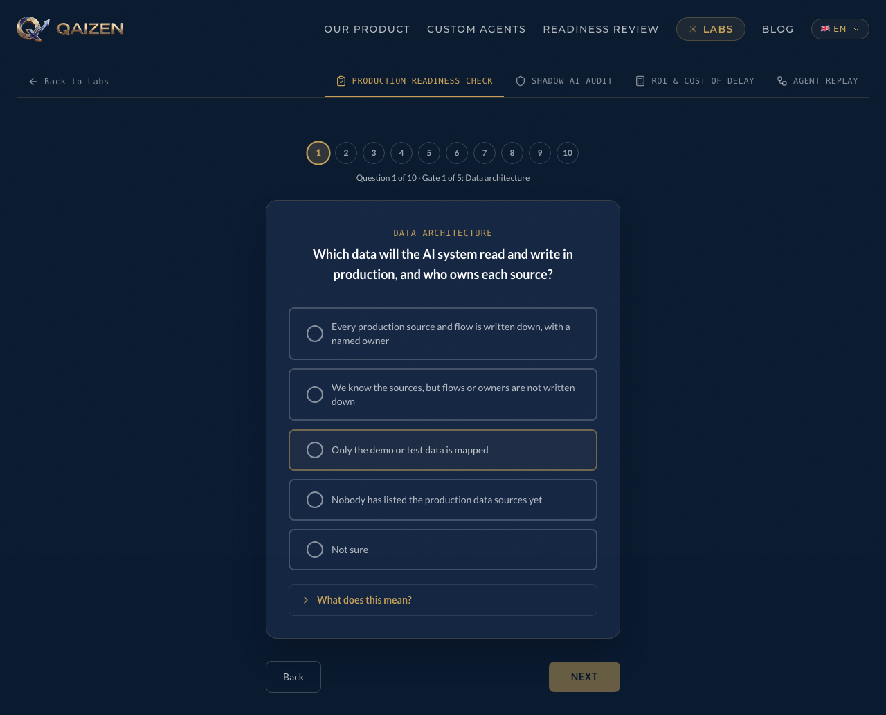

# Qore Skills

Prepare a sourced change plan, challenge a specification with independently checked findings, or inspect what a web interface actually does.

Qore is for developers and maintainers already using Codex on an existing project. It packages three independent methods as local skills. Choose the one your task needs; they are not a mandatory pipeline. No Qore account, backend, or hosted service is required.

Created by [Sylvestre Franceschi](https://github.com/sylvestre-baker) at [Qaizen](https://qaizen.io).

In one actual self-application, planning exposed a malformed verifier option that produced a structural success token. The selected correction rejects it and keeps the earlier zero-finding review visible. [See the problem, evidence, decision and limits](docs/evidence/validator-case.md).

**Version 0.1.0.** Three methods, a deterministic assembler, sourced profiles and recorded executions are included. The [qualification record](docs/qualification.md) distinguishes original snapshots, later corrections and coverage limits. Historical artifacts retain their original release state and identities.

## Choose your task

`$qore-plan` prepares a change, `$qore-review` challenges an artifact, and `$qore-ux-review` observes a web flow.

| You want to… | Target | Skill | Result | Prerequisites |
|---|---|---|---|---|
| Prepare or strengthen a change | Requirements or an existing specification | `$qore-plan` | Sourced specification, acceptance scenarios, adjudicated decisions, and task dependencies | Current project sources; five independent perspectives, scheduled in waves if needed |
| Challenge an artifact | Plan, specification, architecture document, or deliverable | `$qore-review` | Evidence-linked findings, retained refutations, and explicit verification gaps | Three independent finders and a fresh verifier; no browser required |
| Inspect rendered behavior | An authorized web entry, page, or flow | `$qore-ux-review` | Observed gate results, screenshots, defects, freshness, and scope limits | A working browser driver and the capabilities required by the declared scope |

For an ordinary Git diff, prefer the host's available code-review workflow. Small tasks may need only clear repository instructions or a direct check. Qore adds a bounded protocol and evidence records when those are useful; no general quality, speed, or cost advantage is claimed.

## Try one review

The first useful result is an actual review of the [bundled validator-hardening specification](examples/validator-hardening.md), using its implementation and regression tests. This is a snapshot of Qore's own work, not a seeded defect. A valid zero-finding review is a possible result.

You need Codex with a local executor and independent subagent capability, plus `python3`, `node`, and Bash. The helpers use Python's standard library and Node built-ins. A browser, persistent project profile, and Qore account are unnecessary for this example. Merely loading a skill or passing a preflight does not complete the review.

Clone the public repository first. Git is needed for this step; an existing checkout can skip it.

```sh
git clone https://github.com/sylvestre-baker/qore-codex-skills.git
cd qore-codex-skills
```

From the repository directory containing this README, build a new candidate and install its three skills into this checkout:

```sh
qore_stage="$(mktemp -d "${TMPDIR:-/tmp}/qore-first.XXXXXX")"
python3 tools/qore.py build --output "$qore_stage"
python3 tools/qore.py install --source "$qore_stage/qore-skills-0.1.0" --project-root .
```

The installer prints three paths under `.agents/skills/` and `"replaced": false`. It refuses an existing destination and preserves it. If you already have these local skills, use a fresh checkout or compare a newly staged candidate; see [safe updates](docs/profiles.md#update-without-overwriting).

Open a **new Codex chat in this repository directory**, then use:

```text
Use $qore-review to review examples/validator-hardening.md against its bundled
validators and tests. Keep the target to this specification and implementation.
Run the three independent finders, mechanical redaction, and a fresh verifier.
Retain phase evidence and report findings and execution coverage. Do not edit source files.
```

A completed example names the target snapshot, three returned finder reports, the actual redaction, a separate verifier, the final findings gate, and evidence for each phase. The report distinguishes **COMPLETE / PARTIAL / BLOCKED execution coverage** from finding impact and any delivery decision. Missing independence or an unfinished phase means PARTIAL or BLOCKED, even if the JSON is valid. [Troubleshoot discovery or missing capabilities](docs/troubleshooting.md).

## Use a method on your project

Install the verified candidate into your project's `.agents/skills/` with the same installer and your project root as `--project-root`. Generic use reads the current sources you provide; it does not create a persistent profile.

| Method | Starting prompt |
|---|---|
| Plan | `Use $qore-plan to prepare this change from the current requirements and project sources. Preserve open decisions and show acceptance coverage.` |
| Review | `Use $qore-review to challenge docs/specs/change.md against its requirements and implementation. Report actual independent phases and uncovered scope.` |
| Web UX | `Use $qore-ux-review to inspect the authorized web flow from its real entry control. Declare required states and capabilities before execution; retain gaps and fresh evidence.` |

Supply the actual target, relevant requirements, and authorized web origin when applicable. A method can continue useful work while exposing unavailable sources, tools, data, or roles. It cannot label unobserved checks as passing. Fixes run only within the user's authorized scope; a profile or SHIP result does not grant merge, publication, or deployment permission.

## See the evidence

[](docs/demo/technical-demo.mp4)

[Watch the 78-second technical demonstration](docs/demo/technical-demo.mp4) · [English captions](docs/demo/technical-demo.en.vtt) · [Transcript and source chronology](docs/demo/transcript.md). The presentation combines separate actual runs; it is not a simulated continuous session.

The [validator case](docs/evidence/validator-case.md) connects an observed problem to a selected change and a recorded before/after boundary. The [review after the exact-token correction](docs/evidence/executions/review-exact-flags/REPORT.md) retains its actual independent phases, source revision and limits. The scoped web observations below exercise a different consumer.

On 15 October 2026, an isolated Playwright Chromium session followed the existing QAIZEN Labs entry to its readiness introduction, opened the first question, opened and closed an explanation with keyboard input, and returned to the introduction with heading focus. No answers or forms were submitted. This supports the declared entry/state path, rather than a whole-site readiness claim. [Observation record and limits](docs/evidence/browser/README.md).

[](docs/evidence/browser/qaizen-demo-captioned.mp4)

[Watch the actual captioned recording](docs/evidence/browser/qaizen-demo-captioned.mp4) · [Read the transcript](docs/evidence/browser/qaizen-transcript.md) · [English captions](docs/evidence/browser/qaizen-demo.en.vtt) · [Capability matrix](docs/evidence/browser/capability-matrix.json) · [Transformation provenance](docs/evidence/browser/provenance.json)

Navigation, screenshots, DOM inspection, keyboard input, console listening, and network observation were exercised in that recorded environment. Full UX coverage remains PARTIAL: instrumented accessibility, performance, alternate viewports, and the complete question/result/error matrix were not tested. One analytics POST was blocked by the observation harness and is retained in the evidence. The recording is a maintainer-operated agent observation, not external human usability evidence.

## Adapt all three methods from one profile

A reusable project adaptation binds the methods to sourced commands, invariants, and a web target. Every fact names a project source and its SHA-256. The included [Qore profile](profiles/qore.json) applies to this repository; the [contrasting fixture profile](profiles/contrast.json) exercises isolation and different facts.

From this repository, generate three new project-specific skills:

```sh
python3 tools/qore.py derive --profile profiles/qore.json --project-root . --output /tmp/qore-derived-first
python3 tools/qore.py verify /tmp/qore-derived-first
```

Choose an unused output path. Derivation refuses stale sources or an existing destination. The generated names are `qore-plan-qore`, `qore-review-qore`, and `qore-ux-review-qore`. Each contains its own profile, references, and helper scripts. At invocation, its checker compares the target sources again and exposes only current applicable facts. Stale context makes affected coverage PARTIAL or BLOCKED; it never silently falls back to generic behavior.

For your project, maintain one profile from your actual rules and sources, then derive into new staging. Inspect the result and its diff before installing. [Profile fields, runtime checks, and safe updates](docs/profiles.md).

## Understand the boundaries

| Boundary | What the result means |
|---|---|
| Codex host | Actual role/tool availability must be observed. Five planning labels or a verifier flag do not prove independent execution. Clean candidate-only qualification is tracked separately. |
| Planning | Five perspectives, challenge, and adjudication; at most three rounds. Structural spec validation does not establish business completeness. |
| Review | Findings need checkable evidence. Only independently CONFIRMED critical/high findings are verified blockers. An unverified high concern keeps its impact severity and remains non-blocking uncertainty in a PARTIAL report. |
| Web UX | Required checks need actual fresh browser evidence. Skipped required gates prevent global SHIP; six iterations is the ceiling, including persistent defects. |
| Native apps and other hosts | Unqualified by this web/Codex candidate. A web observation does not establish native behavior. |
| Validation | Digests and schemas check identity and structure. They do not prove reasoning quality, defect absence, or superiority over simpler workflows. |
| Human first use | No external human first-use outcome is claimed. Agent, maintainer, portability, and human observations remain separate. |

Four complete method executions and two focused derivative probe suites are recorded with their own identities, plus structural regressions and post-correction checks. These are scope-specific execution checks, not a comparative benchmark. See [qualification evidence](docs/qualification.md) and the [independent Linux procedure](docs/clean-environment.md) for actual scope, isolation and credential boundaries.

## Troubleshoot and update

An existing destination is preserved: build or derive into a new staging path, run the read-only comparison, and inspect changes before choosing any migration. A stale profile requires reconciling its source and regenerating; no silent generic fallback is permitted. [Safe updates](docs/profiles.md#update-without-overwriting) and [observed failures and recovery](docs/troubleshooting.md) cover these cases.

If a role or required browser capability is unavailable, retain its name and evidence gap. The result remains PARTIAL or BLOCKED; a flag, test total or clean console cannot replace the missing phase.

## Reference and contribute

- [Releases](https://github.com/sylvestre-baker/qore-codex-skills/releases), [changelog](CHANGELOG.md), and [publication record](docs/publication.md).
- [Architecture](docs/architecture.md): core, project facts, Codex adaptation, and local trust boundaries.
- [Contracts and validators](docs/contracts.md): project, release, and execution records; what checks can and cannot establish.
- [Command and prompt inventory](docs/command-inventory.json): prerequisites, effects, substitutions, and actual execution status for the documentation examples.
- [Troubleshooting](docs/troubleshooting.md): discovery, stale facts, unavailable tools, and refused updates.
- Method protocols: [planning](skills/qore-plan/SKILL.md), [review](skills/qore-review/SKILL.md), and [web UX](skills/qore-ux-review/SKILL.md).
- [Contributing](CONTRIBUTING.md), [provenance](PROVENANCE.md), and [MIT license](LICENSE).

## License and provenance

The newly authored implementation and documentation use the [MIT license](LICENSE), maintained by Sylvestre Franceschi. The [provenance record](PROVENANCE.md) and explicit release rights inventory identify the scope of selected public observations and first-party resources. Private client distributions and their Git histories are excluded.

First-party repository content is maintained in English. External quotations, rendered evidence and protocol tokens retain their source identity. Publication and any external application remain separate actions.
