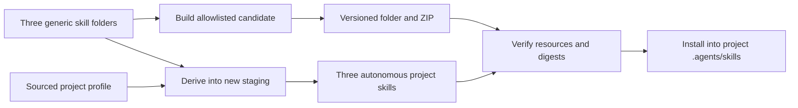

# Architecture

Qore is a local skills package. The three methods can be installed together and invoked independently. There is no Qore application server, account, database, or runtime MCP service.

## From source to an installed skill

In text: `build` copies the explicit release allowlist into a new candidate, writes inventories and digests, verifies it, and creates a ZIP with fixed archive metadata. `derive` validates one current profile for all three methods, copies the core, adds the project binding, and creates three autonomous skills. `install` verifies the source and places its three folders in the target repository's `.agents/skills/` after checking for collisions.

The installed folders contain their own entrypoint, metadata, references, helper scripts, and local release inventory. Project derivatives also contain a copied profile. Required local skill links stay inside each folder. Informational HTTPS citations are allowed; they cannot conceal an undeclared downloaded runtime dependency.

The canonical generic folders are under `skills/`. Codex-facing instructions and `agents/openai.yaml` are maintained there. This candidate qualifies only the actual Codex host/tool behavior exercised during testing; the metadata alone does not establish discovery or independent-agent support.

## Project data at execution time

A profile binds facts to project files with source IDs and SHA-256 digests. Assembly checks those bindings without executing commands. At invocation, each derivative must load its copied profile and run its local checker against the supplied target root before choosing profile facts.

The checker returns only current facts applicable to the selected method. The method still inspects the cited source and records which facts it actually consumed. Changed or missing applicable sources make affected coverage PARTIAL or BLOCKED. A previous successful build does not establish current context.

A profile grants no action permission. Repository instructions and the user's scope still govern commands, browser interaction, shared-data writes, and delivery. An allowed web origin identifies a target boundary, not account access or permission to submit a form.

## Evidence and decisions

Each method records actual phase execution under `qore-run/1`, with candidate/target identity, role or actor IDs, artifacts, commands, timestamps, coverage, and limitations. The run checker validates declared evidence identity and coverage. It cannot establish that a counterexample is sound or that conclusions follow from the sources.

Method controls remain separate:

- Planning: five perspectives, challenge, and evidence-based adjudication; no more than three rounds.
- Review: three isolated finders, actual mechanical redaction, and a fresh verifier; severity and verified blocking status remain separate.
- Web UX: declared required scope, observed capabilities, and fresh browser checks; at most six iterations.

COMPLETE describes execution within scope. A completed review can establish a defect and DO-NOT-SHIP. SHIP is a scoped review result, not merge or deployment authorization. See [contracts](contracts.md) for the exact validators.

## Updates and trust boundaries

Build and derive use new staging and refuse existing generated destinations. Installation refuses existing skill destinations. There is no automatic merge of local adaptations and no force-replacement workflow. Keep the current version, generate the candidate elsewhere, inspect the diff, and choose any later migration explicitly.

Source/profile paths and artifact paths must remain within their declared roots. Release preparation rejects symlinks and unlisted resources; integrity verification rejects altered or unexpected files. These checks protect the stated local boundaries and do not certify the correctness of the contained instructions.

The [independent Linux procedure](clean-environment.md) separates candidate portability from the author's host. An actual clean execution is required to claim that portability result. Agent and maintainer runs remain distinct from external human first use.

Documentation keeps the [first tutorial](../README.md#try-one-review), [adaptation guide](profiles.md), contract reference, and architecture explanation separate. This follows the different reader needs described in the [Diátaxis map](https://diataxis.fr/map/) (consulted 15 October 2026), without claiming a measured adoption benefit.
