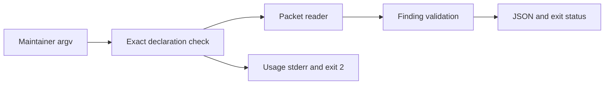
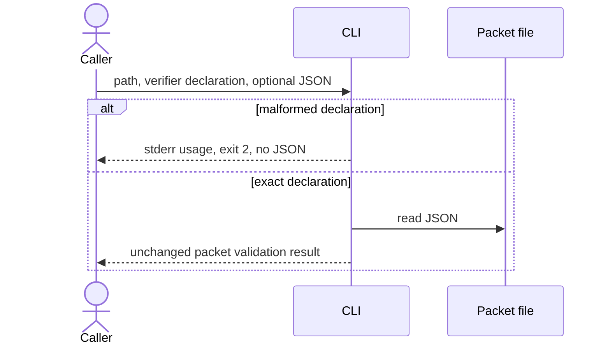

# Architecture — independent Analyze

Target: `<CANDIDATE_B>`, supplied snapshot `dec34e19b7b3036c213299a1f98b05fec1709212fb156eabf9928682024ae2cb`. Workflow is selected by applicable `examples/validator-hardening.md:4-8`. No implementation or package writes occurred.

## Profile consumption and measured baseline

Read the derivative SKILL and all five required planning references before analysis. Actual bundled preflight returned COMPLETE, exit 0. Profile `qore` version `0.1.0`, SHA-256 `da03026c9f73a7771cc35aaaff898a3b970fed75362ebfd0c670068d6b23b3d9`; current source ID `project`, `qore.json`, SHA-256 `948b2784fa7970cf90a25c338a29067b13d8b4476f666d712a5eb95fc6f641c8`.

Consumed fact `check` determines the acceptance command: `python3 -B -m unittest discover -s tests -v` (`qore.json:4`), actually run: 82 tests, OK, exit 0. Consumed invariant `preserve-adaptations` (`qore.json:6`) requires future updates in new staging and refusal of existing destinations; no existing adaptation may be overwritten during this improvement. No other profile invariant or surface was selected/consumed. Exact argv/cwd/stdout/stderr/exits and temporary probe input are retained in `architecture-commands.json`.

## Decisions and reuse/impact sweep

**AR1 — proposed smallest next change: enforce exact verifier declaration grammar.** Existing parser splits on `=` and consumes only element 1 (`skills/qore-review/scripts/finding-lint.mjs:6-10`). A measured empty-envelope probe with `--verifier=ran=skipped --json` exits 0 and returns COMPLETE/SHIP with verifier `ran`. The documented syntax admits only `--verifier=ran|skipped` (`finding-lint.mjs:10`; `skills/qore-review/SKILL.md:14`). Reject trailing values rather than silently discarding them. Preserve existing exit 2 usage failure, stderr diagnostic, and empty stdout; reject before opening packet files. Alternative: tolerant suffix parsing is inconsistent with the published grammar. A schema migration is unnecessary for this bounded correction.

**AR2 — keep packet and result contracts unchanged.** Writer chain: finders produce `{findings}`; redactor filters scalar `id,title,severity,evidence,counterexample`; verifier preserves IDs/severity and adds `verdict`/`refuted_because`; lint derives `coverage,verdict,blocking_findings` (`skills/qore-review/SKILL.md:12-15`; `skills/qore-review/references/findings.md:14-24`; `redact-for-verifier.mjs:13-32`; `finding-lint.mjs:44-51`). Unknown rationale remains dropped. There is no database, network service, transaction, or retry boundary here. Inputs are local files/argv; outputs are stdout JSON, stderr diagnostics, process exit.

The search covered README, all skills and tests. Actual automated consumers are `tests/test_validators.py:15-26,53-124`; the human/agent invocation contract is `references/findings.md:9-11`. Release inventory binds script bytes (`skills/qore-review/references/release.json:44-48`): future release generation must refresh inventories through the established build path, with preservation acceptance retained. Package-tool internals were not inspected; exact release command remains a Delivery prerequisite. No-change classification for redactor: it accepts no verifier declaration (`redact-for-verifier.mjs:4-7`).

## Required component and execution views

## Tasks, risks and peer questions

Order: lock grammar → table-driven public-entry regression cases → parser correction → full declared check → fresh staging/release verification. Preserve exact valid ran/skipped behavior, argument order, legitimate empty arrays, high PLAUSIBLE severity, and malformed-file exit behavior (`tests/test_validators.py:64-113`). Add suffix, duplicate/conflicting declaration, missing declaration, empty value and unknown flag cases. QA should assert stdout/stderr and exit, including invalid argv with nonexistent input to prove rejection precedence.

Product: define whether “verifier ran” means all batches examined. Partial batches are explicitly PARTIAL (`references/findings.md:22`) but current lint uses a global flag (`finding-lint.mjs:45`). This is a separate unresolved contract gap; do not claim AR1 resolves it. UX: keep one existing usage diagnostic; extra configuration or packet fields add unnecessary complexity for AR1. Delivery: confirm release regeneration command before implementation. QA: changed failure precedence is the compatibility trigger for scripts relying on malformed suffixes.

Uninspected: package implementation internals, real external callers, browser/native behavior (no affected surface), partial-batch redesign. Initial analysis complete; cross-examination/adjudication pending. No peer reports or public workspace updates read.

Observed at: 2026-10-15T20:02:38.354834+00:00
