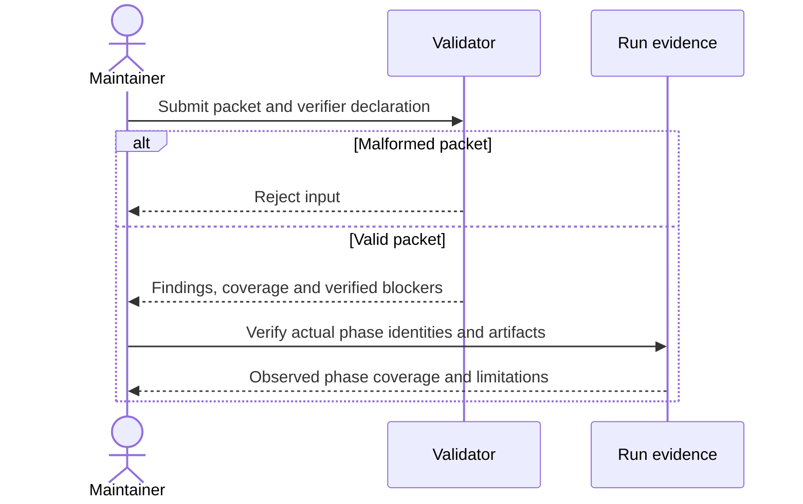
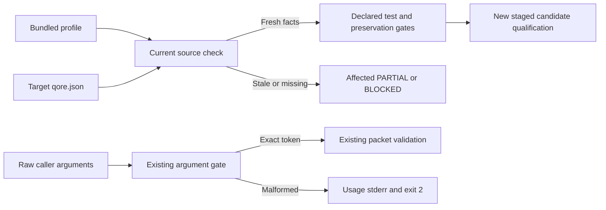
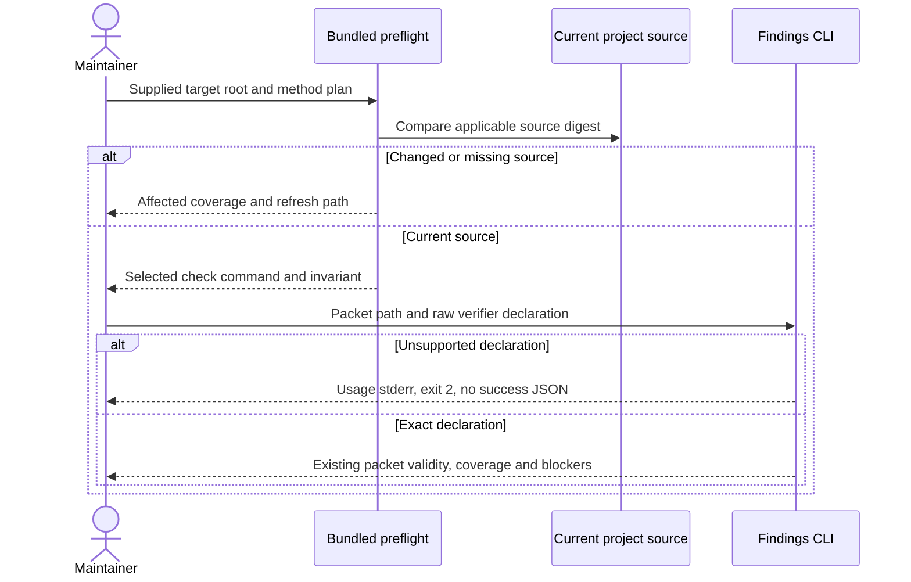

<!-- qore-spec/1 -->
# Reject invalid review packets without hiding uncertainty

This is a tutorial snapshot of Qore's actual validator-hardening work. It is not a seeded production defect or a quality benchmark. Review it against the bundled validator, regression tests and current project rules.

## Goal

A maintainer must distinguish a malformed packet, a complete review, and a valid report whose independent verification is missing. A missing verifier cannot justify lowering a candidate's severity or declaring success.

## Decisions

| ID | Decision |
|---|---|
| D1 | Require an explicit object containing a findings array. |
| D2 | Preserve severity and derive verified blocking status independently. |
| D3 | Missing independent verification keeps coverage partial. |

## User stories

| ID | Need |
|---|---|
| US1 | Reject malformed input rather than treating it as zero defects. |
| US2 | Retain uncertainty and candidate severity without a false success. |

## Acceptance criteria

```gherkin
Feature: Honest review packet validation

  Scenario: A01 Refuse a missing findings envelope
    Given a packet containing only an empty object
    When the findings validator reads it
    Then validation fails before it can represent a complete review

  Scenario: A02 Keep an unverified high-severity candidate
    Given a well-formed high-severity candidate with evidence
    And independent verification is unavailable
    When validation runs with the verifier declared skipped
    Then the packet is structurally valid
    And the candidate remains high and PLAUSIBLE
    And coverage is PARTIAL and no SHIP is produced

  Scenario: A03 Preserve a valid empty review
    Given an explicit findings array containing no items
    And the required independent phases actually completed
    When packet validation runs with verification recorded
    Then the packet may represent a complete review with zero findings
    And the declaration alone does not prove those phases occurred
```

Coverage: A01→US1/D1; A02→US2/D2/D3; A03→US1/US2/D1/D3.



## Verification

Run the actual project check declared in qore.json. Inspect the bundled finding-lint.mjs, redact-for-verifier.mjs and tests/test_validators.py. A passing structure check is not a reasoning-quality result. A valid zero-finding review is a legitimate outcome for this example.

## Project-bound proposed revision

This is a proposed revision of the preserved tutorial above, produced by `qore-plan-qore` in Workflow mode. It plans a change; it does not edit the frozen implementation or authorize delivery. Target: frozen candidate b, snapshot `dec34e19b7b3036c213299a1f98b05fec1709212fb156eabf9928682024ae2cb`. Base archive: `2963c43e98803354932e406627d9e239064fbe2899745a7e093b7d4154fa56d1`. The fresh derived bundle is identified by manifest SHA-256 `19f48167f040ca42c60b0df49a324c6d3aeb3de3014486017668f1263ccd6b35`. This run used fresh role contexts and did not reuse generic planning reports.

The initial question is the smallest useful next improvement after the existing envelope/severity/uncertainty behavior. Multiple fresh independent probes find that `--verifier=ran=skipped` or another suffix-bearing value is silently interpreted as ran, yielding COMPLETE/SHIP for a valid empty packet. Full inputs, argv, stdout/stderr and exits are in the role command logs. `skills/qore-review/scripts/finding-lint.mjs:6-10` explains the result: it selects a prefix and retains only one equals-separated component. This is a demonstrated input grammar mismatch; no production incident or actual bypass of independent execution is inferred.

## Sourced profile consumption

The invocation prompt supplied no project command or invariant. The derivative's bundled preflight ran before fact use and returned COMPLETE. Profile: qore/0.1.0; SHA-256 `da03026c9f73a7771cc35aaaff898a3b970fed75362ebfd0c670068d6b23b3d9`. Applicable source `project` is `qore.json`, current digest `948b2784fa7970cf90a25c338a29067b13d8b4476f666d712a5eb95fc6f641c8`, equal to the recorded digest.

| Consumed fact | Source | Actual effect |
|---|---|---|
| check | project; qore.json:4 | Selected and actually executed `python3 -B -m unittest discover -s tests -v`, yielding exit 0 and 82 passing frozen-b tests. The same declared full check is an implementation acceptance gate; a narrow Node probe alone cannot replace it. |
| preserve-adaptations | project; qore.json:6 | Constrains D5, A08 and T4: future packages/derivatives go to unused staging; existing destinations must be refused with their bytes preserved. Installation is separately authorized and never an in-place correction. |

These are selected and consumed facts, not only profile text copied into an output. Each role's raw command log contains its own preflight and the full declared check; role reports identify their decision effects. Other-method invariants and fixture URLs were not returned for plan and are not used as profile authority. Missing or changed applicable source bytes invalidate affected use; no silent generic fallback may make it complete.

## Added stories and locked decisions

US3: As a CLI caller, I need unsupported verifier declarations rejected before result derivation so malformed arguments cannot appear to be a supported complete declaration.

US4: As a maintainer with an adapted skill, I need checked changes staged separately so qualification preserves my current working copy and shows the candidate identity.

| ID | Decision | Resulting requirement |
|---|---|---|
| D4 | Recognize the complete raw verifier value exactly. | Exactly one ran or skipped declaration is accepted. Reject suffixes, extra equals signs, empty/unknown values, absent/repeated declarations and unsupported options with usage exit 2 and empty stdout before packet reading. Do not normalize or truncate. |
| D5 | Apply the current preservation invariant to qualification. | New staging, explicit old/new candidate identities, existing-destination refusal and unchanged installed bytes. Old evidence remains bound to its actual candidate. |
| D6 | Preserve existing packet, output and exit contracts. | D1–D3 and A01–A03 remain; valid empty reviews, high/critical PLAUSIBLE skipped candidates, retained refutations and supported blockers keep their behavior. Exit 0 is structural validity, not delivery permission. |
| D7 | Keep profile freshness and execution proof distinct. | Recheck applicable sources before consumption; the check command and staging invariant are sourced constraints. A verifier flag, profile pass or passing test count cannot prove actual independent phases. |
| D8 | Keep the increment bounded to grammar and direct acceptance/documentation. | Recovery guidance explains existing channels; broader text-result changes, partial-batch modes, proof platforms and shared CLI rewrites are deferred. |

## Existing boundary and reuse evidence

The actual input producer is the caller's argv. The linter consumes one packet path, a verifier declaration and optional JSON formatting, then writes process status/stdout/stderr. The packet producer/filter/verifier chain remains unchanged: strict findings envelope, scalar claim allowlist, preserved IDs/severity, verdict and refutation support. Sources: `skills/qore-review/SKILL.md:12-15`, `references/findings.md:14-26`, `redact-for-verifier.mjs:13-33` and `finding-lint.mjs:15-58`.

Reuse the existing argument gate and public subprocess harness (`tests/test_validators.py:15-30`). It already supports Node invocation and current semantic regressions but does not exercise complete malformed declaration tokens. No extra library, shared validator framework, packet schema, transaction, database, service, browser/native feature or account authorization change is necessary. Unknown external callers remain an explicit compatibility limit; supported exact tokens remain stable, while reliance on undocumented suffix tolerance intentionally stops.





User-facing scope is the terminal/report boundary. Preserve channel and exit categories, avoid exact Node parse-error wording assertions, and tell callers to repair the malformed token or missing independent work. Do not recommend lowering severity or relabeling skipped verification as ran. No browser or accessibility conformance claim is made by this local planning run.

## Added acceptance coverage

```gherkin
Feature: Exact declarations with sourced maintenance gates
  Scenario Outline: A04 Reject the entire unsupported verifier value
    Given an explicit empty findings envelope
    And the verifier declaration is "<declaration>"
    When the findings CLI executes
    Then it exits 2 with usage on stderr
    And stdout is empty
    Examples:
      | declaration                   |
      | --verifier=ran=skipped         |
      | --verifier=skipped=ran         |
      | --verifier=ran=                |
      | --verifier=                   |
      | --verifier=unknown             |

  Scenario: A05 Preserve both exact supported declarations
    Given a valid packet and exactly one supported ran or skipped declaration
    When the findings CLI validates the packet
    Then the existing field values and exit conventions are preserved
    And skipped high or critical PLAUSIBLE findings remain PARTIAL with unchanged severity and no SHIP

  Scenario: A06 Preserve confirmed blockers and refutation support
    Given a confirmed high finding with source and counterexample and a refuted finding with its reason
    And exactly --verifier=ran is supplied
    When the findings CLI validates the packet
    Then exit 0 and DO-NOT-SHIP retain the confirmed blocker
    And the refuted finding and reason remain present

  Scenario: A07 Reject bad invocation before reading a missing packet
    Given an unreadable packet path and a malformed or duplicate verifier declaration
    When the findings CLI executes
    Then it returns the existing usage error category with exit 2
    And stderr identifies usage rather than a file-read error
    And it does not reinterpret the declaration or report a successful empty review

  Scenario: A08 Preserve an existing local adaptation
    Given a current profile requiring adaptation preservation and an existing locally modified destination
    When an authorized changed candidate is assembled
    Then new output is staged at an unused destination
    And writing to the existing destination is refused with its bytes unchanged
    And old and new candidate identities remain distinct

  Scenario: A09 Refuse stale applicable project facts
    Given an assembled derivative whose applicable source has changed or disappeared
    When its bundled project preflight runs
    Then affected fact use is PARTIAL or BLOCKED
    And stale commands and invariants are not consumed
    And refresh and new staging are required before affected coverage can be complete
```

Coverage: A04→US1/US3/D1/D4/D6; A05→US1/US2/US3/D2/D3/D6; A06→US2/D2/D6; A07→US1/US3/D4/D6; A08→US4/D5/D7; A09→US4/D5/D7.

Retain all existing malformed-envelope/JSON/ID/verdict/severity, missing-verification and redaction regressions. Extend the actual public-entry harness with missing/duplicate/unknown options, whitespace/case variants and raw suffix strings, asserting exit/stdout/stderr separately in default and JSON modes. Prove the new negative fails on frozen b and passes on a separately identified corrected revision. A high blocker with exit 0 is an intentional supported result.

## Tasks, dependency order and readiness

| Task | Relative size and basis | Depends on | Required evidence |
|---|---|---|---|
| T1 Lock complete-token grammar and public boundary matrix | S; one existing two-value argument gate | Current source-backed requirements | Exact refusal/stream/precedence expectations and intentionally failing regression on b |
| T2 Correct only token recognition and add direct regressions | S; existing CLI plus subprocess tests | T1 | Malformed values refuse; all supported packet/control states retained |
| T3 Align tutorial/contract recovery guidance | S; direct references to same CLI | T1, final alignment after T2 | Source/spec/tests agree without implying independent execution from a flag |
| T4 Run the returned full check and qualify fresh staged output | M; current declared command plus copied/hashed skills | T2 and T3 | Actual full check, fresh source preflight, new identity, affected-resource comparison and preservation refusal |

Critical order is T1 → T2 → T4, with T3 drafted after T1 and verified before T4. Sizes describe work surfaces, not measured time savings or calendar commitments. If the profile source changes, refresh the authoritative contract and regenerate at a new destination before using affected facts. The profile does not authorize a command or install; this task already authorizes read-only checks and fresh evaluation staging. Future source implementation or installation requires the user's scope to include it.

Rollout is a new local candidate and affected checks, with the previous verified candidate and adaptations retained. There is no service migration or automatic rollback; selecting a preserved prior copy does not require overwriting a working adaptation. Publication, merges, deployment and human outreach remain outside this plan.

## Adjudication, dissent and execution limits

Select exact declaration parsing first: fresh independent Product, Architecture, Delivery and QA observations/source analysis establish the concrete malformed-token mismatch. The decision rests on that falsifiable behavior and local cause, not agreement counts or baseline test totals. Preserve UX's recovery emphasis by making channels/actions explicit in acceptance and directly affected guidance; defer new error serialization and result-format expansion.

Partial verifier batches are a real documented future concern (`skills/qore-review/references/findings.md:22`). Exact parsing does not resolve how examined-but-unresolved claims differ from unexamined claims, or how an incomplete empty verifier phase should be represented. Preserve that as an unresolved subsequent design decision; do not add a third mode or per-finding attestation as a hidden prerequisite. External caller compatibility and comprehension remain unobserved.

All five new Analyze reports and five bounded Cross-examine reports remain adjacent to this document with a real context roster. One Workflow analysis/challenge cycle plus lead adjudication is sufficient for D4–D8; no third round is required. The planning result can be COMPLETE while implementation gates remain unexecuted. The coordinator's selected check and each role's current preflight/command logs show actual profile consumption; profile validity alone is not proof of that behavior.

This author-host agent execution establishes neither clean-independent discovery nor external-human usability, browser/native quality or general review gains. Frozen b's passing 82-test baseline is historical evidence about b; no result is relabeled as a later corrected candidate. The complete run and structural check records preserve candidate, target, instruction and profile identities.

