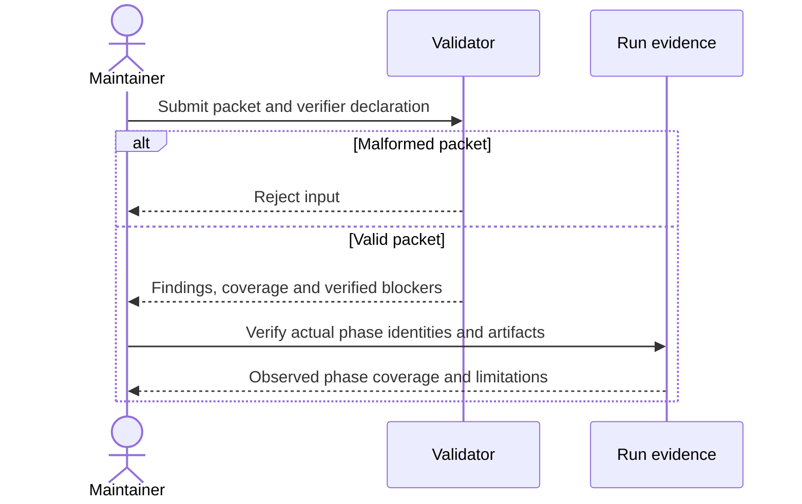

<!-- qore-spec/1 -->
# Reject invalid review packets without hiding uncertainty

This is a tutorial snapshot of Qore's actual validator-hardening work. It is not a seeded production defect or a quality benchmark. Review it against the bundled validator, regression tests and current project rules.

## Goal

A maintainer must distinguish a malformed packet, a complete review, and a valid report whose independent verification is missing. A missing verifier cannot justify lowering a candidate's severity or declaring success.

## Decisions

| ID | Decision |
|---|---|
| D1 | Require an explicit object containing a findings array. |
| D2 | Preserve severity and derive verified blocking status independently. |
| D3 | Missing independent verification keeps coverage partial. |

## User stories

| ID | Need |
|---|---|
| US1 | Reject malformed input rather than treating it as zero defects. |
| US2 | Retain uncertainty and candidate severity without a false success. |

## Acceptance criteria

```gherkin
Feature: Honest review packet validation

  Scenario: A01 Refuse a missing findings envelope
    Given a packet containing only an empty object
    When the findings validator reads it
    Then validation fails before it can represent a complete review

  Scenario: A02 Keep an unverified high-severity candidate
    Given a well-formed high-severity candidate with evidence
    And independent verification is unavailable
    When validation runs with the verifier declared skipped
    Then the packet is structurally valid
    And the candidate remains high and PLAUSIBLE
    And coverage is PARTIAL and no SHIP is produced

  Scenario: A03 Preserve a valid empty review
    Given an explicit findings array containing no items
    And the required independent phases actually completed
    When packet validation runs with verification recorded
    Then the packet may represent a complete review with zero findings
    And the declaration alone does not prove those phases occurred
```

Coverage: A01→US1/D1; A02→US2/D2/D3; A03→US1/US2/D1/D3.



## Verification

Run the actual project check declared in qore.json. Inspect the bundled finding-lint.mjs, redact-for-verifier.mjs and tests/test_validators.py. A passing structure check is not a reasoning-quality result. A valid zero-finding review is a legitimate outcome for this example.
