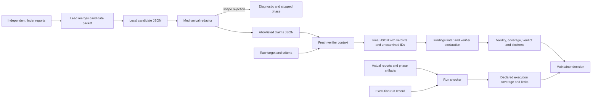
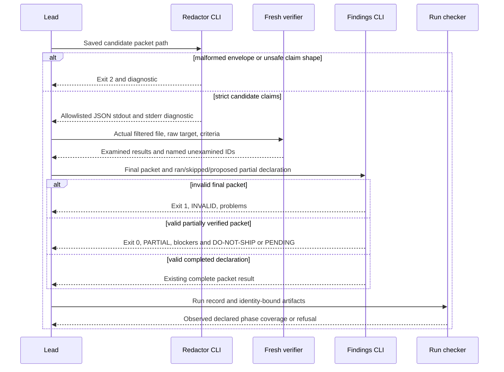

# Architecture independent analysis

Role: Architecture. Mode: Workflow, independent Analyze only. Report completed 2026-10-15T19:47:40Z (UTC). Target: `<CANDIDATE_B>`; supplied frozen snapshot `dec34e19b7b3036c213299a1f98b05fec1709212fb156eabf9928682024ae2cb`. The supplied snapshot identity was used, not independently recomputed. Budget: 100 seconds. No peer conclusions were supplied or consumed. No implementation changes or external claims.

## Recommendation and boundary

Plan a small, explicit representation of **partially executed independent verification**, preserving the example's existing D1–D3. The next improvement should close the declaration gap between the documented partial-batch workflow and the binary findings validator, without pretending the validator authenticates actual agent execution. This is a proposed enhancement, not a seeded production-defect finding.

The applicable existing spec is `examples/validator-hardening.md:6-16`: distinguish malformed, complete, and missing independent verification while preserving severity. A01–A03 already cover invalid envelopes, skipped verification, and legitimate zero findings (`examples/validator-hardening.md:30-48`). Existing source and tests implement these cases (`skills/qore-review/scripts/finding-lint.mjs:18-47`; `tests/test_validators.py:64-104`). Replacing these with an unrelated specification or requiring a nonzero defect count would regress the intended contract.

The material next boundary is explicit in current documentation: some batches may execute while others remain unexamined, and overall coverage must remain PARTIAL (`skills/qore-review/references/findings.md:22`; `skills/qore-review/references/run-evidence.md:28-34`). The current CLI accepts only `ran|skipped` (`skills/qore-review/scripts/finding-lint.mjs:6-10`); `ran` sets COMPLETE for every structurally valid packet (`:43-47`), while `skipped` rejects CONFIRMED and REFUTED results (`:35`). Thus neither declaration faithfully describes a packet containing both independently examined results and unexamined candidates. A PLAUSIBLE verdict alone cannot distinguish an examined but unresolved claim from an unexamined one; the protocol explicitly distinguishes those states (`skills/qore-review/references/protocol.md:37-43`). This is the architectural basis for the proposal; no invented API or database is involved.

## Proposed decisions for adjudication

- **AR1: Add an explicit partial declaration, provisionally `--verifier=partial`.** Preserve existing `ran` and `skipped` entry points and their normal output. Partial means the verifier ran on a proper subset, not that all claims were unresolved. Require a top-level `unexamined_ids` list for partial mode; it must be nonempty, unique, and reference existing IDs. Each listed finding must remain PLAUSIBLE. No automatic severity rewrite. Exact spelling is a proposal for UX and lead adjudication.
- **AR2: Derive outcomes on separate axes.** Structurally valid partial mode returns exit 0 and PARTIAL coverage. Confirmed critical/high findings actually examined remain verified blockers and produce DO-NOT-SHIP even with partial coverage. Otherwise partial yields PENDING; it never yields SHIP. This extends the existing separation between severity, verified blockers, coverage, and verdict (`finding-lint.mjs:33-51`; `docs/contracts.md:49-55`). Invalid declarations or malformed JSON remain exit 2; semantically invalid packets remain exit 1 (`finding-lint.mjs:9-14,58`).
- **AR3: Keep the redaction wall unchanged.** The verifier must receive only claim fields; `unexamined_ids` is final-result metadata written after the pass and must not cross into fresh verifier input. Existing redactor constructs only `{findings}` and retains `id,title,severity,evidence,counterexample` (`redact-for-verifier.mjs:13-34`). Do not forward the complete findings-lint result as verifier input.
- **AR4: Keep execution evidence separate.** The CLI is a declaration and structure check, including after this improvement. A partial verifier phase cannot be PASS for the full requested scope; retain an explicit non-PASS reason and actual artifacts so the existing run contract derives PARTIAL (`tools/run_contract.py:95-119,131-142`; `references/run-evidence.md:32-34` under qore-review). Do not alter the evidence schema solely to add authentication claims that cannot be proved. Clarify how partial work maps to an existing phase status in the final spec; see open question below.
- **AR5: Extend the applicable existing spec and its acceptance coverage.** Retain D1–D3/A01–A03, add a stable decision and scenarios for mixed verification, and document compatibility and declaration limits. Ship through normal candidate assembly, not by modifying installed copies.

## Reuse and impact sweep

| Surface | Actual ownership/read-write flow | Planned impact |
|---|---|---|
| Candidate packet producer | Lead merges stable candidate IDs into strict findings envelope; actual redactor must run before verifier (`qore-review/references/protocol.md:29-35`). | No new candidate fields required. Producer must preserve IDs and severity. |
| Mechanical filter | Reads local candidate JSON; rejects invalid envelope, object fields, IDs and claims; stdout writes `{findings}` with allowlisted scalar strings; stderr emits diagnostic (`redact-for-verifier.mjs:9-34`). | Reuse unchanged. Final metadata stays outside its output. |
| Final packet producer | Fresh verifier writes strict final packet with same IDs/severity, adds verdict and support (`qore-review/references/findings.md:14-24`). | Add explicit unexamined IDs only to final packet for partial mode. Preserve individual refutations. |
| Final findings reader | Local Node CLI reads JSON file and verifier declaration; creates `valid,coverage,verdict,verifier,total,counts,blocking_findings,findings,problems,limit` (`finding-lint.mjs:13-58`). | Validate metadata and extend declared mode; expose unexamined IDs in machine-readable output. Existing fields retain meaning. |
| Maintainer/readable report | Reports execution coverage, impact/verdict/blocking and delivery separately (`qore-review/references/protocol.md:45-51`; `findings.md:28`). | Show partial state, actual missing IDs and next action; no implied automatic delivery. |
| Execution checker | `tools/qore.py:16` imports `validate_run`; checker reads run JSON plus contained identity-bound artifacts (`run_contract.py:28-142`). | No executable change initially. Update instructions/examples for partial-phase recording; add regression demonstrating correct separation if needed. |
| Distribution | Build copies release allowlist, finalizes manifests and verifies; derivation copies complete skill folders (`tools/qore.py:122-156,173-188`). | Rebuild fresh release and manifests. Installed skill script behavior changes only when installed through the authorized release path. |
| Tests | Public Node/shell entrypoint helper; tests for skipped verification, empty packets, refutations, redaction (`tests/test_validators.py:15-30,53-124`). | Extend existing suite; avoid a duplicate test harness. |

Search was `rg -n 'finding-lint|redact-for-verifier|blocking_findings|verifier=|run_contract|qore-run/1|qore_evidence'` excluding profile paths. Matches establish the above direct callers/docs and three standalone `scripts/run-check.py` copies. No claim is made that all downstream external consumers were searched. `docs/contracts.md:33` explicitly says installed derivatives contain their own copies. If run-check implementation changes become necessary, synchronize all three copies and canonical source rather than introducing silent drift; the present proposal deliberately avoids needing such changes.

The component boundary is filesystem and host execution, not a network service. There is no application database, transaction, authorization context, retry service, or browser route in this scoped change. Input file trust is limited: malformed JSON must fail; arbitrary packet text is not execution proof. Evidence paths are a separate trust boundary: the run checker enforces contained paths, SHA-256 bytes, current candidate/target identity, phase ownership and freshness (`tools/run_contract.py:59-89,102-108`). These protections do not validate the truth of a payload (`:141-142`).

## Component flow

## Actual sequence and proposed extension

This sequence separates proposed partial-mode behavior from existing executable behavior. Source for the existing filter/gate ordering is `qore-review/SKILL.md:12-15` and `qore-review/references/protocol.md:29-47`; source for run validation is `tools/run_contract.py:59-142`. The host actually starts independent contexts; neither CLI starts agents itself.

## Compatibility, rejected alternatives and risks

Existing valid packets under `ran` and `skipped` remain accepted, including an explicit empty findings array. Empty findings plus partial declaration is inconsistent with a required nonempty subset and should be rejected; legitimate incomplete empty reviews continue to use skipped with PARTIAL. Missing independent finder roles are still recorded at run/report level and cannot be inferred from finding count. Unknown CLI options remain usage errors. Additional metadata must be validated when present, even outside partial mode; the final spec should define whether `unexamined_ids: []` is accepted for completed mode and reject any nonempty list paired with `ran`.

Rejected alternative: treat every PLAUSIBLE finding under `ran` as unexamined. Counterexample: an independently examined claim remains unresolved because reproduction cannot decide it, which the existing protocol explicitly permits (`qore-review/references/protocol.md:37-43`). Rejected alternative: use `skipped` for a mixed packet. It forbids already examined confirmations and refutations (`finding-lint.mjs:35`), forcing either loss of results or packet rejection. Deferred alternative: a new orchestration service, signed attestations, per-ID cryptographic proofs, or a unified validator. The current requirements call for honest local declarations plus separate execution artifacts, not such infrastructure.

Risk R1: A caller interprets exit 0 as release approval. Trigger: a valid partial packet returns success. Consequence: premature delivery. Mitigation: preserve PENDING and explicit PARTIAL plus existing usage guidance (`docs/contracts.md:29,55`); QA must check output and exit independently.

Risk R2: A caller treats a partial packet as having no blocker. Trigger: a confirmed high finding exists alongside an unexamined candidate. Consequence: confirmed impact is hidden. Mitigation: derive blocker set independently of complete coverage; test mixed confirmed-high/PLAUSIBLE packet. This is a proposed extension, not current implementation behavior under a supported partial mode.

Risk R3: Final writer drops or downgrades claims. Current findings gate sees only the final packet and cannot compare it with candidates (`finding-lint.mjs:13,18-50`); preservation is documented (`findings.md:14`). The proposal does not solve cross-packet continuity. Keep both files and traceability; treat automated candidate-to-final comparison as a separately adjudicated next improvement, not a hidden expansion.

Risk R4: Metadata creates a false sense of independent proof. Trigger: fabricated `partial` declaration or unexamined IDs. Mitigation: retain explicit existing `limit` and separate run evidence, whose actor IDs themselves also do not prove actual isolation (`findings.md:26`; `run-evidence.md:34`).

## Peer questions and challenges

**Product:** Does “complete review” mean every required phase and every requested claim was examined? The existing example's A03 says required phases actually completed, while the binary flag only records a declaration (`examples/validator-hardening.md:43-48`). Lock this invariant explicitly. Do not equate zero findings, zero blockers, successful parsing, or a completed verifier subset with a finished review.

**UX:** Is `partial` plus a named unexamined list the smallest comprehensible CLI surface? Challenge any proposal to ask maintainers to infer missing verification from PLAUSIBLE counts: examined unresolved and never examined are distinct. Present missing IDs and recovery action in the report without exposing another competing global success label.

**Delivery:** Confirm whether adding a third allowed flag value is preferable to an optional metadata-only extension for existing automated consumers. No external consumers were available for inspection. Preserve output keys and exit conventions; distribute as a newly built candidate.

**QA and security:** Exercise partial packets with confirmed high blockers, refutations, examined unresolved claims, all/no unexamined IDs, duplicate/unknown/non-string IDs, unexamined CONFIRMED/REFUTED findings, skipped verifier with completed findings, malformed JSON, and invalid optional metadata outside partial mode. Keep current A01–A03 and redactor tests. Ensure a completed zero-finding declaration does not substitute for independent-phase evidence. Test run coverage PARTIAL for the corresponding partially executed phase, while valid packet structure may still pass.

Open semantic choice for lead/QA: existing run statuses have FAIL for a phase that did not complete successfully and SKIPPED/BLOCKED for work not executed (`run-evidence.md:32`). A partially executed verifier should retain its actual results and a non-PASS reason; choosing FAIL for incomplete scope is consistent with the text but must not be misread as findings being false. Resolve and document this before implementation; do not add a new run status casually.

## Validation and remaining work

No regression suite was executed and no behavior-change implementation was written. Evidence here is current-source inspection; the actual project check is `python3 -B -m unittest discover -s tests -v` (`qore.json:4`). The final implementation must run that check and retain real output. A narrow code change should use existing regression helpers and add coverage for the new declaration/metadata boundary. Package verification is a separate distribution gate (`tools/qore.py:82-119`).

Inspected: the complete example; qore-plan SKILL, protocol, roles, specification contract; finding-lint and redactor; canonical run_contract; test_validators; test_run_contract; qore.json; findings and review protocol; review run-evidence; docs/contracts; package assembly/import portions of tools/qore.py; targeted repository references. Did not read project profiles or evaluation reports.

Uninspected or unfinished: peer analysis/cross-examination and lead adjudication; external installed callers; full package tests and schema constraints; independent snapshot recomputation; end-to-end execution; exact metadata spelling and backward-compatible presence rules; selected run status for partial execution; changes to user-facing tutorial and final acceptance IDs. Budget ends after this complete available initial report. This role's Analyze is complete; the whole Workflow is not complete from this report alone.
