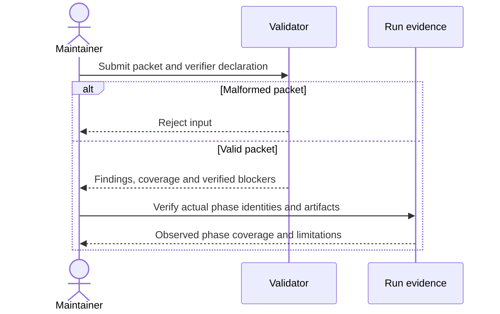
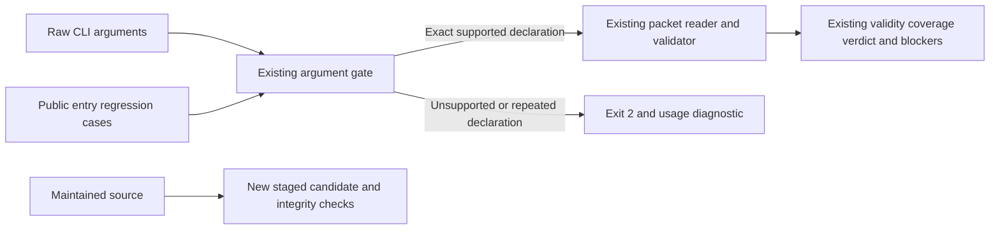
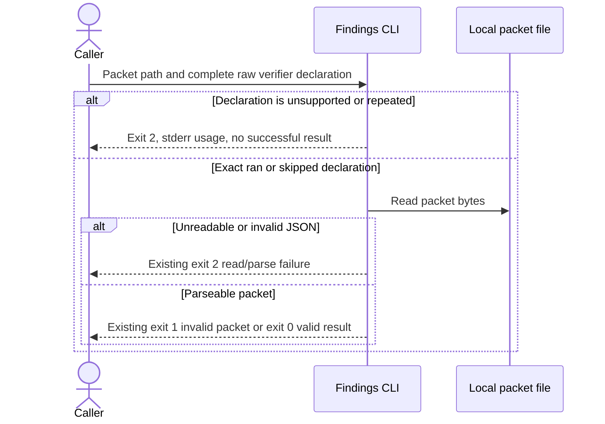

<!-- qore-spec/1 -->
# Reject invalid review packets without hiding uncertainty

This is a tutorial snapshot of Qore's actual validator-hardening work. It is not a seeded production defect or a quality benchmark. Review it against the bundled validator, regression tests and current project rules.

## Goal

A maintainer must distinguish a malformed packet, a complete review, and a valid report whose independent verification is missing. A missing verifier cannot justify lowering a candidate's severity or declaring success.

## Decisions

| ID | Decision |
|---|---|
| D1 | Require an explicit object containing a findings array. |
| D2 | Preserve severity and derive verified blocking status independently. |
| D3 | Missing independent verification keeps coverage partial. |

## User stories

| ID | Need |
|---|---|
| US1 | Reject malformed input rather than treating it as zero defects. |
| US2 | Retain uncertainty and candidate severity without a false success. |

## Acceptance criteria

```gherkin
Feature: Honest review packet validation

  Scenario: A01 Refuse a missing findings envelope
    Given a packet containing only an empty object
    When the findings validator reads it
    Then validation fails before it can represent a complete review

  Scenario: A02 Keep an unverified high-severity candidate
    Given a well-formed high-severity candidate with evidence
    And independent verification is unavailable
    When validation runs with the verifier declared skipped
    Then the packet is structurally valid
    And the candidate remains high and PLAUSIBLE
    And coverage is PARTIAL and no SHIP is produced

  Scenario: A03 Preserve a valid empty review
    Given an explicit findings array containing no items
    And the required independent phases actually completed
    When packet validation runs with verification recorded
    Then the packet may represent a complete review with zero findings
    And the declaration alone does not prove those phases occurred
```

Coverage: A01→US1/D1; A02→US2/D2/D3; A03→US1/US2/D1/D3.



## Verification

Run the actual project check declared in qore.json. Inspect the bundled finding-lint.mjs, redact-for-verifier.mjs and tests/test_validators.py. A passing structure check is not a reasoning-quality result. A valid zero-finding review is a legitimate outcome for this example.

## Proposed revision context

This proposed revision strengthens the tutorial above without editing frozen candidate b. Mode: Workflow, selected by the existing specification. Target snapshot: `dec34e19b7b3036c213299a1f98b05fec1709212fb156eabf9928682024ae2cb`; base archive SHA-256: `2963c43e98803354932e406627d9e239064fbe2899745a7e093b7d4154fa56d1`. Five independent Analyze reports and one Cross-examine pass per role precede lead adjudication. This is planning, not an authorization to implement, install over adaptations, publish or deploy.

The concrete initial question is: what is the next bounded improvement after the existing A01–A03 behavior already passes? Independent Delivery and QA probes retained in `delivery-commands.json` and `qa-commands.json` show that `--verifier=ran=skipped` is accepted as `ran` and can produce COMPLETE/SHIP for an empty findings envelope. This demonstrates a CLI grammar mismatch, not a real-world bypass of independent execution. The baseline suite passes 82 tests and does not cover this malformed token.

Authoritative source locations below are relative to the frozen candidate root. `skills/qore-review/scripts/finding-lint.mjs:6-10` selects declarations by prefix and keeps only `split('=')[1]`. Its documented enum is `ran|skipped`. Packet shape/impact/verdict checks remain at lines 15–42; outcome derivation and execution-declaration limitation remain at lines 43–58. Existing acceptance and regression behavior is retained from the tutorial and `tests/test_validators.py:64-124`.

## Added user story and decisions

US3: As a maintainer or CLI caller, I need malformed verifier declarations refused so that unsupported input cannot be reported as a supported completed declaration.

| ID | Locked decision | Consequence |
|---|---|---|
| D4 | Accept exactly one complete declaration whose value is exactly ran or skipped. | Extra equals signs, suffixes, empty/unknown values and duplicate declarations are usage failures; no normalization, truncation or fallback. |
| D5 | Preserve valid packet/result and process-exit semantics. | Usage/read/parse errors retain exit 2; structurally invalid packets retain exit 1; valid packets retain exit 0 even when the decision is DO-NOT-SHIP. Preserve findings, severity, refutations, coverage, blockers, output keys and the declaration limitation. |
| D6 | Limit this increment to invocation grammar and its direct tests/documentation. | Partial verifier batches and plain-text reporting changes remain separate proposals, with their useful acceptance constraints retained below. No new evidence service, schema platform, API, database or agent scheduler. |
| D7 | Qualify changed resources as a newly identified candidate in unused staging. | Retain old evidence under its own identity, preserve installed adaptations, and rerun affected checks rather than relabeling frozen b results as new-candidate evidence. |

D1–D3 and US1–US2 above remain applicable. US1 is explicitly extended to malformed invocation as well as malformed packet input.

## Reuse, interfaces and impact

Reuse the existing Node CLI argument gate and Python unittest invocation helper; do not duplicate envelope validation or verdict derivation. The affected interface fields are the raw argument vector, one selected verifier declaration, the derived `verifier` enum, exit status, stdout and stderr. The invariant is exact raw-value recognition before a result can use that enum. No candidate packet producer, redaction allowlist or verifier report representation needs to change.

The direct runtime reader is `finding-lint.mjs`; the documented caller is `skills/qore-review/SKILL.md:14` and the contract is `references/findings.md:7-11`. The acceptance consumer is `tests/test_validators.py:15-30`. Packaging copies allowlisted source files and hashes standalone resources (`tools/qore.py:122-156`; the review resource manifest includes this script). Derivatives contain copies, so updates require fresh assembly and affected derivative checks. No installed external caller inventory was available; unknown consumers using malformed tokens will now receive the documented usage failure. No compatibility is promised for unsupported strings.





The actual boundaries are local arguments, files, process streams and generated package copies. There are no application transactions, stored snapshots, service retries, network mutations or browser/native user flows in this change. The user-visible interface is a CLI: stderr must identify repairable usage failure; JSON output and exit status must be assessed separately. Recovery means repairing the declaration and obtaining real missing verification, never changing skipped to ran merely to obtain success.

## Additional acceptance criteria

```gherkin
Feature: Exact verifier declarations without semantic regression
  Scenario Outline: A04 Refuse malformed complete verifier values
    Given an explicit findings envelope with no findings
    And the supplied verifier declaration is "<declaration>"
    When the public findings CLI executes
    Then it exits with usage status 2
    And stderr identifies the supported invocation
    And no successful review result is emitted
    Examples:
      | declaration                  |
      | --verifier=ran=skipped        |
      | --verifier=skipped=ran        |
      | --verifier=ran=               |
      | --verifier=                  |
      | --verifier=unknown            |

  Scenario: A05 Refuse missing duplicate and unsupported argument declarations
    Given the verifier declaration is absent or repeated or an unsupported option is supplied
    When the public findings CLI executes
    Then it exits with usage status 2
    And no COMPLETE or SHIP result is emitted

  Scenario: A06 Preserve exact completed verification and a legitimate empty packet
    Given an explicit empty findings envelope and exactly --verifier=ran
    When the public findings CLI validates it
    Then the existing structurally valid empty-packet result is preserved
    And the result still warns that declarations do not prove actual independent phases

  Scenario: A07 Preserve honest skipped verification and impact severity
    Given a well-formed high or critical PLAUSIBLE candidate with checkable evidence
    And exactly --verifier=skipped is supplied
    When the public findings CLI validates it
    Then the candidate retains its original severity and verdict
    And coverage is PARTIAL with no SHIP and no verified blocker

  Scenario: A08 Preserve a verified blocker and retained refutation
    Given a confirmed high finding with evidence and counterexample and a refuted finding with its reason
    And exactly --verifier=ran is supplied
    When the public findings CLI validates the packet
    Then exit status 0 and DO-NOT-SHIP are preserved
    And the confirmed finding remains blocking and the refuted reason remains retained

  Scenario: A09 Preserve source and installed adaptations during qualification
    Given source changes are authorized and an existing adaptation has local changes
    When the changed candidate is assembled for qualification
    Then it is generated in unused staging and has a new recorded identity
    And an existing install destination is refused without changing local bytes
    And frozen-candidate evidence is retained under its original identity
```

Coverage: A04→US1/US3/D1/D4/D5; A05→US1/US3/D4/D5; A06→US1/US2/D1/D3/D5; A07→US2/D2/D3/D5; A08→US2/D2/D5; A09→US3/D7.

QA matrix: preserve current invalid envelope/null/array, malformed JSON, duplicate finding IDs, unknown verdict/severity, REFUTED reasons, skipped strong-verdict refusal and scalar redaction cases. Add public-entry cases for the complete raw token, missing/duplicate declarations, unknown flags, whitespace/case variants and valid exact tokens. Assert argv, exit, stdout and stderr independently. A successful process containing DO-NOT-SHIP is intentional; a malformed invocation must not be rescued by packet contents.

## Delivery plan and readiness gates

| Task | Size and basis | Dependencies and risk | Gate |
|---|---|---|---|
| T1 Lock exact grammar and add failing public-entry regressions | S; existing invocation helper accepts arbitrary flags | None; ambiguous expected stream/exit behavior | New malformed-suffix cases fail on frozen b for the intended reason, not a missing executable |
| T2 Tighten only raw declaration recognition | S; existing argument gate, no new subsystem | T1; avoid changing legitimate ran/skipped handling | A04–A08 and existing packet regressions pass |
| T3 Align directly affected documentation and run the declared project check | S; one CLI contract plus tutorial acceptance | T2; do not imply declaration proves execution | Actual qore.json check output, source review and spec lint retained |
| T4 Assemble and verify a fresh candidate and inspect affected copies | M; hashed standalone copies and derived outputs | T3; stale evidence and local overwrite risks | New candidate integrity/changed-resource evidence; preserved original/adapted bytes |

Critical order: T1 → T2 → T3 → T4. Relative sizes describe bounded work surfaces; they are not measured duration or throughput. A clean unused installation smoke is needed only if installation/distribution behavior is changed or included in the release claim, not as an invented prerequisite for the parser unit change. Reuse the current regression suite instead of a second harness. Rollout means an authorized new candidate; rollback retains the prior verified candidate/location. Automatic overwrite, merge, publication and universal rollback remain outside scope.

The planning definition of done is complete five-role Analyze/Cross-examine, evidence-weighted adjudication and a lint-valid proposed revision with explicit limits. Implementation readiness still requires the red-then-green regression, actual source fix review, full declared check and affected candidate qualification. This document does not claim those future implementation gates ran.

## Adjudication and retained dissent

Select Delivery D4 / QA-D1 exact-token grammar first because independent probes establish a current concrete rejection mismatch and source control flow explains it. Reject truncating or normalizing suffix-bearing declarations; that repeats the observed mismatch. Preserve all original packet semantics and execution-evidence limits.

Product and Architecture initially favored explicit partial verifier batches. Their cross-examination revises priority while retaining a useful follow-up: distinguish examined-but-unresolved PLAUSIBLE claims from unexamined claims and preserve established blockers during partial work. Architecture's initial nonempty unexamined-ID requirement does not settle an incomplete empty review; that semantic conflict remains open. Do not lock a third flag, metadata schema or run status in this grammar increment.

UX's text clarity and recovery proposal remains useful dissent. Plain-text blocker wording, additional counts and machine-readable parse-error parity change another observable interface and are deferred. Recovery documentation may clarify the existing usage behavior without changing result formatting. Delivery's earlier hour estimates are allowances rather than evidence and are replaced here by relative sizes. No general improvement in review quality, speed or user comprehension is inferred.

Actual reports and the final roster remain adjacent to this specification. The stopping rule is one complete Workflow analysis/challenge cycle with no unresolved decision needed for D4–D7; two passes per role, lead adjudication, and no third planning round. Open work: external/installed caller inventory, later partial-verifier semantics, user comprehension, and qualification of any changed candidate. Browser/native, external-human use and clean-independent execution are not established by this author-host planning run.

