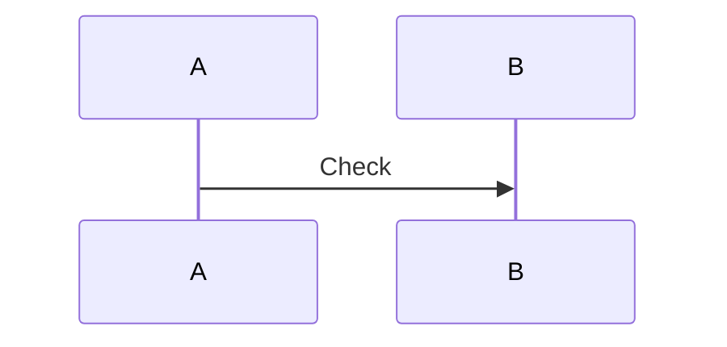

<!-- qore-spec/1 -->
~~~~gherkin
Feature: Probe
  Scenario: AC01 Test
    Given input
      ```text/plain
      Scenario: AC99 literal
      Examples:
      ```
    When executed
    Then output
~~~~
Coverage: AC01 -> US1

