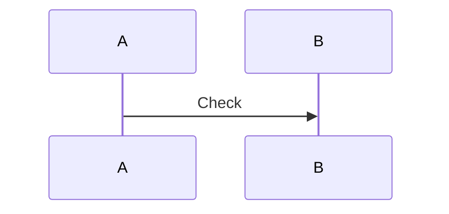

<!-- qore-spec/1 -->
~~~~gherkin
Feature: Probe
  Scenario Outline: AC01 Test
    Given <input>
    When executed
    Then output
    Examples:
      | input |
      | |
~~~~
Coverage: AC01 -> US1

