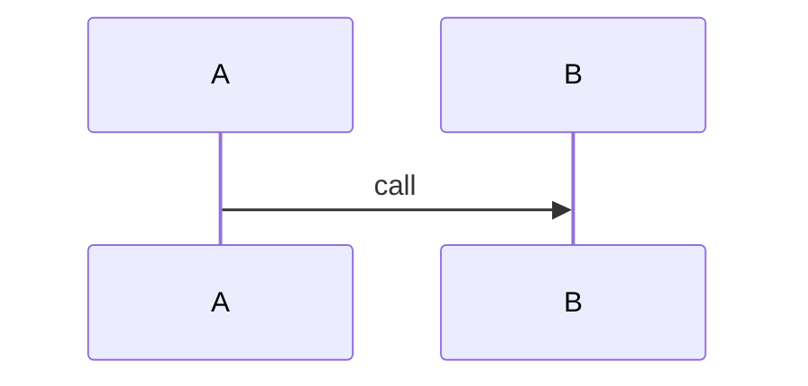

<!-- qore-spec/1 -->
```gherkin
Feature: Preserve inputs
  Scenario: A01 Never runs action/assertion
    Given a multiline input
      """
      When this is only literal content
      Then this is only literal content
      """
```
Coverage: A01 -> US1 / D1

