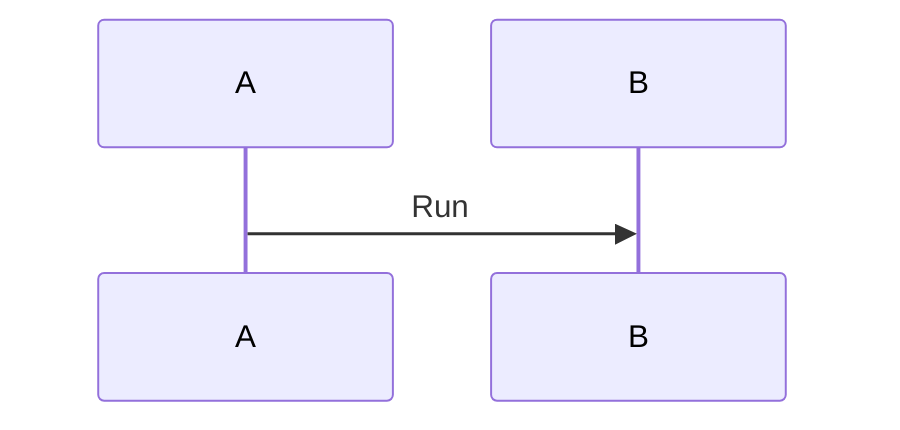

<!-- qore-spec/1 -->
```gherkin
Feature: Probe
  Scenario: AC01 Literal argument
    Given a message
      """
      LiteralWhen this is only literal text
      LiteralThen this is only literal text
      """
```
Coverage: AC01 -> US1

