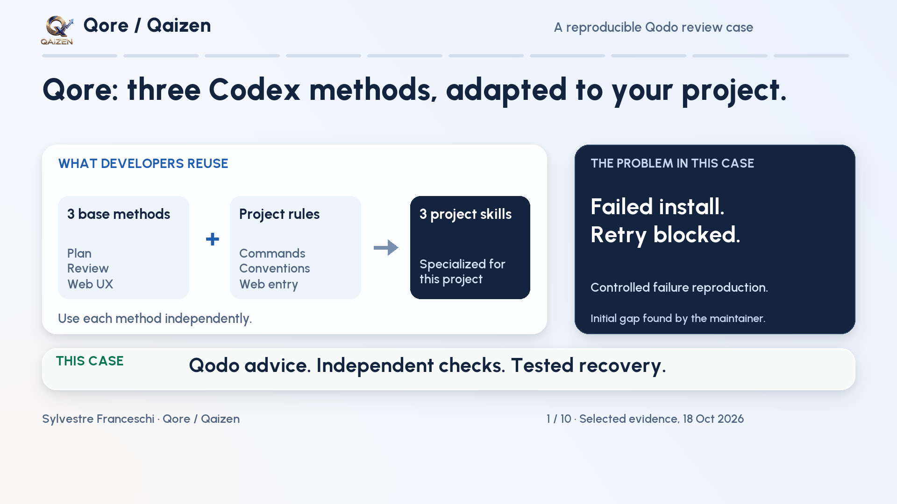

# A recoverable Qore installation: verified Qodo advice

Qore supplies three independent Codex methods: plan a change, challenge a deliverable, and inspect a rendered web interface. One sourced project profile can specialize all three. This case improves the step before using them: installing the three skill folders.

[](https://drive.google.com/file/d/1x-A9-Ga8BOt0LhZ0Mp5t-sAWLDEVybJw/view)

[Watch the captioned English lesson — 3 minutes 30 seconds](https://drive.google.com/file/d/1x-A9-Ga8BOt0LhZ0Mp5t-sAWLDEVybJw/view) · [Read the English transcript](transcript-en.txt) · [Implementation and regression guide](../../tutorials/recoverable-install.md)

## Problem, decision and demonstrated benefit

| Observation | Before | After the correction |
|---|---|---|
| The same injected second-copy failure | Leaves `qore-plan`; retry is refused | Safely removes unchanged attempt-owned content; retry installs all three skills |
| Unrelated local policy | Preserved | Preserved |
| No-fault control | Three matching skills | Three matching skills |
| Copy error followed by a scan error | Secondary error hides the original cause | Primary error is retained; secondary errors remain visible and `safe_to_retry` is false |

The demonstrated benefit is resuming installation without manually deleting partial skill folders after a safely handled failure. When ownership or contents are uncertain, the installer preserves the path and explains the manual recovery. `safe_to_retry` does not promise that the original external cause has disappeared.

This is a controlled filesystem fault injection on public Qore sources. It is not a customer incident, measured time saving, or guarantee about crashes, hostile concurrency, power loss or atomic installation of three directories.

## What Qodo did, and what verification changed

The maintainer first reproduced the installation failure. Qodo's initial native review received the real failing test and recovery requirement before production code changed. It supplied a targeted causal diagnosis, recommendations and missing-test feedback. Staging was already considered; Qodo corroborated that direction. A separate verifier rejected a plain-rename detail after observing it replace an existing empty destination on the tested macOS filesystem.

A later native review of `d5a66ce` flagged the diagnostic scan defect. The follow-up `c3ce75c` corrected it and received separate independent checks. **No native Qodo review after that follow-up is claimed.** Both operations executed the issue reviewer; compliance, skills, spec, UI, persona and cross-repository roles were skipped.

[Six selected remarks and their dispositions](qodo-assessment.json) preserve native classifications, including the diagnostic finding's `informational` classification. They are first-party paraphrases tied to hashes of retained private source packets. The video contains selected original excerpts. Neither resource is a full raw provider response. The exception-metadata refinement remains visible and nonblocking; there is no claim of an all-clear provider verdict.

## Run the offline before/after replay

Requirements: Python 3 and this directory, including `replay/`. No Qodo account, network call, browser, Codex session or personal skill installation is needed. From the repository root, choose a new output directory:

```sh
python3 -B docs/evidence/install-recovery/replay/reproduce.py --output /tmp/qore-offline-recovery-new
```

The command verifies pinned inputs, runs historical and corrected installer modules in temporary projects, asserts the four cases above and writes `result.json`. It never overwrites an existing output directory. Temporary installations are removed. Its bundled runtime is a minimal MIT core export with exact `c3ce75c` installer bytes; it is not the full repository or full test corpus. Packaging inventories were regenerated for that subset. See [runtime provenance](replay/provenance.json) and [export transformation](replay-export-transform.json).

[Recorded replay result](recorded-replay.json) retains the original execution identity. [Publication checks](publication-checks.json) separately identify current checks. A successful replay demonstrates these named cases, not general safety or an external learner outcome.

## Source snapshots and release boundary

| Stage | Immutable source |
|---|---|
| Original installation behavior | [e9d74cf](https://github.com/sylvestre-baker/qore-codex-skills/tree/e9d74cfeadd299a52f66919598b8330d6225e947) |
| Failing regression, production installer unchanged | [f92d9c2](https://github.com/sylvestre-baker/qore-codex-skills/commit/f92d9c200893b023c523011b00d74cabd4c1170e) |
| Final native Qodo review target | [d5a66ce](https://github.com/sylvestre-baker/qore-codex-skills/tree/d5a66ce2fbb4328fd279166f3a8f1ab8d636c3f3) |
| Independently checked follow-up shown in the lesson | [c3ce75c](https://github.com/sylvestre-baker/qore-codex-skills/tree/c3ce75cce730429d21d8b068672beda93c2a4de5) |

This case accompanies `fix/recoverable-skill-install`. A public branch and pull request expose the work for review; they do not update `main`, GitHub Pages or released v0.2.1 assets. The older validator/profile walkthrough in PR #5 and specialization campaign in draft PR #4 are different cases.

The [case provenance](provenance.json) maps selected artifacts, source identities and the video digest. First-party summaries and Qore code use the repository MIT license. Qodo and other product names identify their respective products; no provider or employer endorsement is asserted. Human listening and external learner first use remain **NOT_OBSERVED**. No Ambassador application is submitted by this publication.
