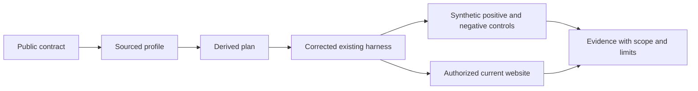
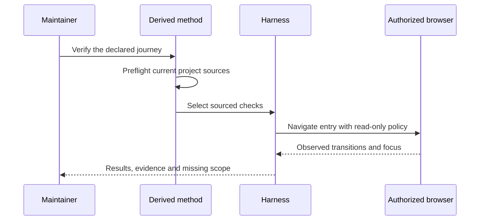
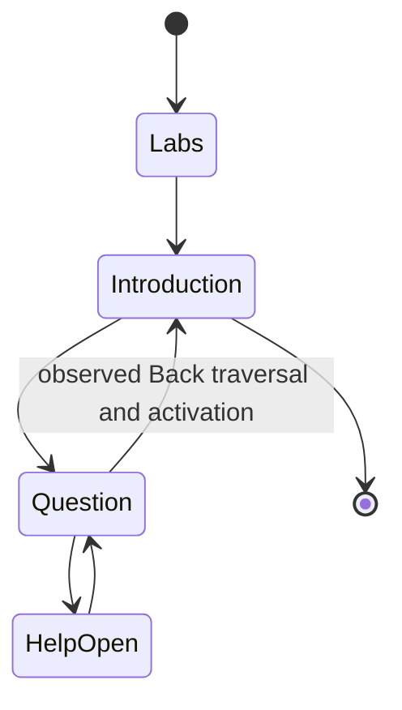

<!-- qore-spec/1 -->
# Labs verification protocol correction

Status: five-perspective derived planning and one cross-examination pass completed; implementation and current-site qualification are separate gates.

## Outcome and scope

A maintainer should be able to decide whether the existing public Labs entry/state journey meets its sourced acceptance contract. The known problem is a coverage gap in the old protocol: state and final focus can be correct after a mouse click while keyboard reachability remains untested. This is not a confirmed website defect.

Sources: [surface contract](surface-contract.json), [offline checker](checks/check_contract.py), [observation actions](browser-actions.json), [read-only policy](observation-policy.json) and the existing repository browser harness. The maintained profile lives at the repository root; generated derivatives must preflight its digests against this example root before consuming facts. The profile does not grant action permission.

US1: a maintainer needs a discriminating keyboard check. US2: a reviewer needs separate proof of contract consistency, test-control behavior and current site behavior. US3: a user needs a bounded, reproducible observation that preserves an unanswered questionnaire and visible limits.

## Decisions and affected consumers

D1: extend the existing optional browser harness rather than build a new product or mandatory skill. Preserve legacy action formats. D2: record actual sequential focus traversal and keyboard activation. D3: keep contract checking offline and website observations fresh and distinct. D4: block mutations, service workers and outside-origin top-level navigation before entry. D5: keep observation scope to desktop English entry/state; fixes concern the public protocol and harness, not the private website.

The profile's offline validation command belongs in the plan and review. Its independent focus and unanswered-scope facts must change assertions in the plan, review and UX execution. A fixture result is not substituted for live behavior. A valid review can find no new defect.

Consumed profile: `qaizen-labs` 0.1.0. The `surface-contract` fact, sourced to `checks/check_contract.py`, selected this command, actually executed from this example root:

```sh
python3 -B checks/check_contract.py surface-contract.json
```

It passed offline consistency only. The separately sourced `close-focus` and `back-focus` facts require Close → summary and Back → introduction heading assertions; `unanswered-scope` requires the intermediate unanswered assertion and read-only/origin policy. The profile's contract/checker digests were current in the recorded planning preflight. Those facts were loaded from the generated profile rather than supplied in the invocation prompt.

The five perspectives retained the existing harness and rejected a new runtime registry. The concrete strengthening is: assert the introduction's Start control visible and the question help absent after Back, retain heading focus independently, assert reopened help explicitly, and check unanswered state after Close before Back. The state predicates reuse controls named by the contract and confirmed in the dated public observation. They do not introduce website markup or private selectors.

Focus/attribute assertions observe their predicate for at most 15 seconds; they do not repeat activation or force focus. A controlled delay beyond the former 900 ms pause must succeed, and a never-correct predicate must fail. The 15 seconds are a chosen observation timeout, not a website SLA. Preserve event evidence of the original traversal and Enter.

Generic probe COMPLETE continues to mean its supplied actions completed. Labs acceptance additionally needs the complete check-to-evidence mapping and input digests. A fresh profile check covers its sourced contract/checker, not every runtime input. The enclosing run identifies actions, policy, harness, fixtures and actual artifacts separately.

Required decision evidence is the actual assertions/events, source/run identity and inspected state captures. Trace/video are useful diagnostics; their absence alone does not invalidate otherwise complete journey evidence, while missing proof of a required check does. Raw artifacts remain private until a selected export is reviewed. Structured events omit request headers/bodies; no whole-trace privacy guarantee is made.







## Acceptance

```gherkin
Feature: Discriminating Labs entry and state verification
  Scenario: L01 Consume current project facts
    Given the generated derivative and current public project root
    When project preflight runs
    Then applicable facts and their sources are retained
    And changed or missing sources prevent affected complete coverage

  Scenario: L02 Check the contract offline
    Given the public contract and its declared checker
    When the validation command runs
    Then internally consistent state and focus rules pass
    And contradictory focus or unknown states fail

  Scenario: L03 Require keyboard reachability
    Given Back is excluded from the sequential tab order
    When the corrected keyboard check runs
    Then it fails even if a later mouse click restores the introduction
    And a reachable positive fixture passes with actual keyboard activation

  Scenario: L04 Preserve distinct focus transitions
    Given the first question is unanswered
    When the declared help and Back transitions are exercised
    Then their separate sourced focus obligations have actual observations
    And no answer is selected

  Scenario: L05 Enforce observation boundaries
    Given an isolated browser context before navigation
    When a mutation or outside-origin top-level navigation is attempted
    Then the policy blocks it and retains the event
    And no policy is relaxed to obtain a successful result

  Scenario: L06 Wait for actual navigation
    Given an asynchronous entry transition
    When the expected URL assertion runs
    Then it waits within the finite declared timeout
    And a missing transition still fails

  Scenario: L07 Keep scope and evidence honest
    Given synthetic control tests and a current real website observation
    When results are reported
    Then their identities and scope remain distinct
    And missing required observations prevent complete scoped success

  Scenario: L08 A focused heading cannot conceal an incorrect returned state
    Given Back focuses a heading but leaves the question visible
    When returned-introduction acceptance is checked
    Then the state obligation fails independently of heading focus
    And a selected answer before Back cannot be hidden by its later unmount

  Scenario: L09 Observe delayed focus without repeated activation
    Given correct focus settles after the fixed action pause but within the declared timeout
    When the focus assertion observes the actual active element
    Then it passes without reactivating the control
    But a never-correct focus fails within the timeout
```

Coverage: L01 → US2 / D3; L02 → US2 / D3; L03 → US1 / D2; L04 → US1 / US3 / D2; L05 → US3 / D4; L06 → US3 / D1; L07 → US2 / US3 / D3 / D5; L08 → US1 / US3 / D2; L09 → US1 / D2.

## Delivery and limits

P1 validate sources and offline contract. P2 extend the existing harness and actions. P3 exercise real positive/negative controls. P4 independently challenge protocol and implementation. P5 observe the real current entry/state journey and inspect captures. P6 retain evidence, decision and limits. Dependencies: P1 → P2 → P3 → P4 → P5 → P6. P2–P3 are bounded local tooling changes; P4–P5 have higher capability/evidence risk. An unavailable required capability leaves the affected result PARTIAL/BLOCKED.

No questionnaire completion, private source export, website mutation, deployment, instrumented performance/accessibility certification or general improvement claim is included. Browser fixture failure does not imply live website failure. The sampled unanswered checks and action review do not establish continuous absence of every transient selection. A 24-Tab failure describes that starting focus, direction and bound, not universal inaccessibility. Cleanup fault injection, continuous selection monitoring and service-worker attempt testing remain optional robustness work; missing required popup/origin controls do not.
