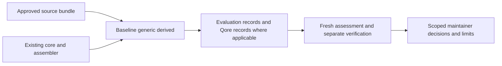
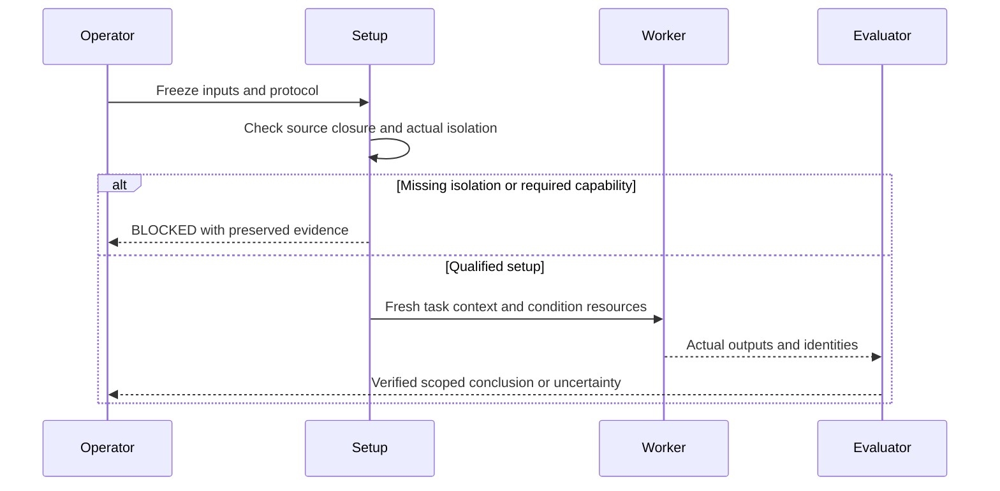

<!-- qore-spec/1 -->
# QORE-003 — Bounded project-specialization diagnostic
Status: accepted implementation specification. Runtime qualification and comparative observations remain pending.
Baseline: e9d74cfeadd299a52f66919598b8330d6225e947. One existing repository and proposed branch feat/specialization-evals.

## Outcome and sources
US1: a maintainer needs evidence to decide whether to retain, simplify, or fix a project-specific derivative for the tested obligations.
US2: a reader needs reproducible observations and explicit uncertainty rather than a general superiority claim.
US3: contributors need local validation without mandatory new services or fees.
Sources: skills/qore-plan and qore-review protocols; tools/qore.py; tools/context.py; tools/run_contract.py; profiles/qaizen-labs.json; examples/qaizen-labs/surface-contract.json; docs/clean-environment.md; release-files.json; release-rights.json.
No backend, database, new account or product is introduced. The original Labs verification gap came from a private planning specification, not an established website defect.

## Decisions and interfaces
D1: keep core skills and derivation unchanged unless a separately established defect requires correction. Add evals/ for scenarios and local tooling, docs/evidence/specialization/ for reviewed public results; preserve the existing quickstart.
D2: every trial has a qore-eval-run/1 record: scenario/condition/trial identity, candidate and input digests, environment/model/tool versions, budgets and actual usage or unavailable markers, artifacts, task assessment and limitations. Qore trials additionally link independently validated qore-run/1 records. Baseline is not forced into Qore phases. Never weaken qore-run for comparison.
D3: prepare identical authoritative target-source bundles for all conditions. Supply generic or derived skill resources separately. The derivative may package the same source facts as its treatment. Exclude prior reports, evaluator answer keys, Git history and unrelated profiles. Supply the corrected comparator only when it is the actual P2 or R2 target. Do not supply completed action sequences when judging action selection.
D4: enforce file, context and network boundaries for every cell and child role, using the existing clean-environment approach only after observing current support. Fresh chats on an unrestricted host do not suffice. Runtime/model transport may use its documented channel; worker browsing is restricted to authorized target origins, without repository/search access. If required containment cannot be demonstrated, report isolation BLOCKED; do not claim comparative advantage.
D5: six frozen tasks times baseline/generic/derived produce 18 planned cells, one observation per cell. Primary contrast is generic versus derived. Baseline versus Qore changes method and staffing together. No statistical, stable improvement, efficiency, future-model robustness, commercial-demand or admission claim follows.
D6: freeze exact task bytes, rubric, source manifest, condition order and common per-method resource envelope before dispatch. Provisional feasibility caps are 15 minutes wall time and 40 aggregate agent-minutes per cell, including child work. They are chosen safety bounds, not calibrated estimates. Stop new dispatches at exhaustion and record actual overruns; do not claim enforced hard timeouts. Unavailable resource accounting is explicit, not zero. No automatic paid calls or installation. Existing quota limits can block work.
D7: execute the first balanced review triad as feasibility pilot before the other 15 cells. Continue only for isolation, phase completion, budget compliance and assessability, never favorable findings. A changed protocol preserves the pilot and starts a separate balanced series. Every planned cell, including NOT_RUN, remains visible.
D8: all web conditions share externally enforced no-answer, non-mutation and origin policy, clean browser state and predeclared capabilities. Record relevant state, document/resource observations and time. Live source deployment cannot be fully pinned from public observations. Unverified comparability permits observation reporting only; observed material drift invalidates the affected matched group.
D9: fresh evaluators use neutral IDs and frozen behavioral criteria; disclose residual condition visibility. A separate fresh verifier checks material comparative claims and reproductions. Preserve all outcomes. Post-correction trials have new identities; matched affected groups rerun, and unaffected carryover needs a written rationale.
D10: implement no agent scheduler, browser engine or LLM judge. A Python standard-library tool prepares bundles and validates identities, containment, unique IDs and evidence links, then aggregates entered assessments. CI runs deterministic checks only.
D11: all public additions remain English with provenance and release rights. Keep skills-only export compact. Update full-export allowlists explicitly. Qodo is a separate optional review of a frozen implementation diff, with actual observations or NOT_OBSERVED. No publication, merge, application or outreach follows automatically.

## Task definitions and reader behavior
P1 plans correction of the newly authored reconstructed mouse-only verification protocol using the current authoritative contract.
P2 plans a documentation-only clarification of the already consistent Close/Back obligations without introducing unnecessary behavior changes.
R1 reviews the same defective protocol input; R2 reviews its frozen corrected comparator, with an empty review allowed. Use newly authored, explicitly reconstructed tutorial fixtures by default. No historical byte lookup or private resource is required, and no authentic public Git ancestor is claimed.
U1 observes actual keyboard Back traversal and returned-introduction state/focus, after common entry prerequisites.
U2 observes help closure and summary focus only, after common entry prerequisites; it does not score Back again.
These tasks share one known surface and are correlated, not six independent projects.
Worker prompts identify task and output, without repeating profile facts. All conditions can read the same original contract/checker/policy.
Rubric predicates: distinct correct focus obligations; actual sequential traversal for Back; unanswered state; shared policy preserved; no website-defect claim from a protocol fixture; evidence-linked conclusions; missing proof remains unknown; no forced issue count. Bind each predicate to its applicable scenario before dispatch.
Reader outputs distinguish execution coverage, rule adherence, profile-fact behavioral effect and comparative conclusion. Use scoped Retain/Simplify/Fix/Unknown decisions with supporting observations. Simplify is a candidate follow-up unless an actual compared simplification supports it. No observed difference is valid. Partial data is not a tie or zero defects.
Keep existing README onboarding. Add an optional concise results table after the existing case, linking detailed reports. New rendered sections require narrow/wide layout, keyboard/focus, zoom, descriptive links, non-color statuses and textual diagram equivalents; use qore-ux-review after implementation, not as completed planning evidence.





## Acceptance
```gherkin
Feature: Honest project-specialization diagnostics
  Scenario: A01 Preserve baseline semantics
    Given a baseline trial without Qore phases
    When its evaluation record is checked
    Then it is not rejected merely for lacking a Qore execution record
    And Qore trial records still require the existing method phases
  Scenario: A02 Refuse answer contamination
    Given a worker can access a previous solution or evaluator key
    When setup isolation is checked
    Then the comparison is blocked or marked contaminated
    And that trial cannot establish a specialization advantage
  Scenario: A03 Preserve legitimate provenance
    Given authentic public pre-fix bytes are unavailable
    When the review tutorial is prepared
    Then any replacement is labelled reconstructed
    And no public historical revision or new discovery is invented
  Scenario: A04 Bound resource usage
    Given a trial reaches its declared resource cap
    When its required phases are unfinished
    Then new dispatches stop and actual overruns remain visible
    And the result is incomplete rather than a quality failure
  Scenario: A05 Respect web boundaries
    Given every condition uses the same enforced observation policy
    When a prohibited request is attempted
    Then it is blocked without relaxing policy
    And policy effects are retained separately from product defects
  Scenario: A06 Separate local freshness from live comparability
    Given profile sources are current but live target comparability is unverified
    When UX observations are summarized
    Then the profile may be current
    And no comparative benefit is inferred from that group
  Scenario: A07 Retain unfavorable and empty outcomes
    Given complete valid trials with no supported difference or finding
    When the results are assessed
    Then the outcomes remain visible without a manufactured winner
    And task correctness remains separate from execution completeness
  Scenario: A08 Reject invalid evidence mappings
    Given a missing altered escaping or mismatched evidence resource
    When evaluation validation runs
    Then it refuses the affected record with an explicit reason
  Scenario: A09 Preserve failed series and updates
    Given the protocol or relevant candidate changes after a pilot
    When a new balanced series is run
    Then original trials remain identified
    And affected groups are not silently replaced or selectively retried
  Scenario: A10 Keep public surfaces honest
    Given the implementation and reviewed results
    When documentation and packaging are checked
    Then English supported claims and working evidence links are retained
    And the skills-only export excludes evaluation artifacts
  Scenario: A11 Account for every planned cell
    Given 18 planned cells and missing executions
    When the series is reported
    Then missing cells and causes are visible
    And a partial report is not called a completed comparison
```
Coverage: A01 -> US3 / D2; A02 -> US1 / D3 / D4; A03 -> US2 / D5; A04 -> US3 / D6 / D7; A05 -> US1 / D8; A06 -> US2 / D8; A07 -> US1 / D5 / D9; A08 -> US3 / D10; A09 -> US2 / D7 / D9; A10 -> US2 / D1 / D11; A11 -> US2 / D5 / D7.

## Delivery, dependencies and readiness
T1 M/high: freeze scenario inputs, predicates, provenance, allowed sources and resource policy.
T2 M/medium after T1: evaluation wrapper, local validator and positive/negative tests; reuse existing contracts.
T3 M/high after T2: demonstrate current isolated setup and browser constraints, then independent protocol review.
T4 L/high after T3: balanced review pilot and conditional remaining cells; cap exhaustion or infeasibility preserves PARTIAL.
T5 M/high after T4: fresh evaluation and separate verification; records preserve actual resource differences.
T6 M/medium after T5: README/showcase and English/public inventory updates, affected package and rendered checks.
Optional Qodo review follows a frozen implementation diff and remains outside experimental worker inputs.
Critical order: T1 -> T2 -> T3 -> T4 -> T5 -> T6.
Implementation readiness, experiment coverage and comparison interpretability are separate. All18 accounted for is not all18 completed. Full campaign completion requires18 completed records; valid comparative groups additionally require comparability and assessment. A completed campaign can legitimately conclude no demonstrated benefit or Unknown.
Implementation is tracked on feat/specialization-evals. The original planning pass created no files; later artifacts retain their actual observation times.

## Adjudication and execution limits
Mode Workflow, based on the conversational QORE-003 proposal. Five independent planning perspectives returned initial reports and were given a shared cross-examination summary; original complete reports remain in chat. Role summaries, not every complete peer report, were redistributed. Arbitrary caps remain explicit provisional policy, not observed feasibility; retain that dissent. No general benchmark or new evaluation platform is selected.
The original Plan Mode prevented report/spec persistence. Formal evidence from that historical planning pass remains PARTIAL; saving this specification does not manufacture missing original report files. Structural lint and independent review outcomes must be recorded separately when actually run; they are not implied here.

## Locked implementation details
The authored public specification will be docs/specs/QORE-003-feature-spec.md in the existing public repository. Its planning reports identify this conversation as their origin; no claim is made that a saved original report already exists.

### Exact reconstructed task artifacts
Create target/verification-protocol.md from these English numbered statements, marked Reconstructed tutorial fixture, not a historical protocol:
1. Open the public Labs entry and follow its journey link.
2. Start the check without selecting an answer.
3. Open help using the summary control.
4. Reach Close with Tab or Shift+Tab, activate with Enter and assert help closed and summary focused.
5. Assert the first question remains unanswered.
6. Click Back and assert the introduction visible, the question and help absent, and the introduction heading focused.
For the corrected comparator replace statement6 only:
6. Reach Back through Tab or Shift+Tab within24 steps, activate with Enter and assert the introduction visible, the question and help absent, and the introduction heading focused; assert the unanswered state before leaving the question.
Both share the same original contract, checker and observation policy. Reconstructed target files are task inputs, not new project authority. The fixed comparator is not exposed to P1 or R1.
Exact common prompt bodies:
P1: Plan the changes needed for target/verification-protocol.md to satisfy the supplied project sources. Provide sourced decisions, acceptance criteria, checks and limits.
P2: Plan a documentation-only clarification of target/verification-protocol.md for maintainers. No application behavior change is requested. Preserve valid obligations and justify any proposed change.
R1/R2: Review target/verification-protocol.md against the supplied project sources. Report evidence-backed findings, uncertainty and scope; an empty supported result is acceptable.
U1: Observe the application's Back journey from its public entry. Select your observations from the supplied project sources and return evidence, conclusions and limits.
U2: Observe opening and closing application help from its public entry. Select your observations from the supplied project sources and return evidence, conclusions and limits.
The same prompt body is used across conditions; only the invocation of the actual generic/derived skill is added for its condition.

### Frozen rubric
K1: accurate relevant rules and distinct focus obligations.
K2: actual sequential traversal and Enter evidence when Back is in scope; click/programmatic focus alone is insufficient.
K3: unanswered state and enforced activation/network/origin policy.
K4: supporting proof or explicit unknown, with no protocol-fixture result mislabelled a website defect.
K5: relevant checker command and acceptance checks for plan/review; executing it is recorded separately from proposing it.
K6: no unsupported finding against the corrected comparator; any nonempty review is judged on evidence rather than penalized for not being empty.
K7: documentation-only P2 preserves valid obligations and does not invent required application changes.
K8: final scoped decision supported by actual observations.
Applicability: P1=K1,K2,K3,K4,K5,K8; P2=K1,K3,K4,K5,K7,K8; R1=K1,K2,K3,K4,K5,K8; R2=K1,K2,K3,K4,K5,K6,K8; U1=K1,K2,K3,K4,K8; U2=K1,K3,K4,K8. Missing mandatory evidence is UNKNOWN rather than inferred MET. NOT_MET requires an observable contradiction or omission after the required assessment; protocol incompleteness is separately recorded.

### Evaluation interface and local CLI
Implement tools/evaluate.py with prepare --scenario ID --condition baseline|generic|derived --output NEW_DIR, check RECORD --evidence-root ROOT, and summarize SERIES --output NEW_DIR.
prepare reads the frozen evals/scenarios.json, validates and stages only declared files, copies complete method runtime closures for the selected Qore condition, writes an input manifest and refuses existing output. It does not launch an agent, run a project command, access a model or provision a container.
check validates qore-eval-run/1, scenario identity, pre/post source and skill digests, unique run IDs, contained artifacts, actual observation identity and Qore record linkage. Unsupported major schemas and duplicate JSON keys fail. Input mutation makes comparability INVALID and preserves evidence. Task correctness is never inferred from validation.
summarize reads the full18-cell registry, includes missing cells explicitly, combines entered criterion assessments and linked verifier dispositions, and creates no model judgments or winner score.
Required record fields: schema,id,series_id,scenario_id,condition,trial,candidate_sha256,input_manifest_sha256,condition_resources_sha256,environment,resources,artifacts,execution,assessment,comparison,limitations,qore_run.
environment includes operator category, actual model/settings, tool versions and isolation proof references. resources includes caps, actual times, child identities and nullable unavailable usage with reasons. artifacts have contained path,sha256,kind and observed_at where relevant. execution coverage is COMPLETE/PARTIAL/BLOCKED. assessment contains applicable K IDs, MET/NOT_MET/UNKNOWN/NOT_APPLICABLE, evidence references and reason; non-applicability must match the frozen matrix. comparison comparability is COMPARABLE/UNVERIFIED/INVALID, plus scoped decision and verification references. qore_run is null for baseline and a checked record reference for Qore. A NOT_RUN cell exists only in the series registry, never as a fabricated execution.

### Isolation and browser handoff
Verify the full candidate outside worker environments; stage the allowed reduced bundles only. Adapt the existing clean-room helper to discover the single verified archive root/version instead of hardcoding0.2.0, without widening accepted archive safety checks. No full repository, Git history, host mounts, personal config or sibling trial is inside worker environments.
Pin Codex0.162.0 (observed locally), actual candidate/model configuration and available runtimes. Use ignore-user-config, ignore-rules, ephemeral, workspace-write, web_search disabled and sandbox_workspace_write.network_access false. Common instructions explicitly list staged authoritative inputs because automatic rule loading is disabled. Auth is supplied at runtime through the documented protected channel, never in images or public outputs.
Before pilot, demonstrate file canaries outside the bundle unreadable/absent, unavailable prior answers, command networking blocked, no search/fetch tool escape and fresh independent required child roles inside the same boundaries. Current Docker response proves availability only. Missing actual enforcement or required delegation blocks controlled trials; no fallback to the unrestricted author chat. Authenticated model transport remains available; do not call the entire container offline.
All UX workers use the same manual browser relay: agent writes a complete supported action array; operator executes it verbatim through browser_probe and returns actual result/events/DOM/screenshots with no judgment, missing-action hint or selector repair. Every invocation starts fresh at entry with the existing automatic Tab probe; sequences contain the entire desired journey, at most40 actions. Six requests means six independent full replays, not continuation of one browser session. Continuation prompts contain only that cell's legitimate prior outputs and observed feedback.
Add a bounded optional observation-policy activation guard to the existing harness. Before click or Enter/Space, inspect the actual resolved/focused element in the scoped state. Permit only approved entry, Start, summary, Close and Back controls; block answer controls, submission, unsupported actions and origins before activation. Allowed targets are not granted from labels alone. Tests cover nested/mislabeled controls and Tab-to-answer then Space/Enter. Guard unavailable means live cell BLOCKED. Operator returns the actual rejection, never substitutes a safer/better action.
Source/skill manifests are checked before and after each cell, outputs live separately, and changed inputs invalidate comparability.

### Campaign and completion
Declared order: R1 baseline/generic/derived (pilot); P1 generic/derived/baseline; U1 derived/baseline/generic; R2 derived/generic/baseline; P2 baseline/derived/generic; U2 generic/baseline/derived. This counterbalances order descriptively without claiming randomization.
A pilot may be excluded only for declared setup/protocol changes; an unfavorable valid result is not grounds to exclude it. At most one pilot correction is included: maximum21 attempted original cells including an excluded triad. Further campaigns require an explicitly revised scope rather than indefinite retries.
No selective retries for quality. One non-destructive browser retry for a transient error counts within the six-request and cell budget, with its own observation identity. Stop new work at the provisional15-minute cell wall cap or observed40-agent-minute aggregate cap; record overrun and unobservable enforcement. Separate evaluator and verifier work has at most30minutes each, unfinished items explicit.
Only aggregate child usage when it is actually measured; never infer zero cost from a subscription. No additional billable services or dependency installation are authorized by this specification.
Implementation-ready requires tests, package/refusal checks and observed setup. Campaign-complete requires all18 final-protocol cells to complete prescribed phases; even then task failures, ties or Unknown conclusions are valid. All attempted or missing rows remain visible. Public-report-ready additionally requires verified claim support, export/rights/English checks and fresh rendered review of changed public surfaces. No new video or platform is required.
