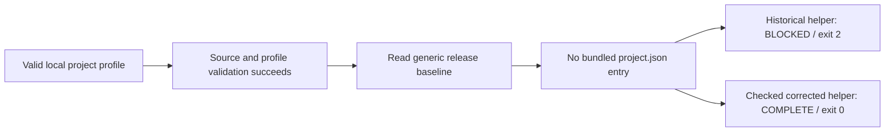

# From a Qodo review comment to a verified decision

An AI review has returned a finding. Should you change the code?

Run a local replay of a real Qore case, compare the reported behavior across pinned versions, and write a decision that another engineer can check. The case uses actual Qodo Agentic Toolbox review output from **18 October 2026**, followed by separate Codex verification.

You will distinguish three outcomes: a historical regression already corrected, a useful diagnostic suggestion, and a failure caused by our own incomplete review input.

## 1. Reproduce the observations

Start in a checkout of this repository containing `examples/qodo-review`. You need `python3`, Node.js and a POSIX shell. The recorded maintainer run used Python 3.14.7 and Node 22.23.3 on macOS arm64; it is not a cross-platform certification.

The following command uses bundled public helper snapshots and labeled synthetic inputs. It makes **no Qodo request, network call, login or project-profile command execution**. It writes only to a new output directory.

```sh
qodo_replay_root="$(mktemp -d "${TMPDIR:-/tmp}/qore-qodo.XXXXXX")"
python3 -B examples/qodo-review/reproduce.py --output "$qodo_replay_root/run"
```

Expect these observations, followed by the path to the evidence file:

```text
Profile base: COMPLETE, exit 0
Profile historical: BLOCKED, exit 2
Profile current: COMPLETE, exit 0
Text: PENDING; unresolved ID F1 appears in JSON
Hashes: 2 slice mismatches; 0 complete-fix mismatches
Recorded observations match: true
```

Here, **current means the checked `e9d74cf` snapshot**, not an assertion about whatever is on GitHub when you read this. The first two snapshots are the actual parent `a4fef83` and historical correction `d676730`. [Exact source identities and digests](../../examples/qodo-review/sources.json) are bundled with the replay.

Inspect the actual command results:

```sh
python3 -m json.tool "$qodo_replay_root/run/observations.json"
```

The file contains normalized commands, exit codes, stdout/stderr, runtime versions and explicit limits. `matches_recorded_observations` means the focused observations matched; it is not a deployment decision or a declaration that the project is defect-free.

If the command refuses an existing output, choose a new directory. If a bundled source digest differs, use a clean checkout or inspect the change; do not disable the check. Missing Python or Node is a prerequisite gap, and the replay does not install either.

## 2. Follow the finding across its boundaries

Qore's project profile supplies source-backed conventions to a skill. Its preflight checks the profile before the method consumes those facts.

In this historical change, an added profile was valid, but the diagnostic code for a bundled release baseline rejected it:



**Diagram in words:** the profile validation succeeds. The historical helper then demands a profile entry that a generic release baseline does not contain, turning the result into BLOCKED. The corrected checked version accepts this condition.

The replay uses the exact three public helper versions with a small generic-manifest fixture. It checks the review helper only. The original separate verifier also built and installed the full public snapshots, checked all three method helpers plus `tools/context.py`, and exercised the documented derivation control. The focused replay does not repeat that complete installation.

The outcome matters as much as the reproduction: **the profile regression was already corrected by [`908ba019`](https://github.com/sylvestre-baker/qore-codex-skills/commit/908ba019ce43b8566d0f68fda4b2bf237a2b5d66)** before the checked main snapshot. Opening a new current-code bug for the same counterexample would be misleading.

Adding a profile manually to a generic installation is also not the primary documented adaptation path; see the [derive-and-install workflow](../profiles.md). Derivation and all three derivative preflight checks succeeded in the retained independent control. Installation of the derived candidate was not part of that recorded control. This finding does not establish that normal generic use or derivation was broken.

**Decision:** retain the historical counterexample and the fix identity. Do not report it as still open on the checked main.

## 3. Separate a diagnostic suggestion from a gate failure

The second observation concerns the human-readable summary of an unresolved finding. The replay supplies a **synthetic packet** containing one `high` / `PLAUSIBLE` candidate, `F1`, to the actual helper.

Its text output is:

```text
finding-lint: valid; coverage PARTIAL; verdict PENDING; 0 blocking findings.
```

The human can see PENDING but cannot see which finding caused it. The JSON output retains:

```json
{
  "coverage": "PARTIAL",
  "verdict": "PENDING",
  "blocking_findings": [],
  "unresolved_findings": ["F1"]
}
```

This is a selected JSON excerpt; the helper emits additional fields. `0 blocking findings` refers to independently confirmed blockers. It does not clear unresolved high-impact candidates. The helper does **not** return SHIP for this input.

Qodo's original level was **`informational`**. Preserve that level rather than turning a text omission into an alleged security bypass. The optional human summary could identify unresolved candidates; the existing JSON consumer already receives them.

The replay's `--verifier=ran` is structural test input. It does not mean a new independent review phase ran during your local replay.

**Decision:** retain a narrow diagnostic improvement, with the existing correct PENDING verdict and JSON behavior visible.

## 4. Check whether the evaluation introduced the problem

Our first review selected three changed files from a larger public correction. That slice retained old release-approved digests while replacing two resources. Qodo correctly reported that the slice could not build.

The actual published correction also updated the companion rights records. Its full package build succeeded, as did the checked main. The apparent current-code bug came from **our incomplete evaluation input**.

The replay compares the real public resource bytes against those two sets of approved digests:

| Input | Approved digest matches the selected resource? | Supported conclusion |
|---|---|---|
| Initial three-file slice | No, for both inspected resources | The sliced input is inconsistent |
| Complete published correction | Yes, for both resources | The companion hash updates are present |

This hash comparison is narrower than running the package builder. The [verification record](../evidence/qodo-review/verification.json) separately retains the original full-build outcomes and their snapshot scope.

**Decision:** repair the review target and run the complete change. Do not patch the real repository for a defect introduced by the evaluation harness.

## 5. Keep the complete review story

These are **three native claim IDs across two different inputs**, not three open defects in today's code.

| Returned observation | Qodo action level | Independent result | Engineering decision |
|---|---|---|---|
| Added profile blocked by generic baseline | `remediation_recommended` | Reproduced in `d676730`; absent from checked `e9d74cf` | Retain historical regression and existing fix |
| Text summary omits unresolved ID | `informational` | Reproduced; JSON and PENDING remain correct | Consider a diagnostic improvement |
| Package hashes stale | `action_required` | Reproduced only in our slice; absent from complete fix and checked main | Correct the evaluation input |

For each review, record:

1. The exact target, base, changed files and instruction context.
2. The finding's native identity, location and action level.
3. A concrete reproduction or a retained reason for refutation.
4. Whether the behavior is still present in the version you plan to change.
5. The decision and the scope that remains untested.

The original finder here was **Qodo**. A mechanical allowlist then selected claim fields for a **fresh, separate Codex verifier for each input scope**. The author did not silently promote its own inspection to independent verification. This is a recorded cross-tool workflow, not the full generic Qore three-finder protocol and not a Qodo-versus-Codex benchmark.

## 6. Read coverage before treating a result as clean

Both Qodo operations returned terminal issue-review results. The full-change operation observed the exact public correction tree. Its metadata also reported:

- `spec_context_unresolved`: the explicit public specification reference was not resolved; the spec reviewer was skipped.
- `finding_state_unavailable`: the previous finding inventory was incomplete. A later run did not establish that earlier findings had disappeared.
- Issue review ran; compliance, skills, spec, UI, persona and cross-repository reviewers were skipped.

The provider's `coverage.complete: true` therefore does not establish that the requested spec comparison happened. Our overall coverage remains **PARTIAL**, while all three returned claims have recorded independent examinations.

The historical candidate also passed 43 validator tests and a full package build. Those are separate local controls, not Qodo findings or a measure of detection quality. The older malformed `--verifier` token example elsewhere in this repository is a different issue.

See the [sanitized provider excerpts](../evidence/qodo-review/provider-excerpts.json), [independent verification summary](../evidence/qodo-review/verification.json) and [selection/provenance record](../evidence/qodo-review/provenance.json). Raw account/session data, authentication images, the proprietary CLI bundle and full private traces are not published. A digest of a private source preserves an audit identity; it cannot by itself authenticate a provider response for a public reader.

## Run a new live Qodo review

The local replay above is complete without a Qodo account. To submit a new review of the historical change, follow the separate [live-review guide](qodo-live-review.md). It needs Git history, the official CLI, authentication and repository access. A new model run can return different findings or coverage. Do not expect the historical IDs or wording to repeat.

## Apply the lesson to your own change

Use a small decision record:

```text
Target and base:
Native finding ID / level / location:
Input and command:
Observed result and evidence:
Counterexample or refutation:
Still present in the intended delivery snapshot:
Decision:
Missing coverage:
```

Keep source versions and evidence with the record. A review comment starts an investigation; a reproducible result and its scope support the engineering decision.

This tutorial is an independent contribution by Sylvestre Franceschi for Qore/Qaizen. It does not imply Qodo affiliation or endorsement, production adoption, general performance gains or programme admission.
