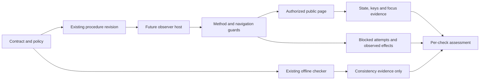

<!-- qore-spec/1 -->
# Plan: repair the unanswered journey verification procedure

Version 1, 2026-10-17. Target: `target/verification-protocol.md`; proposed changes only. The supplied inputs and skill resources remain unchanged. This report plans a document correction; it does not establish a website defect or a successful deployed journey.

The existing procedure clicks Back, leaving keyboard reachability unproved. It also omits summary Space-close/Enter-reopen and pre-navigation policy/evidence instructions. Replace these gaps while preserving the fixture disclaimer, unanswered journey, separate Close focus check, and returned-introduction assertions.

## Authority, snapshot and scope

Workflow mode is selected by the existing applicable procedure, not by an absent specification. Authoritative project sources are:

| Source | Revision / locations | Effect |
|---|---|---|
| `TASK.md` | Exact frozen bytes in `sources/TASK.md`; hash in `input-manifest.json` | Plan this target against original sources; keep inputs immutable |
| `surface-contract.json` | SHA-256 `3728739a119a53272541f83d451e40addb6939304f9d9ec060a477a87170a4a3`; lines 4–20 | Entry, scope, seven transitions, focus, eight checks, provenance and exclusions |
| `checks/check_contract.py` | SHA-256 `9ef2a0acf51f078ce290ec723ca550b8b73597e68304179fe4d0625c5757963b`; lines 14–43,46–50 | Consistency gate and its limits; different focus destinations and keyboard Back |
| `observation-policy.json` | SHA-256 `15f4e5b4960b5011684be265f027e42b8637a3b8aae96b24bba1ba3a4d0f0202`; `/allowed_origins` | Sole allowed origin agrees with contract |
| Existing target | SHA-256 `b8d1f4ad7bd691dbf8f019cd3b87a7644a21899e6317edebac545fd3b245136e`; lines 3,5–10 | Applicable change target, useful existing checks and fixture disclaimer; not project authority |

Run `qore003-20261017-p1-derived-1`; candidate identity `8b26119f383a7d5853c1bd2ab5f678e08966300846c0d6f2784351c1f5a59e8d`; target enclosing prepared-input identity `ed6c0fb8d8737cb4b8fc9e6b3485e0e618bf332d15725a557cf30d17b127e394`. These enclosing identities and last relevant change `2026-10-17T09:53:58.555717+00:00` are supplied operational metadata. The enclosing digest serialization/manifest was not supplied, so these hashes are not independently reconstructed or replaced by the target file hash. `input-manifest.json` independently records each supplied file's bytes/hash; `sources/` preserves originals, including instructions and skill revisions.

Project preflight returned current sources and COMPLETE context coverage for profile `qaizen-labs` 0.1.0, digest `f76afdd45cb6352e5044a06affc4182ea6cd40aa9c012fb216636a61faa428f0`. `profile-check.json` retains its full output; `profile-use.json` distinguishes selection from actual consumption. Its plan facts shape the separate focus checks, keyboard traversal, policy prerequisites and local consistency gate. No web surface was returned for method plan. The profile grants no action permission.

In scope: one source-aligned procedure revision, explicit future observation prerequisites, acceptance/evidence design and offline checks. Non-applicable surfaces: application implementation, APIs, databases, transactions, account access, deployment, shared-data mutation, publication and native interfaces. No runner construction or checker/profile/contract rewrite is needed. No network was used. Answers, results, form submission, website-source redistribution, mobile, complete questionnaire, performance and accessibility certification remain excluded (`surface-contract.json:/limits`).

## Stories and locked decisions

- **US1:** A future verifier can follow every declared transition and distinguish each observed help state.
- **US2:** A reviewer can independently judge Close focus, Back keyboard reachability, and returned-heading focus.
- **US3:** An observer stays unanswered and within the authorized method/navigation boundary, preserving blocked effects.
- **US4:** A recipient can distinguish document/static validity, future observations, failures and unresolved evidence.

| Decision | Selected requirement or proposal | Source and consequence |
|---|---|---|
| **D1** | Improve the existing procedure; preserve its disclaimer and meaningful existing assertions; keep this execution offline | TASK; target:3,8–10. No duplicate protocol or website changes |
| **D2** | Include all seven transitions in order and all eight required checks | Contract `/transitions`, `/required_checks`; Back-only repair is insufficient |
| **D3** | Record actual control reached before Enter and actual destination focus afterward; separate Close-summary from Back-introduction-h1 | Contract `/focus_targets`, transitions 5–6; checker:32–36. Reading focus is observation; assigning focus cannot prove reachability |
| **D4** | Require guard readiness before first future navigation: all-request method allowlist and exact-origin main-frame/popup navigation containment, including redirects | Contract `/scope`, `/allowed_origins`, `/limits/2`; policy; current `unanswered-scope` profile fact. Retain blocks/effects; no relaxed policy |
| **D5** | Use per-check pass/failed/blocked/not-run with actual evidence; never upgrade static validity to live success | Checker:42–50; contract `/provenance`, `/limits`. This result vocabulary is a proposed evidence convention |
| **D6** | Use forward sequential Tab then Enter for canonical Close and Back | Literal contract transitions 5–6. Checker permits Shift+Tab only for Back; tolerance does not amend the canonical source path |
| **D7** | Keep unresolved future-host/subresource authorization explicit; stop on conflicting allowlists or unavailable boundary enforcement | Original allowlists and current navigation-specific profile do not settle comprehensive third-party subresource permission. No permission inferred; this blocks an affected future observation, not the document plan |

## Precise proposed procedure revision

Retain the title and reconstructed-fixture disclaimer at target lines 1–3. Expand the current six steps into this single coherent procedure, followed by its evidence and limits section:

1. Before any future browser navigation, record observation time/environment, procedure and source revision, locale **en-US**, viewport **1280×800**, and entry/state-only depth. Require an observer capable of enforcing all guards before the first request, including new popup contexts and redirects. If capability is missing, stop before entry and record blocked/not-run.
2. Compare contract/policy allowlists; currently both contain only `https://qaizen.io`. Deny every request method except **GET, HEAD, OPTIONS**. Deny main-frame/popup navigation whose parsed exact origin is outside the allowlist, checking redirect destinations too. An href suffix identifies a control and never authorizes its destination. Do not infer third-party subresource permission; resolve that scope before a future attempt depends on it, or conservatively block and retain effects. Stop on source disagreement. Guard requirements are a future host prerequisite, not an asserted available API.
3. Open `https://qaizen.io/labs`. Click `a[href$='/labs/readiness-check']`; observe `labs → introduction` and allowed origin. Click **Start the check**; observe `introduction → first-question`. Inspect answer controls without selecting anything; all must be unanswered.
4. Reach the actual question-help **summary** using ordinary keyboard interaction. With it focused, press **Enter** and observe help open. Press **Space** on the summary and observe help closed. Press **Enter** on the summary and observe help reopened. Preserve each intermediate observation and unanswered state. Do not add an unsupported focus-after-toggle requirement or substitute final-open evidence for the missing closed observation.
5. From reopened help, use sequential **Tab** until the actual **Close** control is focused; record the actual traversal and control identity. Press **Enter**. Independently assert help closed and active focus restored to its associated **summary**. Confirm the question still unanswered.
6. Starting from that actual post-Close summary focus, use sequential **Tab** to the application **Back** control; record the reached control before activation. Press **Enter**. Do not click Back, invoke browser-history Back, or directly assign Back focus to obtain the proof.
7. Independently assert returned introduction visible, question/help absent from visible, accessible and interactive presentation, and actual active element the introduction's **h1**. The presentation interpretation is proposed; DOM deletion is not required. Identify the intended heading rather than any arbitrary h1. Hidden inert retained nodes may be compatible; departed controls still exposed for interaction are a discrepancy. Do not re-enter the questionnaire to inspect answer persistence. If answer controls are absent, a post-return selected-value observation is unavailable, not evidence of persistence or a failed unanswered assertion.
8. Retain per-transition evidence, unanswered checkpoints, blocked requests and their observed effects. An expected analytics POST must stay blocked. If a state/focus is actually wrong, mark its check failed; if safe observation cannot be established, mark blocked/not-run and preserve earlier failures. Do not continue by answering, forcing focus, changing state programmatically or weakening guards. Keep later dependent checks unobserved after the first blocking failure.

Use bounded condition waits and bounded traversal attempts in a future host; record chosen values and actual keys. No exact tab count, timeout, DOM ID or current tab order is supplied, so none is a new product requirement. If controls/heading are ambiguous or Back cannot be reached within the declared observation bound, preserve evidence and report the affected assertion without a shortcut. No Start-focus obligation or additional keyboard entry path is introduced: entry and Start remain the contracted clicks.

## Reuse, impact and evidence interfaces

The supplied-tree sweep found only this Markdown target, contract/policy JSON, the existing Python checker and skill resources. No application source, browser harness, storage or transaction owner is supplied. Reuse the existing Close and returned-state assertions, contract vocabulary and checker; add a manual source-to-procedure coverage review. No data/configuration migration, reader/writer update, new framework or production rollout follows from this document plan.

Material interfaces are sources → procedure → future observer → evidence → reviewer. Carry entry URL, exact origins, locale/viewport, answer/method policy, transition IDs/from/to/control/activation/traversal/focus_after, focus targets, required-check IDs, provenance and exclusions without silently broadening them. The existing checker consumes JSON and emits consistency stdout/exit only; it does not consume target Markdown or observation-policy JSON. Manually compare both allowlists.

Proposed compact observation record: attempt ID; timestamp/environment and source/procedure revision; actual URL/origin; transition ID; expected/observed state; actual keys and focused control before activation; active element after activation; unanswered state when observable; blocked method/destination/reason and resulting visible effects; assertion status/reason; artifact references. Record enough semantic identity to associate summary and heading with the intended state. Avoid page-source redistribution and unnecessary request bodies/query data. No mandatory storage format or retention period is invented. A screenshot can supplement state evidence but cannot establish actual key sequence or focus on its own.



This sequence specifies the future runtime; none of its website interactions ran here. The actual offline execution is separately recorded in `execution.json` and full role reports.

```mermaid
sequenceDiagram
  actor O as Future observer
  participant H as Observer host
  participant W as Public page
  participant E as Evidence record
  O->>H: Establish scope, locale, viewport and guards
  alt Scope conflict or guards unavailable
    H-->>E: Block prerequisite; no navigation
  else Guard prerequisites established
    O->>H: Open entry, click journey link and Start
    H->>W: Allowed requests and navigation only
    W-->>H: Unanswered first question
    O->>H: Summary Enter, Space, Enter
    H-->>E: Each open/closed state and unanswered checkpoint
    O->>H: Tab to Close, observe focus, Enter
    H-->>E: Help closed and summary focused
    O->>H: Tab from actual summary to Back, observe focus, Enter
    H-->>E: Introduction, departed-state absence, heading focus
    alt Forbidden method or navigation attempted
      H-->>E: Block before transmission; retain effects
    else State or focus actually wrong
      H-->>E: Failed assertion; preserve dependent evidence gaps
    end
  end
```

Guards apply throughout, not only at the depicted branch. The host owns guard enforcement/evidence. No website service, transaction or persistence mechanism is invented.

## Acceptance scenarios and source coverage

These are planned acceptance obligations, not executed browser tests. Document review checks that the revised procedure requires these oracles. Any later runtime result needs actual guarded observations. Local-double policy scenarios describe future checks; no test harness was built here.

```gherkin
Feature: Source-faithful unanswered journey verification
  Scenario: AC01 Authorized entry and unanswered start
    Given the specified locale and viewport and required guards are established before entry
    When the verifier opens the declared Labs URL and clicks the declared journey link and Start
    Then the introduction followed by the first question is observed on the allowed origin
    And all answer controls are unselected

  Scenario: AC02 Every help state is observed
    Given the unanswered first question and its focused summary
    When Enter opens help and Space closes it and Enter reopens it
    Then an open, closed and reopened state observation is retained separately
    And the question remains unanswered at those checkpoints

  Scenario: AC03 Close restores summary focus independently
    Given help is reopened and the question is unanswered
    When sequential forward Tab reaches Close and Enter activates it
    Then the focused Close record and actual key trace are retained
    And help is closed and its summary is the actual active element

  Scenario: AC04 Keyboard Back and introduction focus
    Given Close has left actual focus on the summary
    When sequential forward Tab reaches application Back and Enter activates it
    Then the reached Back control and actual key trace are retained
    And the introduction is visible and its h1 is the active element
    And question and help are absent from visible accessible and interactive presentation

  Scenario: AC05 Click or assigned focus cannot pass keyboard proof
    Given evidence shows Back was clicked or directly focused before activation
    When the introduction appears with correct heading focus
    Then keyboard Back is not accepted as passed
    And destination focus is recorded separately from the missing reachability proof

  Scenario: AC06 Wrong focus or unreachable control remains a failed check
    Given a guarded observation records wrong summary or heading focus or failed bounded traversal to Close or Back
    When the affected assertion is assessed
    Then the observed discrepancy and actual trace are retained as failed or incomplete as supported by evidence
    And no click or forced focus repairs the proof or passes dependent checks

  Scenario: AC07 Every forbidden method is denied
    Given a local policy test double and the method guard specified before entry
    When the double supplies methods outside GET HEAD and OPTIONS including analytics POST
    Then each forbidden request is blocked before transmission
    And method destination block reason and observed effects are retained without relaxing the guard

  Scenario: AC08 Off-origin main frame and popup destinations are denied
    Given a local navigation test double and the exact-origin navigation guard
    When direct or redirected main-frame and popup destinations have origins outside the allowlist
    Then every such navigation is denied before it is followed
    And href suffix or host substring matches do not authorize it

  Scenario: AC09 Missing prerequisites prevent entry
    Given either method or main-frame and popup navigation protection cannot be established before the first request
    When the future attempt is prepared
    Then navigation does not begin
    And the missing prerequisite is recorded as blocked with dependent checks not run

  Scenario: AC10 Unexpected answer selection prevents acceptance
    Given the question was initially unanswered
    When a help-state or pre-Back checkpoint observes a selected answer
    Then unanswered acceptance fails with the observed state retained
    And no submission or result generation is performed

  Scenario: AC11 Static results cannot certify deployed behavior
    Given the offline contract checker and specification lint pass
    When no deployed journey was observed
    Then the result states contract consistency and document structure only
    And the fixture disclaimer acceptance expectations and coverage exclusions remain explicit

  Scenario: AC12 Expected analytics blocking disrupts progress
    Given an analytics POST is blocked under unchanged policy
    When subsequent progress cannot be observed and the visible effects are recorded
    Then affected checks are blocked or not run without inferring unsupported causality
    And any earlier observed failed assertion stays failed
    And blocking alone is neither journey success nor a website defect

  Scenario: AC13 Unresolved authorization cannot silently expand scope
    Given source allowlists conflict or third-party subresource permission needed for an attempt is unresolved
    When preparing that future observation
    Then conflicting authority is reported and no broader permission is inferred
    And the affected request is not allowed pending resolution or is conservatively blocked with effects retained

  Scenario: AC14 Absent controls require no questionnaire re-entry
    Given keyboard Back returns the introduction and the departed question controls are absent
    When unanswered evidence and returned presentation are assessed
    Then prior observable unanswered checkpoints and returned absence are retained
    And no DOM retention or re-entry is required and later answer persistence remains unobserved
```

Coverage: AC01 → US1,US3 / D1,D2,D4; AC02 → US1,US3 / D2; AC03 → US2 / D2,D3,D6; AC04 → US1,US2 / D2,D3,D6; AC05 → US2 / D3,D6; AC06 → US2,US4 / D3,D5; AC07 → US3 / D4; AC08 → US3 / D4; AC09 → US3,US4 / D4,D5; AC10 → US3 / D2,D4,D5; AC11 → US4 / D1,D5; AC12 → US3,US4 / D4,D5; AC13 → US3,US4 / D7; AC14 → US1,US4 / D1,D2,D3,D5.

| Supplied obligation | Planned procedure / acceptance | Authority |
|---|---|---|
| `entry` | Steps 1–3; AC01 | Contract entry/start transitions, entry URL, locale/viewport |
| `unanswered` | Steps 3–8; AC01,AC02,AC10,AC14 | Scope, limits, target:6,9 |
| `help-toggle` | Step 4; AC02 | All three summary transitions 2–4 |
| `close-focus` | Step 5; AC03,AC06 | Transition 5 and summary target |
| `keyboard-back` | Step 6; AC04–AC06 | Transition 6; checker:35–36 |
| `introduction-focus` | Step 7; AC04,AC06,AC14 | Transition 6, heading target; target:10 |
| `read-only-policy` | Steps 1–2,8; AC07,AC09,AC10,AC12 | Scope and limits; fresh unanswered-scope invariant |
| `origin-policy` | Steps 1–3; AC08,AC09,AC13 | Contract/policy allowlists; fresh invariant |

QA cross-examination feedback is covered by AC01/09 setup, AC07 method rejection, AC08 direct/redirected main-frame/popup rejection, AC02 intermediate help failures, AC03/04/06 control/focus failures, AC10 selection, AC12 block effects, and AC14 absent controls. Identity ambiguity and unavailable observations stay unresolved rather than guessed. No supplied transition or required-check ID is intentionally deferred.

## Tasks, dependencies and completion gates

Estimates are proposals for a later document revision/review by one familiar implementer, not observed durations or commitments. Basis: a ten-line existing procedure, seven transitions, eight checks, existing validator, no app code or runner.

| Task | Size / estimate and basis | Dependencies and gate |
|---|---|---|
| T1 Lock source revision and coverage inventory | XS, 10–20 min; four source files and target | First; preserve disclaimer, all seven transitions/eight checks |
| T2 Add setup, guard and stop section | S, 20–40 min; method/navigation rules and evidence | T1; guards before navigation, unknown scope explicit |
| T3 Expand canonical journey and distinct focus checks | S, 20–40 min; seven action/state pairs | T1; exact help keys and Tab/Enter Close/Back; preserve original return assertions |
| T4 Add evidence/limits and acceptance mapping | S, 20–40 min; eight check IDs plus negative oracles | T2,T3; no missing transition/check, no static-to-browser inference |
| T5 Review actual revised document and run local checks | XS–S, 15–30 min; semantic source comparison and structure | T4; retain argv/exit/output, review every source obligation, verify frozen inputs |

Critical order: T1 → T2/T3 → T4 → T5; T2/T3 share one procedure and must be reconciled, even if drafted independently. Estimated later total 85–170 minutes excludes browser execution. Definition of done for planning: this sourced edit plan, measurable mapping, completed role/challenge/adjudication evidence, explicit dependencies and structural checks. Later implementation additionally requires reviewing the actual revised Markdown. Live pass is a separate future gate with scope and host prerequisites; this run does not authorize it.

Proposed document adoption: review and version the single procedure through the project's normal documentation process. No publication performed. Rollback is a document revision reversal retaining a known keyboard-proof-gap notice; it cannot retroactively certify old records. No database migration, feature flag or deployment rollback applies.

## Adjudication, rejected alternatives and risks

Full decisions/refutations are retained in `adjudication.json` and all ten role reports, rather than replaced with a vote count.

| Divergence | Evidence and decision | Consequence / remaining uncertainty |
|---|---|---|
| Back-only wording patch versus complete source coverage | Contract all transitions/checks; D2 selects complete bounded correction | Reject minimal Back-only patch; retain useful old content |
| Either traversal direction versus canonical Tab | Literal transitions specify Tab; checker only tolerates reverse Back | D6 selects forward Tab. Product revises broader Close wording; Architecture retracts reverse-as-equivalent wording. Supplemental reverse exploration cannot replace canonical proof |
| New runner/checker versus direct document repair | Checker reads JSON only; no supplied host implementation | D1 reuses checker plus manual mapping. No new framework or app work |
| Navigation-only wording versus broader origin permission | Bare allowlists and navigation-specific profile do not settle all subresources | D7 preserves Product/QA dissent; Architecture qualifies its wording. Future boundary remains unresolved; no third-party permission inferred |
| DOM deletion/post-return answer inspection versus presentation absence | Existing target requires absence but no DOM removal or re-entry | Presentation interpretation accepted as proposal. Hidden inert nodes need not fail; accessible/focusable departed state is a discrepancy; Q-D4 revised |
| One green status versus distinct evidence gates | Checker explicit limit; probes below show its partial predicate | D5 separates static/document/observed checks and preserves first failure |

**Severity is preserved by claim.** High: confirmed keyboard-proof gap from clicked Back; conditional unauthorized-observation risk if guards are missing/relaxed; conflating focus or static results can create a false pass. Medium: confirmed missing help toggle; QA's confirmed guard/evidence omission; future analytics interference and origin ambiguity remain hypotheses/unknowns. Peers' High conditional guard impact and QA's Medium document omission describe different claims and are both retained. Traversal authority precision is Low; deployment misstatement was Low in Delivery and Medium in Architecture, both judgments retained. None is an observed website vulnerability. Full role reports preserve individual ratings and refutations.

Expected analytics blocking does not establish harmlessness, causality, product failure or journey success. Missing host capability, unambiguous control identities, future traversal/wait bounds, current DOM/focus and deployment identity are open evidence dependencies. Private source commits cannot identify the current deployment. No hidden rubric or comparative winner is evaluated.

## Actual execution, checks and limits

Five independent initial contexts ran: `/root/product`, `/root/architecture`, `/root/ux`, `/root/delivery`, `/root/qa`, all initially dispatched with `fork_turns="none"`. Complete initial reports preceded the report barrier at **2026-10-17T10:43:51.194754+00:00**. All five then received all returned reports for exactly one cross-examination pass with assigned challenge links. Completed contexts could not be resumed: actual followup tools returned `agent not found`; fresh `/root/*_cross` contexts explicitly loaded their own full initial role report and all five peer reports. This is disclosed role continuity through files, not a claim of uninterrupted private contexts. No sequential lead self-review substitutes for a role.

The lead adjudicated after all cross reports were retained. Workflow stopped after Analyze → barrier → one Cross-examine pass per role → Adjudicate, with unresolved external evidence named. No additional debate/quality round was dispatched. A separate fresh `/root/fresh_verifier` received only mechanically filtered claims plus raw original sources, without role reports or adjudicator verdicts; its bounded factual-audit outcome is retained separately.

Actual local checks:

- Project preflight: exit 0, current source digests and COMPLETE context coverage. Full command/result in `evidence/profile-preflight-command.json`.
- `python3 -B checks/check_contract.py surface-contract.json`: exit 0, `valid: true`, eight checks and explicit consistency-only limit; `evidence/contract-check-command.json`.
- Delivery's unchanged-checker in-memory probe: original and a copy omitting `toggle-help`/`reopen-help` both returned valid, exit 0. Full code/argv/output/UTC bounds in `evidence/delivery-probe-command.json`; no input written. QA separately reported in-memory counterexamples for Close click/no traversal and omitted required-check IDs; its full report retains those results, but no separate raw command transcript was supplied for that probe. These demonstrate checker limitations, not a requested checker repair.
- Specification lint and final execution-record validation: actual command outputs are saved in `evidence/spec-lint-command.json` and `run-check-final.json`; the completion record below states their results after execution. Structural validity does not prove source reasoning or product correctness.

Finite limits: 900 wall seconds and 2,400 aggregate agent-seconds; at most three simultaneous children. Roles were assigned 150-second Analyze, 100-second Cross-examine and 90-second fresh-verifier deadlines. Available Delivery cross results were requested near/at expiry; final retention/return overran its nominal role deadline, disclosed in report/roster. No new investigation was authorized at expiry. `roster.json` records actual actor identities, dispatch/return UTC observations, requested/returned/missing roster and timing precision. Exact internal API dispatch events and CPU/token/aggregate usage are unavailable; never reported as zero. `budget.json` distinguishes allocated upper bounds from observed wall intervals.

No browser, network, website source, actual live keyboard/focus behavior, analytics effects, mobile, full questionnaire, results/submission, performance or accessibility certification was examined. Future policy/host and current-deployment evidence remain missing. COMPLETE planning protocol coverage, if validated, means the declared phases ran with evidence; it does not resolve those dependencies or authorize implementation/deployment.


Completion record: **COMPLETE planning protocol coverage**; five initial roles, five cross-examinations, lead adjudication, current profile preflight and structural specification validation are retained. Fresh verifier covered 12/12 claims: 11 supported, C12 partially supported and retained as an interpretive proposal. No claim was refuted; this does not establish overall correctness. Structural lint passed for this specification; the final run-check output records execution identity/coverage validation separately. Missing coverage is future live observation, host enforcement, subresource authorization and deployment behavior, not a hidden successful run. Full roster, reports, command results and limitations accompany `execution.json`.
