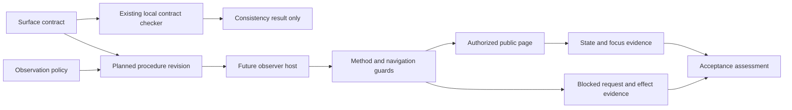

# Architecture independent analysis

Role/context: Architecture / `/root/architecture`; Workflow Analyze phase, independent context. Actual UTC start recording: 2026-10-17 10:39:59 UTC (first clock measurement; initial source read immediately preceded it). Report completed: 2026-10-17 10:41:23 UTC. Target snapshot supplied by lead: `ed6c0fb8d8737cb4b8fc9e6b3485e0e618bf332d15725a557cf30d17b127e394`. Snapshot identity is lead-supplied rather than recomputed here. No peer report read during this initial analysis. No network contact, website observation, or input change performed.

## Sources and measured evidence

- `TASK.md`: original task requires planning changes to `target/verification-protocol.md`, use of original project sources, outputs outside input, no input/skill edits, no network or previous reports.
- `target/verification-protocol.md:3,5–10`: existing applicable procedure; explicitly reconstructed fixture, not historical evidence or website-defect evidence. It starts unanswered and separately checks Close focus but leaves help activation unspecified and instructs click Back.
- `surface-contract.json`: `/schema`, `/version`, `/entry_url`, `/allowed_origins`, `/scope`; `/states`; `/transitions/0` through `/transitions/6`; `/focus_targets`; `/required_checks`; `/provenance`; `/limits` (lines 2–20).
- `observation-policy.json:/allowed_origins` (lines 2–4): only `https://qaizen.io` authorized.
- `checks/check_contract.py:9–43`: original source inspected before local execution. In particular lines 14–18 enforce entry origin and read-only/unanswered declarations; 23–36 validate transitions and keyboard Back; 37–43 declare required checks and consistency-only limit. Lines 46–54 implement local JSON reading and failure exit.
- `.agents/skills/qore-plan-qaizen-labs/SKILL.md`; `references/{protocol.md,roles.md,specification.md,project-profile.md,project.json}`: planning and architecture obligations. Lead's current `/workspace/output/profile-check.json` inspected before consuming its returned facts: COMPLETE plan coverage, current source digests. Original sources independently inspected. Profile surfaces returned `{}` for plan; this does not establish website observation.
- Visible reuse sweep: `find . -type f` inspected complete supplied file inventory. Project behavior consists of one local Python contract checker, one target Markdown procedure, JSON contract/policy, and the bundled planning skill. There is no supplied application source, route implementation, database schema, browser runner, or reusable browser helper. This statement is limited to the supplied tree, not the deployed website.
- Command: `python3 -B checks/check_contract.py surface-contract.json`, cwd `/workspace/worker`, executed 2026-10-17 10:40 UTC, exit 0. Output: `valid: true`, schema `qaizen-labs-surface/1`, all eight checks, limit `Contract consistency only; browser observations establish current behavior.` No output browser evidence was produced. `rg` unavailable; used `find`, `cat`, and `nl -ba` for original-source inventory/reads.

## Proposed decisions and deliverables

**ARCH-D1 — Retain the target as the sole procedure being improved.** Preserve its fixture/provenance warning and its separate Close/unanswered/return assertions. Add explicit setup, guards, complete transition sequence, evidence fields, and limits. Planning output is a reviewable change specification outside the input tree; actual target edit is future implementation. Source: TASK; target:3; specification artifact contract. No API, storage, transaction, website feature, or runner implementation is necessary to this documentation change.

**ARCH-D2 — Reuse current contract and checker without expanding either.** The contract already declares every needed state/transition/check. The checker already passes its contract. It neither reads Markdown nor contacts the website (`check_contract.py:2,42–50`), so do not label its pass as protocol completeness or journey success. Deliver a manual source-to-procedure coverage table beside the planned checker invocation; preserve the checker as the local contract consistency gate. A document-specific automated checker is deferred because no existing facility requires it and this low-impact edit can be reviewed directly.

**ARCH-D3 — Make the seven-transition sequence explicit.** Use entry click → Start click → summary Enter → summary Space → summary Enter → sequential Tab to Close, Enter → sequential Tab to application Back, Enter. Assert help open/closed at each toggle, summary focus after Close, unanswered state before Back, then returned introduction visibility, absent question/help, and heading focus after Back. Source: surface `/transitions/0–6`, `/focus_targets`; target:8–10. Canonical Tab for both Close and Back follows the literal contract. `check_contract.py:35` and current profile back-focus allow Shift+Tab for Back; this is an allowable documented alternative, not a reason to change the canonical sequence. Do not replace keyboard reachability with clicking, locator activation, or programmatic focusing of Back. Reading active focus is observation; setting focus is not proof of reachability.

**ARCH-D4 — Establish future observation guards before navigation.** Scope: en-US; 1280×800; only entry/state; no answer selection. Block every request whose method is outside GET/HEAD/OPTIONS, including analytics POST. Block main-frame and popup navigation outside the exact authorized origin `https://qaizen.io`; apply it to redirect targets and popup navigation too. Resolve URLs to origins rather than matching string prefixes. The original entry URL is HTTPS. Preserve blocked requests and any visible effects; do not relax guards to make the recording succeed. Source: `/scope`, `/allowed_origins`, `/limits/0–2`, observation policy, current returned `unanswered-scope` invariant. The origin rule is a navigation rule; sources do not specify a blanket third-party subresource-origin prohibition. Planning does not execute these guards or assert tool capability. If a future tool cannot enforce them, stop before navigation and record the missing prerequisite.

**ARCH-D5 — Preserve evidence and failure status at the document/host boundary.** Future evidence records setup, URL, action/key and observed state/focus before and after each relevant transition, unanswered checks, intercepted requests and observed effects, and any failure/blocked/unobserved stage. Expected acceptance is separate from actual observations. Record a failure at its first unsupported transition; retain already captured observations without declaring later dependent states passed. If blocked analytics disrupts the flow, record that disruption and the resulting evidence gap; no policy exception. Provenance is public acceptance/baseline metadata (`/provenance`), not proof of today's deployment. Source commit labels cannot establish deployment identity (`/limits/3`).

Deliverables: one coherent planned revision of the existing procedure; explicit boundary/guard section; seven-transition checklist with independent Close and Back focus; semantic coverage mapping to all eight required checks; local checker command and limits; future observation evidence requirements; bounded failure/recovery instructions and scope exclusions. No code or contract mutation proposed.

## Boundaries, interface fields, ownership, compatibility

1. Frozen supplied files → planning report/specification outside input. Producer: project sources. Consumer: planner/reviewer. Material values: contract version, entry URL, exact origin allowlist, locale, viewport, allowed methods, answer policy, state IDs, transition IDs/from/to/control/activation/traversal/focus_after, focus target selectors, required check IDs, provenance and limits. Current sources are reused as authority; target text cannot override them.
2. Contract JSON → existing Python validator → local stdout/stderr and exit status. Fields consumed exactly as listed in checker lines 10–41. It validates contract consistency, not policy JSON alignment, target prose, network enforcement, deployed DOM, or active focus. Policy alignment is currently a manual comparison of both allowlists, which match.
3. Future observer/browser host → public origin. User navigation and focus observations cross the browser boundary; network guards must be installed before requests. No browser tool or interception API is supplied, so documentation states required behavior without invented API names. Runner/operator owns guard enforcement and evidence; website receives only permitted requests.
4. Website rendered state/focus → future evidence record. DOM state and focus are observations, never inferred from expected IDs alone. Evidence recorder must retain blocked analytics effects rather than silently omitting them.

Compatibility: retain target filename/provenance and current no-answer journey; expand its incomplete instructions. No migration/configuration change or new shared values. The contract and policy remain read-only inputs. No transaction/retry/authorization service exists in supplied scope; retrying a failed observed journey must not erase failure evidence or weaken policy. Account access, form submission, answers/results, mobile and full questionnaire checks are out of scope.

## Component/information flow



## Actual future execution sequence being specified

This is a planned browser execution sequence, not an observation or new service architecture.

```mermaid
sequenceDiagram
  actor O as Future observer
  participant H as Browser host
  participant P as Public page
  participant E as Evidence record
  O->>H: Configure locale/viewport and install guards
  alt Guard enforcement unavailable
    H-->>E: Record blocked prerequisite; no navigation
  else Guard enforcement available
    O->>H: Navigate entry and follow allowed journey link
    H->>P: Only allowed request methods/navigation
    P-->>H: Introduction
    O->>H: Click Start; leave unanswered
    O->>H: Summary Enter, Space, Enter
    H-->>E: Observed help states and unanswered state
    O->>H: Tab to Close; Enter
    H-->>E: Help closed; summary focus observation
    O->>H: Tab to application Back; Enter
    H-->>E: Introduction visible; question/help absent; h1 focus
    alt Forbidden request or navigation attempted
      H-->>E: Block attempt; retain effects
    else Transition or focus fails
      H-->>E: Record failure and dependent evidence gap
    end
  end
```

## Severity-tagged risks and checks

- **HIGH / false keyboard proof:** trigger is retaining target:10 click Back or using scripted focus. Affected behavior: a mouse-reachable control could pass without keyboard reachability. Direct contradiction: surface `/transitions/6`, checker:35–36. Check: source review requires recorded sequential traversal and Enter, plus separate post-return focus.
- **HIGH / unauthorized observation:** trigger is starting future navigation before method/origin guards or relaxing a blocked analytics request. Affected behavior: mutation or off-origin navigation becomes possible. Evidence: surface `/scope`, `/limits/0–2`, current profile unanswered-scope. Hypothesis, not observed incident. Check: pre-navigation guard readiness; retain blocked attempts/effects; no pass if prerequisite absent.
- **MEDIUM / incomplete help coverage:** target:7 specifies no key and lacks Space close/Enter reopen, though contract `/transitions/2–4` and required `help-toggle` require them. Check: exact three-action toggle trace and intermediate state assertions before independent Close path.
- **MEDIUM / conflated focus outcomes:** target:8 and :10 are separate already; careless rewrite may collapse them. Contract `/focus_targets` and checker:32–36 demand different destinations. Check: independent Close summary and Back h1 observations.
- **MEDIUM / misleading local green check:** checker pass could be called browser success despite not reading target or website. Evidence checker:2,42–50. Check: distinguish contract consistency, document semantic review, and future observations in acceptance/reporting.
- **LOW / traversal wording ambiguity:** literal surface Tab for Back versus checker/profile allowing Shift+Tab. This does not block canonical Tab. Check: document canonical Tab; mention alternate only with source-backed rationale, never click.
- **MEDIUM / unsupported deployment claim:** baseline/public provenance and fixture warning could be mistaken for current pass or defect. Evidence target:3; surface `/provenance`, `/limits/3`. Check: mark expectations and observations distinctly; no deployment claim from private commits.

## Named peer challenges and alternatives

**To Product:** Lock the invariant that all seven declared transitions and all eight required checks are minimum acceptance, not only repairing click Back. Can Product keep the target's introduction/question/help visibility assertions while preserving no-answer scope? Clarify that plan completeness and deployment acceptance are separate outcomes. Smallest investigation: map target:5–10 against every transition and required check.

**To UX:** Avoid adding extra user-facing controls or demanding keyboard entry where contract allows entry/Start clicks. Is each keyboard action paired with an observable intermediate state, and are Close summary focus and Back introduction heading focus independently asserted? Smallest investigation: walk only the declared state machine on paper; no website observation in this task.

**To QA/security:** Negative paths must distinguish unavailable guards, blocked analytics with retained effects, unexpected off-origin redirect/popup, failed help toggles, unreachable Back, wrong focus, and answer accidentally selected. Contract validator will not detect missing prose or wrong browser state. Please make absence of browser evidence explicit, not a failed website claim.

Alternatives: (a) minimal click-to-keyword replacement — reject as insufficient because it omits help toggles, guard/evidence setup, and all source checks; (b) new runner or validator — defer because inputs supply no such runtime and task is planning a document change; (c) rewrite app or contract — reject as outside supplied scope; (d) allow analytics or off-origin navigation to complete recording — reject against explicit limits; (e) canonical Tab plus explicit Enter — recommend, with Shift+Tab alternate scoped to source-supported traversal rather than weakening proof.

## Uninspected and unfinished

No deployed site, browser availability, actual tab order/DOM, network requests, current deployment identity, or original website source inspected. These are intentionally outside planning authorization/resources. No peer reports inspected; cross-examination follows barrier. No semantic verdict about final specification or spec lint until lead assembles it. Snapshot digest not independently recomputed by this role. Future evidence would resolve guard capability, observed state/focus and blocked-request effects. Plan readiness does not establish deployment success.
