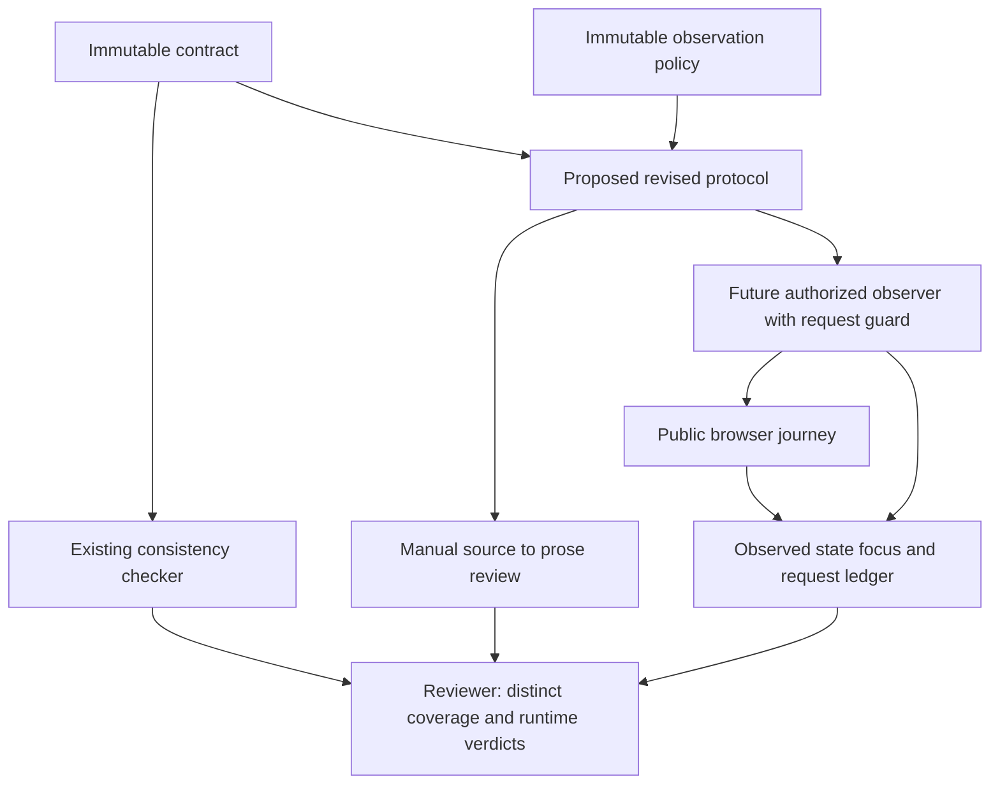

# Navigable copy of the original trial report

The [original report](final-output/REPORT.md) is preserved byte-for-byte with the original method record. This copy adjusts only links for this public layout. It does not revise findings, coverage or observations. Later independent qualification is recorded separately in `evaluation.json`.

<!-- qore-spec/1 -->
# Verification protocol change specification

Version 1, prepared 2026-10-17. Target: `target/verification-protocol.md` in the frozen prepared-input snapshot `0aa277436d8dcda4d6c2412c6ad4307dd0192b0f6230fa96c8b16d99c8bac194`. This digest identifies the whole enclosing input manifest, not this Markdown file or the deployed site. This is a plan; supplied inputs remain unchanged.

The protocol needs the full declared help keyboard sequence, genuine Tab/Enter Back evidence, separate Close/Back focus checks, and explicit unanswered and request-policy boundaries. Replacing only “Click Back” would leave other source obligations uncovered. Current website behavior is unknown.

## Authority, outcome and limits

The authority is `TASK.md:3-5`, `surface-contract.json` version 0.1.0, `checks/check_contract.py`, and `observation-policy.json`. Source citations below use original input line numbers; complete frozen copies and numbered originals are retained under `evidence/source/` and `evidence/`. The target is an existing applicable procedure, so the method is Workflow. Its reconstructed-fixture disclaimer (`target/verification-protocol.md:3`) must remain accurate. It is the change target, not project authority.

Outcome: a later observer can execute the bounded public journey and report each required transition and check with sufficient evidence, including failures or unavailable observations. A green local validator is insufficient: it reads the contract JSON, not the target or policy (`checks/check_contract.py:46-51`), and explicitly disclaims browser proof (`:42-43`).

Scope is one prospective document revision. Reuse the existing contract, policy and consistency checker. No new runner, schema, CI integration, site fix, database, transaction, API, migration or deployment is required. No such implementation surfaces are supplied. This classification concerns the available files; it is not a claim about unseen website architecture. Network access, shared-data mutations and input edits were prohibited in this execution.

Future observation is limited to `https://qaizen.io/labs`, en-US, 1280×800, entry/state depth, no selected answers, GET/HEAD/OPTIONS and origin `https://qaizen.io` (`surface-contract.json:4-6`; `observation-policy.json:2-4`). No answers, results, form submissions or website source redistribution; no mobile, full-questionnaire, performance or accessibility certification. An analytics POST is expected to be blocked, and any observed effects must be retained. A private source commit cannot identify the current deployment (`surface-contract.json:19-20`). The historical public baseline is dated 2026-10-15; the 2026-10-16 keyboard proof gap was found in the protocol, not on the website (`:19`). Neither date establishes current behavior.

## Stories and locked planning decisions

| Story | Outcome |
|---|---|
| US1 | An observer completes the declared unanswered entry/state journey within the origin, method and action boundaries. |
| US2 | A reviewer can establish actual keyboard traversal, activation and the two distinct focus destinations from evidence. |
| US3 | A reviewer can distinguish source consistency, document coverage, and measured browser outcomes, including incomplete evidence. |

“Locked” means selected for this proposed document change, not approval to implement, observe or deploy. The following decisions are proposals derived from cited obligations; none asserts measured site behavior.

| ID | Decision and basis |
|---|---|
| D1 | Amend only the target, preserve its fixture notice, cite the original authority and separate expected from observed. Sources: TASK:3-5; contract:19; target:3. |
| D2 | Specify all seven transitions in contract order, including Enter/Space/Enter on summary. Sources: contract:9-15,18. |
| D3 | Use actual Tab traversal then Enter for both Close and Back, and observe focused controls before activation and distinct focus afterward. Use Tab because the concrete contract specifies it; the checker's broader allowance for Back is not a waiver. Sources: contract:14-17; checker:32-36. |
| D4 | Establish and observe unanswered state; maintain it through help actions and before Back. No answer interaction, submission or results, even if a submission uses GET. Sources: contract:6,18,20. Observation timing and evidence format are proposed proof safeguards. |
| D5 | Describe enforceable origin/method restrictions before future navigation, covering redirects, subresources and other request surfaces. No execution if prevention cannot be established. Sources: contract:5-6,18; policy:2-4. Guard mechanics/readiness gate are proposals; no supplied harness is claimed. |
| D6 | Block any observed analytics POST and retain attempt/effect evidence. Do not provoke one, assume it occurred, exempt it, or treat blocking alone as journey success/failure. Source: contract:20. |
| D7 | Use one compact evidence ledger, all seven transition outcomes and all eight check mappings. Keep source/document/browser statuses distinct; do not stitch a passing journey from failed or separate attempts. Sources: contract:8-18; checker:42-43. Ledger and dependency rules are proposed evidence design. |
| D8 | Required Back outcome is returned introduction and its h1 focus. Preserve “question/help not visibly presented” only as a labeled supplemental observation. DOM removal is not required. Sources: contract:15,17 versus target:10; TASK:5. |
| D9 | Keep runtime selectors, answer indicators, tab counts, timeout bounds, request-guard feasibility and deployment behavior as unresolved execution evidence. Use no invented UI messages, fixed focus order, or certification. Sources: contract:19-20 and absence of these details from supplied files. |

## Concrete planned document changes

Add a short authority/scope paragraph, preflight, the following ordered procedure, a compact evidence template, exception rules and limits. Preserve useful existing content, refining it rather than replacing it with unrelated specifications.

Preflight, before any future public navigation: compare both origin allowlists; run the existing local checker; record protocol/source revision, browser/tool version, observation UTC time, locale, viewport and effective policy. Confirm a selected tool can prevent prohibited requests before dispatch across all applicable surfaces. If policies disagree or guard coverage cannot be demonstrated, mark execution blocked and do not navigate. This gate is for a later authorized execution, not a prerequisite to completing this source-based plan or editing the document.

| Step / transition | Pre-state → expected post-state | Exact action and observable checkpoint |
|---|---|---|
| 1 / entry | labs → introduction | Open exact entry URL; click `a[href$='/labs/readiness-check']`; identify introduction and record resolved URL/origin. Source contract:4,9. |
| 2 / start | introduction → first-question | Click “Start the check”; identify first question and publicly observable unselected answer state. Do not infer unanswered solely from lack of deliberate clicks. Source:6,10. |
| 3 / open-help | first-question → help-open | Identify the relevant summary; establish focus using ordinary navigation as a proposed technique; press Enter and observe help open. Source:11. Initial traversal is not source-prescribed. |
| 4 / toggle-help | help-open → help-closed | Press Space on that summary and observe help closed. Source:12. |
| 5 / reopen-help | help-closed → help-open | Press Enter on that summary and observe help reopened. Source:13. Record each intermediate result separately. |
| 6 / close-help | help-open → help-closed | Use Tab to reach Close, observe its focus, press Enter, observe help closed and the relevant summary as active element. Source:14,17. |
| 7 / back | help-closed → returned-introduction | Starting from the actual observed restored summary focus, Tab to Back, observe its focus, press Enter, observe introduction and its h1 as active element. Source:15,17. |

Observe unanswered state at first-question entry, after help actions/Close and before Back, using public rendered/accessibility/DOM answer-control state if available. Record the actual indicator; no private application introspection, invented selector or answer selection is needed. After Back, do not infer hidden stored answer state from the returned introduction.

A read-only active-element observation can substantiate focus. A screenshot of visible content, a direct focus call, a synthetic click, browser history navigation or a focus correction cannot substitute for the declared Tab/Enter proof or restore an already failed focus check. The source specifies no post-open/toggle/reopen focus destination. Record unexpected focus and any ordinary recovery navigation without adding such an acceptance gate. Identify controls in journey context if multiple summary/h1 elements match; unresolved ambiguity cannot yield a pass. No fixed Tab count is supplied.

Use normalized parsed web origins rather than hostname text prefixes. HTTP, lookalike hosts, sibling subdomains, nondefault ports and redirect destinations do not inherit entry authorization. An explicit default HTTPS port normalizes to the same origin. The entry checker separately rejects credentials (`checks/check_contract.py:12-15`). Allowed methods do not authorize otherwise excluded actions, such as GET form submission.

If an expected action visibly contradicts the required state/focus, record that criterion's observed failure and policy context. If observation or a prerequisite cannot be established, record blocked/not observed with reason. Retain both policy prevention and its visible effects; a working guard can coexist with a blocked journey. Stop dependent checks when their starting state/focus is unestablished. Do not repair focus or jump ahead to produce a pass. A later retry is a separate recorded journey and does not assume that reload clears persisted answers. Any declared operational wait bound is an observation limit, not a new performance requirement.

## Reuse, interface flow and ownership

The supplied immutable contract produces expectations. The existing Python checker consumes that JSON and checks a subset of invariants; it never reads the target or observation policy. The document consumes the contract/policy and guides a future observer. There is no supplied executable policy reader or browser harness. A manual source-to-prose review must close the coverage gap; expanding the checker is deferred.

Fields crossing the source→protocol interface are entry_url; allowed_origins; locale; viewport; depth; answer_policy; allowed_methods; states; each transition's id/from/to/control/activation and optional traversal/focus_after; focus_targets; required_checks; provenance and limits. The protocol→observer interface carries these expectations and the ordered procedure. Observer→ledger carries actual time/environment, action/traversal, preactivation control, state before/after, active element at required checkpoints, unanswered indicator, policy decisions/effects and outcome/reason. Ledger→reviewer preserves expected versus observed and per-check completeness. No new serialized schema or backend is required.

One record may store run-wide configuration once and reference source expectations rather than duplicate them. The observer owns setup/actions and evidence capture; the selected guard owns request prevention; the website owns runtime state/focus and request attempts; the reviewer owns outcome classification. Request/capture capability is unknown. There is no transactional rollback or application data migration in this document plan.



The following is a future execution sequence, not an observation performed in this run.

```mermaid
sequenceDiagram
  participant O as Future observer
  participant S as Supplied sources and checker
  participant G as Selected request guard
  participant B as Public browser journey
  participant E as Evidence ledger
  O->>S: Read policies and run local contract check
  O->>G: Establish before-dispatch origin and method restrictions
  alt Policy mismatch or guard capability unavailable
    O->>E: Record blocked before navigation, with reason
  else Preconditions established in later authorized run
    O->>B: Entry click then Start click, no answer
    O->>B: Summary Enter, Space, Enter with state observations
    O->>B: Tab to Close, Enter; inspect summary focus
    B->>G: Request attempts including possible analytics POST
    G->>E: Allow/block decisions and observed effects
    alt Required starting state or focus not established
      O->>E: Retain failure or blocked observation; stop dependent steps
    else Declared state and focus established
      O->>B: Tab to Back, Enter; inspect returned introduction h1 focus
      B->>E: Actual states, active elements and unanswered evidence
    end
  end
```

## Acceptance scenarios and check traceability

These are acceptance criteria for the proposed procedure and its later use. They are not browser tests executed here. Negative request cases are design/offline-fixture criteria for a future guard; never send prohibited traffic to the live site to test blocking.

```gherkin
Feature: Source-traced bounded journey verification
  Scenario: AC01 Preserve authority and the observation envelope
    Given the supplied fixture is a change target and the original project sources are authoritative
    When the protocol revision is reviewed
    Then it preserves fixture provenance and cites the contract, checker and observation policy
    And it states en-US, 1280 by 800, entry and state depth, and the exact public entry URL
    And it lists every exclusion and distinguishes expected acceptance from current observations

  Scenario: AC02 Establish the declared unanswered entry
    Given a later authorized run has established its origin and method guards
    When the observer clicks the declared Labs journey anchor and then Start the check
    Then introduction and first-question states are observed in order
    And the public observable answer-control state establishes no selected answer

  Scenario: AC03 Observe all summary transitions separately
    Given the unanswered first question and relevant focused summary are established
    When the observer presses Enter then Space then Enter on the summary
    Then help-open, help-closed and help-open are observed after their respective actions
    And each transition has its own outcome and the question remains unanswered

  Scenario: AC04 Prove Close traversal and focus restoration
    Given help is open after the declared reopen-help action
    When Tab reaches the actual Close control and Enter activates it
    Then help is closed and the relevant summary is the active element
    And the preactivation Close focus and postactivation summary focus are recorded separately

  Scenario: AC05 Prove keyboard Back and introduction focus
    Given help is closed and Close actually restored summary focus
    When Tab reaches the actual Back control and Enter activates it
    Then the returned introduction is observed and its h1 is the active element
    And traversal, focused Back, Enter activation and resulting heading focus have separate evidence

  Scenario: AC06 Reject final-state substitutes for keyboard evidence
    Given an observation clicks Back or directly focuses Back and later shows the introduction
    When keyboard-back evidence is assessed
    Then the observation cannot pass declared sequential Tab and Enter proof
    And no direct focus assignment is used to repair or manufacture destination-focus evidence

  Scenario: AC07 Preserve an observable unanswered invariant
    Given no deliberate answer click occurred but a current selection cannot be established
    When the unanswered check is assessed
    Then it is not marked pass merely from absence of input
    And the missing public indicator is recorded as unobserved with a reason
    And an observed selected answer or forbidden answer action is retained as a deviation and stops dependent execution

  Scenario: AC08 Refuse a future run without enforceable policy
    Given the origin sources disagree or the selected tool cannot prevent all prohibited requests before dispatch
    When future observation preflight is assessed
    Then no public navigation is performed
    And the execution is blocked with its capability or policy reason

  Scenario: AC09 Prevent origin and method escape across request surfaces
    Given a future guard design or offline fixture includes redirects and page subresources
    When a destination has an unauthorized parsed origin or a method outside GET, HEAD, OPTIONS
    Then that request is denied before dispatch and its decision is retained
    And the allowlist is not expanded to accommodate the request

  Scenario: AC10 Retain conditional analytics blocking effects
    Given an in-scope action is observed attempting an analytics POST in a later authorized run
    When the guard evaluates the attempt
    Then the POST remains blocked and its method, destination and observed effects are retained
    And actual journey outcomes are evaluated separately without relaxing policy
    And if no attempt or effect is observed it is not invented or provoked

  Scenario: AC11 Exclude submissions regardless of method
    Given a candidate action submits a form using GET or generates a result
    When actions are reviewed against the allowed journey
    Then the action is excluded even though GET is an allowed request method
    And no live submission or answer interaction is used to test that exclusion

  Scenario: AC12 Retain failed and unavailable dependent evidence
    Given a required state, correct target or focus checkpoint fails or cannot be identified
    When dependent journey checks are assessed
    Then the actual failure or ambiguity is retained with its cause
    And unestablished downstream checks are blocked or not observed rather than passed
    And evidence from a separate restarted run is not stitched into one successful journey

  Scenario: AC13 Distinguish source, document and browser results
    Given the local contract checker exits successfully but no browser run occurred
    When the revised document's readiness is reported
    Then a full seven-transition tuple review and eight-check mapping are still required
    And current browser behavior remains unknown regardless of checker or structural-lint success

  Scenario: AC14 Preserve supplemental terminal visibility without new authority
    Given the required returned introduction and its h1 focus are the declared Back outcomes
    When optional question and help visibility observations are retained
    Then they are labeled supplemental and mean not visibly presented
    And DOM node removal or hidden questionnaire-state preservation is not required or inferred
```

Coverage: AC01 → US1, US3 / D1, D9; AC02 → US1 / D2, D4, D5; AC03 → US1, US2 / D2, D4; AC04 → US2 / D3; AC05 → US2 / D3; AC06 → US2, US3 / D3, D7; AC07 → US1, US3 / D4, D9; AC08 → US1 / D5; AC09 → US1 / D5; AC10 → US1, US3 / D6, D7; AC11 → US1 / D4, D5; AC12 → US2, US3 / D7, D9; AC13 → US3 / D1, D7; AC14 → US3 / D8.

| Supplied required check (`surface-contract.json:18`) | Procedure/evidence | Scenarios |
|---|---|---|
| entry | Entry anchor click, introduction, actual URL/origin; Start checked separately | AC02 |
| unanswered | Public baseline indicator and persistence through help/Close before Back; no answer or submission | AC02, AC03, AC07, AC11 |
| help-toggle | Separate open-help, toggle-help, reopen-help actions and states | AC03 |
| close-focus | Tab to Close, Enter, closed help and relevant summary active | AC04, AC06, AC12 |
| keyboard-back | Tab from observed summary to focused Back, Enter and returned state | AC05, AC06, AC12 |
| introduction-focus | Actual returned introduction h1 active after Back | AC05, AC12 |
| read-only-policy | Pre-dispatch methods plus allowed-action review; analytics blocking/effects | AC08, AC09, AC10, AC11 |
| origin-policy | Both allowlists, parsed-origin comparisons, redirects/subresources before dispatch | AC08, AC09 |

Additional mapped obligations: environment/provenance/exclusions → AC01; complete start/open/reopen transitions → AC02/AC03; evidence limitations and local-check scope → AC13; target-only absence wording → AC14. Peer QA feedback on multiple matching controls, persistent/default answers, conditional analytics, GET submissions, failed prerequisite chains, and source/checker asymmetry → AC07/AC09/AC10/AC11/AC12/AC13. Unknown selectors, current focus behavior and guard capability have no executed browser coverage; AC scenarios specify the required handling rather than claim those observations exist.

## Tasks, dependencies and acceptance gates

Delivery's estimates are proposals for a prospective document edit/review, based on ten existing target lines, seven transitions, eight check labels and three small authority files. They are not measured productivity, staffing or schedule commitments, and exclude this planning run and future tooling/browser execution.

| Task | Size and rationale | Depends on | Gate / coupling / risk |
|---|---|---|---|
| T1 | 20–30 minutes: source-to-protocol ledger and authority/scope mapping | None | All transition fields, eight checks and limits accounted for; omission risk couples all later tasks. |
| T2 | 20–35 minutes: write environment, policy preflight and exceptions | T1 | Exact scope before navigation; future capability unknown explicitly retained. |
| T3 | 25–40 minutes: write seven-step journey and focus/unanswered observations | T1 | All transition tuples match the source; no direct-focus shortcut or fixed Tab count. |
| T4 | 15–25 minutes: add one compact evidence record and result distinctions | T2, T3 | Each check has evidence/outcome/reason; run-wide fields need not repeat. |
| T5 | 15–25 minutes: source comparison, checker and document review | T4 | Review each `(id, from, to, control, activation, traversal, focus_after)` against source; compare policy; map eight check IDs and all limits. |

Total proposed effort: 95–155 person-minutes. Logical critical order: T1 → T3 → T4 → T5, with T2 joining before T4. With one editor all tasks are sequential; no extra staffing is assumed. Documentation/evidence review is part of the same change, not deferred quality work. New automation, checker expansion, application remediation and broader device/accessibility work are deferred scope.

Definition of done for the future document revision: T1–T5 produce one sourced procedure with all traceability and exception/evidence rules; local consistency check passes and manual source comparison has no unexplained contradiction. Browser observation is a distinct later readiness gate: policy-capable tooling and observable controls/answer indicators must first be established. Current task completion is the saved plan and recorded planning evidence, not execution of T1–T5 against the immutable target.

No deployment, external delivery or migration is planned. A later authorized document revision can follow the project's version-control workflow, which is not supplied here. Reverting a faulty document revision restores prior text but also restores its known protocol evidence gaps; it does not prove conformance. No site rollback or shared-data mutation is authorized.

## Adjudication, refutations and material dissent

Lead adjudication follows all five initial reports and all five cross reports. Selections rely on source comparisons and counterexamples, not votes. Full role arguments, severity assessments and corrections are preserved in `reports/*-analysis.md` and `reports/*-cross.md`.

| Issue | Alternatives and evidence | Selected disposition and consequence |
|---|---|---|
| Minimal fix | Change only Click Back; or cover all declared transitions. Contract:11-15 includes missing Space/Enter actions as well as Back Tab/Enter. | D2/D3: reject Back-only patch. All seven tuples remain required documentary scope. |
| Checker versus concrete contract | Allow Shift+Tab because checker:35 accepts it; or use concrete Tab from contract:14-15. QA's actual in-memory experiment also accepted altered Close traversal/activation while rejecting Back click (`reports/qa-cross.md`, Actual checks). | D3: use exact Tab for both. Reuse checker as a consistency floor; no authorized checker change. Its permissiveness cannot waive source values. |
| Unnecessary architecture complexity | A7's long field list might imply a new schema/runner; Architecture explicitly allows a manual record and no new software. Product, UX and Delivery cross-examinations inspected that qualification. | Alleged existing overbuild requirement refuted. D7 uses one compact table with shared metadata, not a new implementation dependency. Future guard feasibility remains unresolved. |
| Delivery scope realism | Outcome might imply live verification before document completion; Delivery D1/D4 and Product P7 explicitly separate those gates. | Alleged current live-run prerequisite refuted. T1–T5 remain documentation/review; no harness build or browser acceptance gate for this plan. Estimates remain unmeasured proposals. |
| Summary focus acquisition | Delivery initial D2 could make sequential initial-summary focus a new source requirement. Contract:11 supplies Enter but no traversal; Delivery R1 and QA correction recognize this. | Record ordinary navigation as a proposed procedure technique. No extra initial-summary traversal or posttoggle focus gate. Declared Close/Back Tab obligations remain unchanged. |
| Coarse help/focus coverage | A grouped help-toggle label could hide Space failure or failed reopen. QA's full matrix/Gherkin already specifies each; UX cross-examination refuted an existing omission. | Retain separate transition outcomes as a presentation safeguard. High false-focus/keyboard-pass impact and Medium missing-toggle impact remain. |
| Terminal absence | UX initially retained mandatory-sounding absence; Product P4, Architecture A8, Delivery D6 and source comparison show no DOM-removal requirement. UX explicitly corrected its proposal. | D8: optional visibility observation only. Product/UX describe reader-confusion risk as Low; Architecture/Delivery describe an unsupported acceptance gate as Medium. Both assessments remain, because they address different consequences. No averaged severity or invented consensus. |
| Unanswered proof | No deliberate clicks versus an observed baseline and persistence. A hypothetical persisted/default answer defeats the no-click proxy. | D4/D7: require public observable control-state evidence; missing evidence cannot pass. Architecture's Medium risk of unnoticed defaults and QA's High false-acceptance impact remain distinct. Exact indicator is unresolved. |
| Analytics and failure causality | Blocked POST automatically passes/fails journey; or evaluate policy and UI outcomes separately. Source:20 requires retained observed effects and no policy exemption. | D6/D7: conditional evidence, no provocation; retain failures/unobserved dependencies. Delivery corrected its initial claim implying effects necessarily exist. No guarantee of occurrence or benign effects. |

Impact severity concerns the bounded verification outcome, not measured website vulnerabilities or likelihood. Retain High impact for false keyboard acceptance, merged Close/Back focus, forbidden request/action escape, unsupported website-status claims, and stitched success chains. Retain Medium for omitted help-cycle evidence, hidden blocking effects, runtime target ambiguity and scope expansion; allowing prohibited POST raises boundary impact to High. Low/Medium dissent on unsupported terminal absence is preserved above. All request escape, persisted answer, multiple targets and actual blocking consequences are hypotheses until observed; the demonstrated defects are documentary omissions/conflicts.

The cross-boundary review is complete at the supplied document/tool boundary: requirements feed protocol expectations; observer/guard produce observations; the ledger retains them; reviewer derives scoped outcomes. No unexplained source value has a proposed new authoritative writer. Unknown runtime details cannot be resolved by source-consistency agreement. No additional challenge round was needed after the single Workflow pass.

## Actual execution, checks and remaining evidence

Workflow ran Analyze → five-report barrier → one Cross-examine pass per role → lead adjudication → structural validation. The deciding existing artifact is `target/verification-protocol.md`. Initial perspectives used five actual independent fresh contexts with no peer conclusions, scheduled with no more than three children active. All five full reports returned before any cross-examination dispatch; barrier observed at 2026-10-17T10:28:02.060147+00:00.

| Role | Initial context | Cross-examination context | Complete report files |
|---|---|---|---|
| Product | `/root/product` | `/root/product_cross` | `reports/product-analysis.md`, `reports/product-cross.md` |
| Architecture | `/root/architecture` | `/root/architecture_cross` | `reports/architecture-analysis.md`, `reports/architecture-cross.md` |
| UX | `/root/ux` | `/root/ux` | `reports/ux-analysis.md`, `reports/ux-cross.md` |
| Delivery | `/root/delivery` | `/root/delivery` | `reports/delivery-analysis.md`, `reports/delivery-cross.md` |
| QA and security | `/root/qa` | `/root/qa` | `reports/qa-analysis.md`, `reports/qa-cross.md` |

Requested/returned roster: 5/5 Analyze and 5/5 Cross-examine; no missing reports. The host no longer exposed the completed original Product/Architecture contexts. Product follow-up returned agent-not-found; `list_agents` omitted both originals. Their required single cross passes used explicitly identified fresh continuation actors reading their preserved prior proposals and all initial reports. This limits actor continuity; they are not presented as original actors or additional independent analyses. Cause of context disappearance is unavailable. No review-method finder/verifier phase applies to qore-plan, so none is invented.

Stopping reason: all declared planning phases and one required challenge pass per role completed, with remaining runtime questions bounded explicitly. No additional quality retry or new dispatch after exhaustion. Budget: 900 seconds wall, 2,400 aggregate agent-seconds, three simultaneous children; role deadlines 150 seconds Analyze and 100 seconds Cross-examine. Report files were saved before the post-dispatch observed deadlines; exact internal dispatch times are unavailable. Role file completion times and lead notification receipt times are retained separately where notifications arrived during a lead write. No unfinished role required an expiry partial request. `roster.json` records actual actor names, UTC dispatch bounds/post-dispatch observations and return-notification observations; exact host-internal dispatch/return times are unavailable. Token/billed agent-second metrics are not exposed, so they are recorded as unavailable rather than zero. Conservative wall-occupancy accounting and the final wall time are in that roster.

The candidate/target identities and last-relevant-change timestamp come from enclosing run metadata. Per-file hashes and copies of all supplied files independently bind the inspected bytes (`evidence/input-manifest.json`, `evidence/source/`). The enclosing manifest serialization was not supplied, so this run does not claim to independently reproduce its enclosing SHA-256 or substitute a single-file digest for it. No profile exists or was consumed; profile is null. No additional project instructions were found. The installed bundled qore-plan skill and its references/validators are preserved in the source snapshot.

Executed local project check: `python3 -B checks/check_contract.py surface-contract.json`, exit 0, valid contract, eight required checks. Raw stdout/stderr is in `evidence/contract-check.json`. QA's cross report retains the full actual read-only in-memory counterexample program and output demonstrating the checker's narrower coverage; no source mutation occurred. Other roles retained their local command/check observations in their complete reports. Their raw host tool transcripts are not available to the lead; the root's captured project check is the direct retained command output. `rg` was unavailable (exit 127); file discovery/read fallbacks succeeded. No network, browser, guard, application or website checks ran.

Structural validation results and the execution-record checker output are retained in `evidence/spec-lint.json` and `run-check-output.json`; final status is recorded below after execution. Structural validity does not certify reasoning, source completeness, website behavior or implementation approval. `execution.json` binds actual phase wrappers and artifacts to the supplied candidate/target identities.

Remaining evidence needed for a later run: chosen browser/tool request-prevention coverage, current DOM/control identity and uniqueness, actual sequential focus route, public unanswered indicators, operational timing bounds, request attempts and their effects, and current deployment outcomes. None was observed here, and no website defect/pass or broad accessibility claim is supported. This task's outcome is a completed source-based plan; the target was not edited and future execution remains unperformed.

Final method coverage: **COMPLETE**, with the two context-continuity limitations above. The supplied specification linter passed with 14 scenarios (exit 0). The initial execution-record validator passed with COMPLETE coverage and no missing phases (exit 0); the sealed-record check is retained in `run-check-output.json`. All 17 supplied files and the original file inventory matched the initial hashes. At final accounting, root elapsed wall was 681.969 seconds and the conservative root-plus-child occupancy upper bound was 1917.317 seconds. Even reserving the entire 900-second root wall budget gives 2135.348 seconds, below the 2,400-second aggregate limit. Actual billed usage remains unavailable. Browser/state/request enforcement coverage is **not executed**; no target edit or runtime success claim is made.
