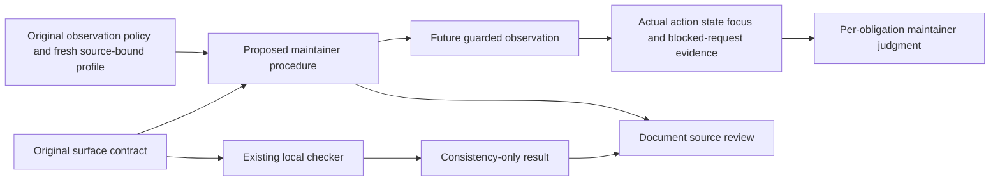

# Navigable copy of the original trial report

The [original report](final-output/REPORT.md) is preserved byte-for-byte with the original method record. This copy adjusts only links for this public layout. It does not revise findings, coverage or observations. Later independent qualification is recorded separately in `evaluation.json`.

<!-- qore-spec/1 -->
# Maintainer verification procedure clarification, v1

The proposed change is a documentation clarification: make the help keyboard sequence and observation boundaries explicit while retaining the procedure's valid Close, Back, unanswered and focus obligations. It proposes no application behavior change. The supplied files remain unchanged. Reviewable wording is in [proposed-protocol.md](final-output/proposed-protocol.md); this report is its change specification, not a record of a website test.

## Outcome, scope and source identity

Workflow mode applies because `target/verification-protocol.md` is an existing, scoped verification specification. The target is a reconstructed tutorial fixture, not historical evidence or project authority. The original project sources govern its clarification: `surface-contract.json`, `checks/check_contract.py`, and `observation-policy.json`; `TASK.md:3–5` defines the authorized documentation-only planning scope.

Run: `qore003-20261017-p2-derived-1`. Supplied candidate identity: `8b26119f383a7d5853c1bd2ab5f678e08966300846c0d6f2784351c1f5a59e8d`. Supplied frozen prepared-input manifest identity: `92981d42bbb636d2809b22af476c7974c1a1f54b539b8e5a7d6c9767b0d53b1d`. The latter identifies the enclosing prepared inputs, not the individual Markdown file. Per-file hashes and the digest procedure are in `evidence/input-manifest.json`; full frozen source copies are in `sources/`. The enclosing digests are supplied metadata; their manifest canonicalization was not independently available for recomputation. Last relevant input/candidate change is the supplied `2026-10-17T09:53:58.874712+00:00`.

The derivative profile `qaizen-labs@0.1.0`, SHA-256 `f76afdd45cb6352e5044a06affc4182ea6cd40aa9c012fb216636a61faa428f0`, passed its current preflight. Both source digests match. `evidence/profile-use.json` separates selected facts from actual consumption. The close-focus, back-focus and unanswered-scope invariants shape the acceptance gates; the declared consistency command was executed. No web surface is selected for method `plan`.

Explicitly outside this change: browser execution, app code, contract/checker/policy edits, guard implementation, data changes, network access, deployment, questionnaire completion, mobile testing, performance or accessibility certification, and website-source redistribution. Actual DOM, tab order, guard capability, deployment identity and blocked-analytics effects remain unknown. No extra runtime evidence is required to accept this documentation plan.

## Stories and locked decisions

| Story | Maintainer outcome |
|---|---|
| US1 | Prepare the declared observation scope and understand method/origin enforcement before a future navigation. |
| US2 | Exercise and distinguish every declared help transition, Close and Back, with separate state/focus evidence. |
| US3 | Preserve unanswered scope and interpret incomplete or failed observations without fabricating a website verdict. |
| US4 | Review a minimal documentation change with source traceability and known limits. |

| Decision | Selection and source-backed justification |
|---|---|
| D1 | Change only the proposed procedure wording; keep the fixture disclaimer and existing project assets. TASK:3–5; target:3. |
| D2 | Expand generic help opening into summary Enter/open, Space/closed, Enter/reopen before Close. Contract:11–14,18 versus target:7. This is the concrete missing coverage; keyboard Back proof is already present. |
| D3 | Preserve Close keyboard traversal/Enter/closed help/summary focus, both unanswered checkpoints, and Back traversal/Enter/introduction visibility/question-and-help absence/heading focus. Target:8–10; contract:14–17; checker:32–36. |
| D4 | Preserve the target's 24-step Back bound. Proposed counting convention: each Tab or Shift+Tab key traversal counts once across both directions, after the pre-departure unanswered assertion, without reset. The number is target-only, not a contract-wide accessibility threshold. Target:10. |
| D5 | Use Tab for the canonical Close traversal declared by contract:14. Preserve target:8's Shift+Tab alternative as labeled alternative evidence; it cannot prove that Tab was observed. Back retains either direction, explicitly accepted by checker:35–36. No required extra run is added. |
| D6 | Document en-US, 1280×800, entry/state depth, exact entry and pointer entry/Start; all-request GET/HEAD/OPTIONS filtering and allowed-origin navigation controls before a future run. Contract:4–10,18,20 and policy:2–4 supply values. The fresh original profile `references/project.json`, invariant `unanswered-scope`, supplies main-frame/popup detail. Redirect handling is a proposed operational elaboration of that navigation boundary. Do not invent an all-resource same-origin rule or guard implementation. |
| D7 | Distinguish static consistency, prose coverage review and future observations; retain blocked analytics effects, no answers/results/submission, and separate per-obligation outcomes. Checker:42–43,46–51; contract:6,19–20. Observed wrong focus is an unmet assertion; bounded traversal exhaustion leaves downstream checks unobserved; absent evidence never becomes a pass or an observed failure. |
| D8 | Provide a single proposed Markdown clarification plus rationale and acceptance map. No logger, new schema, harness, service or database is a dependency. TASK:3–5 and the supplied tool/document boundaries. |

All numbered source references above are within the frozen original files, not the proposed wording. Statements about future evidence and counting are proposals; they are not measurements of the website.

## Preservation and change map

| Existing or supplied obligation | Proposed location / disposition |
|---|---|
| Fixture provenance notice, target:3 | Opening paragraph retained. |
| Entry journey, target:5; contract `entry` | Ordered step 1 retains public entry and following link; supplies exact URL/control and introduction assertion. |
| Start unanswered, target:6; contract `start` | Step 2 retains no selection; names click and first-question visibility. |
| Generic help opening, target:7 | Step 3 specifies the existing contract's Enter, adds Space-close and Enter-reopen, each with its immediate state. |
| Close Tab or Shift+Tab, Enter, closed help, summary focus, target:8 | Step 4 retains every clause; D5 annotates canonical versus alternative coverage without deleting the alternative. |
| Unanswered after Close, target:9 | Step 5 retained as a separate checkpoint. |
| Unanswered before departure, target:10 | Step 6 retained separately; no merging with step 5. |
| Application Back Tab/Shift+Tab within 24, Enter, target:10 | Step 6 retained, counted explicitly, with no click/forced-focus substitute. |
| Introduction visible; question/help absent; heading focused, target:10 | All three assertions retained in step 6, independently from Close focus. |
| `entry`, `unanswered`, `help-toggle` | Steps 1, 2/5/6, 3 respectively; evidence paragraph lists each named check. |
| `close-focus`, `keyboard-back`, `introduction-focus` | Steps 4 and 6; actual focus and traversal records required separately. |
| `read-only-policy`, `origin-policy` | Preconditions before navigation; evidence includes block/destination outcomes. |
| Analytics POST blocked; effects retained; no source-commit deployment inference | Preconditions and evidence limits retain contract:20. |

## Architecture, reuse and impact

The existing JSON contract produces declarations for a maintainer and the local checker. The checker reads only its one JSON argument and emits `{valid,schema,checks,limit}` or an error/exit 1; `checks` is a returned declaration list, not a record of executed checks. It reads neither the procedure nor the separate observation policy. Consequently a source-to-prose review is necessary even when that command passes. Architecture's bounded sweep inspected all supplied project files and searched their relevant field names; no other supplied runtime reader or guard exists. This does not establish absence of consumers outside the supplied snapshot.

Shared fields crossing the real boundaries are entry URL, allowed origins, locale/viewport/depth, answer policy, allowed methods, transition IDs/from/to/control/activation/traversal/focus_after, focus targets, required-check IDs, provenance and limits. The proposed prose consumes those fields; it does not write new persisted state. Origin values agree across the two original JSON files. No serialization, compatibility, schema, authorization, transaction or storage behavior changes. The future observer owns guard enforcement, evidence and stopping; no transaction/retry service is supplied or invented. Ordinary navigation to focus the summary is setup guidance, not a new summary-reachability acceptance criterion.



The following sequence specifies a future execution and its rejection path; no browser sequence ran here.

```mermaid
sequenceDiagram
    participant M as Maintainer
    participant K as Local checker
    participant G as Future observer and guards
    participant B as Public browser journey
    M->>K: Validate original contract
    K-->>M: Consistency result only
    M->>G: Establish method and navigation guards before entry
    alt Guards unavailable
        G-->>M: Stop; compliant observation blocked
    else Guards established
        M->>B: Click entry link and Start; remain unanswered
        M->>B: Summary Enter, Space, Enter
        B-->>M: Observe open, closed, open
        M->>B: Sequential Close then Enter
        B-->>M: Observe closed help and summary focus; unanswered
        M->>B: Recheck unanswered; seek Back within 24 traversals
        alt Bound exhausted or assertion unmet
            M->>M: Retain trace; distinguish unmet and unobserved checks
        else Back reached
            M->>B: Enter on application Back
            B-->>M: Observe introduction, absent question/help, heading focus
        end
        B->>G: Any attempted request or navigation
        G-->>M: Block prohibited methods/origins; retain analytics effects
    end
```

## Acceptance scenarios

These are acceptance tests for the proposed documentation and its interpretation, not claims of executed browser tests.

```gherkin
Feature: Clarify the bounded maintainer procedure
  Scenario: AC01 Prepare declared scope before entry
    Given the original contract and observation policy agree on https://qaizen.io
    When a reviewer reads the proposed preconditions and entry steps
    Then en-US, 1280 by 800, entry/state depth and unanswered scope are explicit
    And GET HEAD OPTIONS only and main-frame/popup origin guards precede navigation
    And the entry-link and Start click transitions remain explicit

  Scenario: AC02 Missing guard capability prevents a future run
    Given a future observer cannot establish the required guards
    When the proposed procedure is followed
    Then it stops before navigation and records blocked verification
    And this does not become a website failure or a dependency on building tooling for this plan

  Scenario: AC03 Every help transition has its own proof
    Given the first question is visible and unanswered
    When the reviewer follows proposed step 3
    Then summary Enter/open, Space/closed and Enter/reopen are separately required
    And Space closure does not replace subsequent Close and summary-focus proof

  Scenario: AC04 Preserve Close and distinguish traversal paths
    Given the existing target permits Tab or Shift+Tab to Close
    When a reviewer compares proposed step 4 with the target and contract
    Then Enter, closed help and actual summary focus remain required
    And canonical Tab is distinguished from preserved Shift+Tab alternative evidence
    And a Shift+Tab-only trace cannot be labeled observed Tab coverage

  Scenario: AC05 Preserve both unanswered checks and bounded Back
    Given Close has been activated and summary focus observed
    When the reviewer examines proposed steps 5 and 6
    Then unanswered is asserted after Close and again before departure
    And application Back requires sequential Tab or Shift+Tab within 24 combined traversal steps and Enter
    And introduction visible, question and help absent, and introduction heading focused remain separate postconditions

  Scenario: AC06 Exhausting the bound cannot manufacture proof
    Given a future recorded attempt has made 24 traversals without reaching Back
    When its result is interpreted using the proposed evidence guidance
    Then bounded traversal is recorded as unmet and the trace is retained
    And Back activation and return focus remain unobserved
    And no click, forced focus, reset count or universal inaccessibility claim supplies the missing proof

  Scenario: AC07 Visible introduction does not prove heading focus
    Given a future attempt observes the returned introduction with focus elsewhere
    When its obligations are assessed separately
    Then visibility can be observed while the heading-focus assertion is unmet
    And missing focus capture instead would be unobserved rather than an invented pass or failure

  Scenario: AC08 Blocking effects are retained without policy relaxation
    Given an analytics POST or outside-origin redirected or popup navigation is attempted
    When the future procedure applies its existing guards
    Then the prohibited request or navigation is blocked before completion
    And attempted method or destination and observed journey effects are retained
    And interrupted downstream checks remain unobserved and guards stay active

  Scenario: AC09 Static success is bounded evidence
    Given the existing contract checker exits zero
    When a maintainer reviews the clarified document
    Then that result is labeled consistency only and does not prove Markdown coverage or website behavior
    And the fixture disclaimer, narrow exclusions and private-commit deployment limitation remain explicit
    And no input edit, new harness or application change is required by this plan
```

Coverage: AC01 → US1 / D6; AC02 → US1,US3 / D6,D7,D8; AC03 → US2 / D2; AC04 → US2 / D3,D5; AC05 → US2,US3 / D3,D4; AC06 → US3 / D4,D7; AC07 → US2,US3 / D3,D7; AC08 → US1,US3 / D6,D7; AC09 → US4 / D1,D7,D8.

The preservation map also maps all seven transition IDs and all eight required-check IDs. Cross-examination feedback on canonical traversal, counting, two unanswered checkpoints, guard provenance, wrong-focus versus unavailable evidence, and scope is addressed by AC01–AC09. No supplied acceptance item is intentionally dropped. Current browser conformance is missing empirical coverage, outside the authorized planning task.

## Delivery order, gates and risks

| Task | Size and basis | Dependency / acceptance gate |
|---|---|---|
| T1 Lock source/preservation map | XS, 10–15 minutes; five small source files | Current frozen sources/profile; every retained target clause accounted for. |
| T2 Prepare one proposed clarification | S, 20–35 minutes; bounded prose, no code | T1; D1–D8 reflected in proposed wording. |
| T3 Review source-to-prose coverage and failure interpretation | S, 15–25 minutes; seven transitions/eight checks | T2; AC01–AC09 and canonical/alternative labeling, both checkpoints and all Back postconditions. |
| T4 Retain offline validation and hand off for maintainer review | XS, 5–10 minutes; existing command and artifact checks | T3; consistency result remains distinct from document and live evidence. |

Critical path: T1 → T2 → T3 → T4. The 50–85 minute range is Delivery's hypothesis for a familiar maintainer doing a later documentation change, not measured execution time or a commitment. This run already supplies the proposed wording and checks; unchanged checks need not be rerun merely to fill tasks. Guard selection and live observation are deferred execution responsibilities. No data migration, app build, deployment or feature flag is coupled to the change. A later documentation rollout uses normal maintainer review; rollback is reverting that documentation edit while acknowledging that the original help omission returns.

Preservation failure is HIGH in Product/Architecture/Delivery's verification-risk assessment and MEDIUM in QA's framing. The help-sequence gap is MEDIUM in four role assessments and HIGH in UX's acceptance-reliability assessment. Both ratings are preserved; no averaged severity replaces them. Unauthorized future observation or fabricated evidence is HIGH. Canonical/alternative mismatch and treating bound exhaustion as universal failure are MEDIUM. QA's LOW risk for overbroad origin policy and Delivery's MEDIUM scope/schedule impact concern different consequences. All are proposed verification risks with the triggers and evidence in the full reports, not observed incidents.

## Adjudication, dissent and execution record

The lead selected D1–D8 after the five-report barrier and one cross-examination by each role. `evidence/adjudication.json` retains alternatives, exact source divergence, selected decisions, consequences and dissent. No votes establish source truth. Rejected alternatives are an unspecified help opening, deleted Shift+Tab, Shift+Tab mislabeled as observed Tab, a changed/deleted 24-step bound, merged unanswered checkpoints, a whole-journey keyboard rewrite, a blanket cross-origin resource ban, a new harness prerequisite, forced-focus rescue, and checker success treated as a website pass. The sources justify each rejection at its point of divergence; empirical unknowns are not resolved by agreement.

A fresh verifier received only 35 mechanically whitelisted claims and the original sources, not full role reports or the lead draft. `evidence/filter-claims.py` and `evidence/filter-log.json` retain the transformation, complete input/output hashes and allowed fields. No claims, severities or refutations were semantically selected away. The verifier covered all 35 IDs: 17 supported and 18 qualified; no unfinished IDs. Its full report and structured results are saved. Qualifications are retained: counting rules, canonical/alternative labels, outcome taxonomy, pre-navigation stopping and redirect handling are proposed operational clarifications, not source-defined result schemas or measured behavior. The final proposal explicitly distinguishes them.

The verifier could not independently establish Delivery's claimed prior successful checker execution because its permitted evidence excluded command output; profile-check only proves freshness and command metadata. That verification limit remains recorded. Separately, the lead actually executed the allowed checker and retained its exit-zero output in `evidence/contract-check.json`; the execution record binds it to its real command. This does not change the verifier's limited verdict or establish any browser behavior. Delivery's 50–85 minute range remains an unmeasured estimate.

Actual method execution: five independent initial Analyze contexts, a saved report barrier, one Cross-examine pass for all five roles, a saved cross barrier, lead adjudication, mechanical claim filtering, one fresh verifier, and structural validation. Workflow uses one analysis and one challenge pass; no third pass or extra quality retry was dispatched. All five complete initial reports, all five full cross reports, and the verifier report are in `reports/`. Requested/returned/missing roster, actor identities and UTC dispatch/lead-observed return times are in `roster.json`; missing roles/reports: none.

Runtime continuity limit: `/root/product` and `/root/ux` were retired when later initial roles were scheduled. The host rejected a Product follow-up as context unavailable. Fresh `/root/product_cross` and `/root/ux_cross` performed those role challenges using their complete saved own reports and all peer reports, explicitly declaring the context change. Architecture, Delivery and QA resumed their actual initial contexts. These fresh challenge contexts do not replace any independent initial analysis. The planning protocol's role barrier and all challenge links ran; identity continuity is not claimed.

Budget: 900 wall seconds, 2,400 aggregate agent-seconds, at most three active children. Initial role deadlines were 120 seconds, cross roles 90 seconds, verifier 90 seconds. The verifier was asked for available results at its deadline. Exact child completion timestamps/usage are unavailable from the host: recorded returns are lead-observed UTC times, and the first dispatch wave has time bounds. Some conservative cross-report spans exceed 90 seconds; completion notifications were already available at the next scheduling boundary, and no expiry request preceded those notifications. This timing-control limitation is recorded rather than claiming that all deadlines were met. Actual token/active-agent usage is unavailable, not zero; conservative dispatch/return elapsed bounds and wall time are retained in the final roster. No global budget exhaustion occurred and no dispatch was made after the budget.

Remaining dependencies for a later real observation are an authorized compliant observer, enforceable pre-entry guards and actual state/focus/request evidence. Their implementation and deployment behavior remain deliberately unexamined. Browser coverage is absent; this run establishes no current website pass or defect. Input identity is checked again at handoff. The frozen input copies and all source/skill hashes permit inspection of the exact resources used. `rg` was unavailable and BusyBox `find` rejected `-printf`; standard file reads/search fallbacks were used, with failures preserved.

Planning protocol coverage: **COMPLETE**, meaning all required planning roles/phases and the additional verifier ran with saved evidence; this is not implementation/deployment approval. Structural validation and the identity/coverage record check are retained in `evidence/spec-lint.txt` and `evidence/run-check.txt`, with actual command statuses in the execution and validation records. Their success checks structure and declared evidence identity, not the reasoning's correctness. Decision readiness: a source-backed documentation proposal is available for maintainer review; actual runtime conformance remains unknown.

