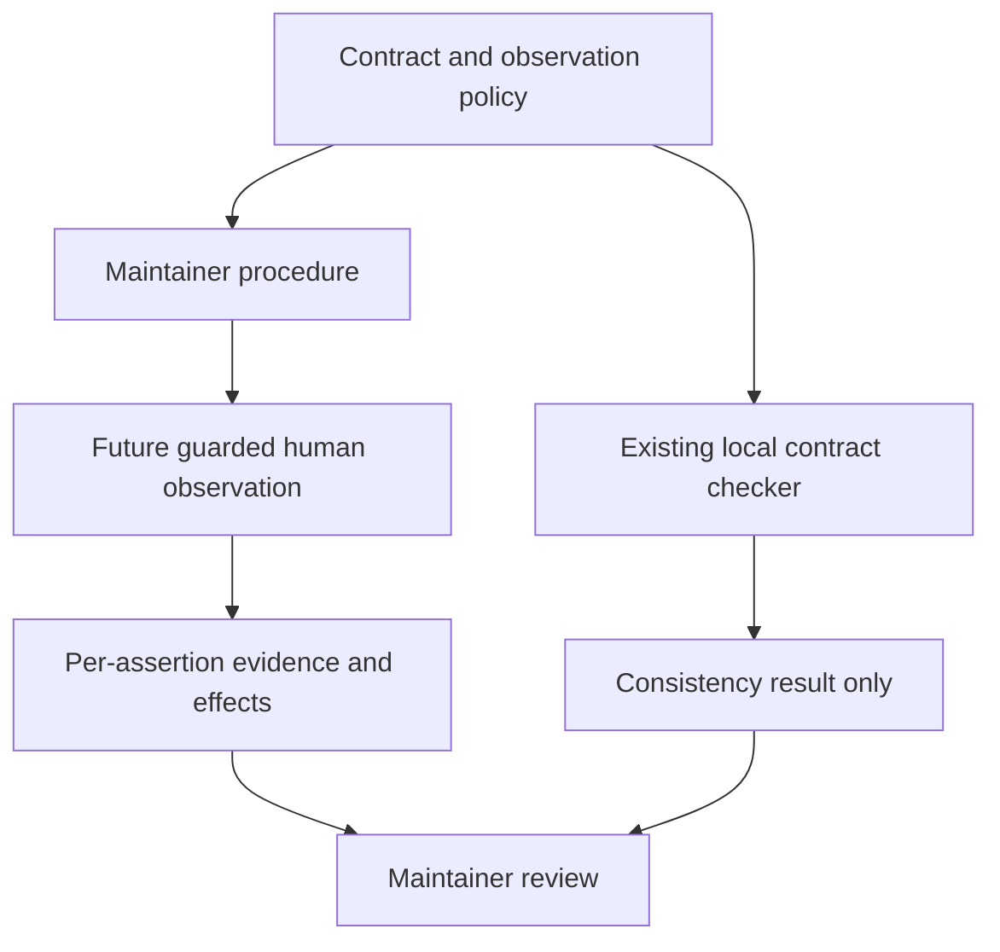

<!-- qore-spec/1 -->
# Clarify the maintainer journey verification procedure — version 1

## Outcome, scope and authority

Plan a documentation-only clarification of `target/verification-protocol.md` so maintainers can follow the declared journey and accurately qualify its evidence. Exact proposed text is in [proposed-verification-protocol.md](proposed-verification-protocol.md). It is a reviewable proposal outside the frozen input, not an applied change. The sole prospective project edit is that Markdown file. Preserve the current fixture disclaimer and all valid existing obligations. No application behavior change is proposed.

Source revision: frozen prepared-input manifest `e9aeec2eee10b52c3339b53b4e491d3ff69f57c68be2f5ea1d61e70df55acccc`, supplied by the enclosing run. Target-file raw-byte digest is `0a3452f02e358d8800fb26d591083deb972c5531165473990dc27007a9a9e0d4`; these identify different scopes. Candidate skill identity is `8b26119f383a7d5853c1bd2ab5f678e08966300846c0d6f2784351c1f5a59e8d`. Per-file hashes/copies are in `evidence/input-inventory.json` and `sources/`; enclosing manifest serialization was not supplied for independent digest reconstruction. Last relevant source change: `2026-10-17T09:53:58.901555+00:00`; no input correction occurred during execution.

Authority and measured limits:

| Source | Facts used |
|---|---|
| `TASK.md:1–5` | qore-plan; maintainer documentation scope; preserve valid obligations; original project sources authoritative; immutable inputs. |
| `surface-contract.json:2–6` | Schema/version, entry URL, exact allowed origin, locale, viewport, depth, unanswered policy, allowed methods. |
| `surface-contract.json:7–18` | Six states, seven transitions with control/activation/traversal/focus, eight required checks. |
| `surface-contract.json:19–20` | Expectations versus observations, historical protocol-gap note, blocked analytics effects and exclusions. |
| `checks/check_contract.py:12–18,23–43` | Static consistency checks, Back accepts Tab or Shift+Tab, distinct focus targets; no browser proof. |
| `observation-policy.json:2–4` | Sole authorized origin `https://qaizen.io`, agrees with contract. |
| `target/verification-protocol.md:3,5–10` | Existing applicable procedure to preserve; task target, not project authority. It ALREADY has keyboard Back, 24-step bound, unanswered-before-leave and return/focus assertions. |

The lead and five independent roles inspected all three original project sources. The local command `python3 -B checks/check_contract.py surface-contract.json` actually returned exit 0 and `valid: true`; output is in `evidence/contract-check.txt`. That checker reads the contract JSON, not Markdown or policy, and never contacts the website. Its success establishes no current site behavior.

Non-applicable surfaces: no supplied application service, database, transaction, migration, runtime retry mechanism, native UI or deployment configuration is changed. Browser execution, full questionnaire, results, answer selection, submission, source redistribution, mobile, performance and accessibility certification are outside scope. No profile is present or consumed. No network access is used.

## User stories and locked planning decisions

- **US1:** As a maintainer, I can see what the clarification preserves and why each addition is justified.
- **US2:** As an observer, I can prepare and retain the bounded, read-only, unanswered journey without guessing actions or focus destinations.
- **US3:** As a reviewer, I can distinguish static consistency, procedure coverage, actual observations and missing evidence.

These decisions lock the proposed documentation content for review, not application implementation or publication:

| ID | Decision and source-backed reason |
|---|---|
| **D1** | Reuse the one existing procedure; preserve fixture provenance, entry/start, Close keyboard/closed/summary focus, both unanswered checkpoints, Back keyboard/Enter/24 bound, visible introduction, absent question/help and heading focus (`target:3,5–10`). No sourced reason permits deletion. |
| **D2** | Add preparation: `en-US`, 1280×800, entry/state depth, exact `https://qaizen.io`, GET/HEAD/OPTIONS, no answers/submission/results/source redistribution; policy applies before navigation and throughout requests/subrequests/redirects. Keep analytics POST blocked and retain effects (`contract:4–6,18–20`; policy:2–4). No guard software is implemented. |
| **D3** | Specify entry link click and Start click, then summary Enter-open, Space-close, Enter-reopen with separate state assertions (`contract:9–13`). Current target:7 omits two help transitions and opening key; that is documentary under-specification, not a measured site defect. No new focus-after-toggle invariant is added. |
| **D4** | Recommend Tab to match concrete Close/Back transition fields; preserve existing Shift+Tab option for both controls, one permitted sequential route sufficient for the procedure. Record actual direction; reverse/mixed proof leaves literal forward-Tab behavior unobserved. No second directional run is required (`contract:14–15`; checker:35–36; target:8,10). |
| **D5** | Retain 24 as the existing Back procedural bound. Start at actual post-Close summary focus, count each Tab/Shift+Tab once without reset, accept Back focused on action 24; Enter is not traversal. Stop before action 25 if absent. No new Close bound, timing threshold or product accessibility maximum (`target:10`; contract states no numeric cap). |
| **D6** | Record per-assertion PASS/FAIL/NOT OBSERVED plus cause. Bound exhaustion fails bounded demonstration; unperformed Back activation/return remain NOT OBSERVED. Separate visible state from actual focus. Stop on guard breach, missing predecessor or lost unanswered invariant; expected denied POST alone need not abort observable checks. Retain observed effects and avoid unsupported causality (`contract:14–20`; target:8–10). |
| **D7** | Keep a compact evidence note, local checker limitation, time/environment, actual input/count/focus, sanitized necessary request metadata. No mandatory screenshots, full DOM/network dumps, schema, runner or exhaustive focus log. Data minimization and outcome labels are proposed maintainer conventions; source redistribution exclusion is authoritative (`contract:19–20`; checker:42–43). |

## Architecture, reuse and impact evidence

Architecture's actual sweep is retained in full in `reports/architecture-analysis.md` and its cross-examination. The supplied surfaces support a single-document proposal; no absent implementation is invented.

| Producer → reader | Fields crossing boundary | Ownership, reuse and compatibility |
|---|---|---|
| Contract → checker | entry/origins, scope methods/answer policy, states, transition id/from/to/control/activation/traversal/focus_after, focus_targets, required_checks, provenance | Existing Python reader and JSON output retained unchanged. It is not a complete semantic checker for every concrete transition. |
| Contract + observation policy → human maintainer | origin/methods, locale/viewport/depth, seven transitions, focus destinations, limits/provenance | Reuse declarations by reference plus compact prose. Currently same origin; mismatch in a future revision is reported, never resolved by unioning allowlists. |
| Maintained Markdown → future observer → reviewer | ordered actions, count convention, actual direction, visible/answer/focus results, denied requests/effects, outcome/reason | Observer owns enforcement and observations before/through navigation. No runtime enforcement code was supplied. Markdown change cannot claim guard deployment. |
| Checker → caller | `valid`, `schema`, `checks`, `limit`, exit status; error string on failure | Reuse command; failed consistency is reported/resolved before claiming verification. Static PASS cannot populate runtime observations. |
| Planning actors → `/workspace/output` | independent reports, challenges, decisions, proposed wording, evidence identities | External proposal only; no input or shared data writer. No transaction/retry/storage changes. |



The following sequence specifies future observation; this run executed only local source inspection/checking and planning, never the browser branch.

```mermaid
sequenceDiagram
  actor M as Maintainer
  participant C as Local contract checker
  participant G as Future observation guard
  participant W as Public journey
  M->>C: Validate frozen contract locally
  C-->>M: Consistency result, not website proof
  M->>G: Confirm exact origin and methods before navigation
  alt Guard unavailable or contract inconsistent
    G-->>M: Do not start; report missing evidence
  else Preconditions established
    M->>W: Allowed Labs entry and journey link click
    M->>W: Start click, remain unanswered
    M->>W: Summary Enter, Space, Enter with state checks
    M->>W: Sequential Close, Enter
    W-->>M: Observe help closed and actual summary focus
    M->>M: Check unanswered after Close and before departure
    M->>W: Sequential Back within 24 traversal actions
    alt Back not focused after action 24 or predecessor failed
      M->>M: Record bounded failure and unperformed results
    else Back actually focused in bound
      M->>W: Enter on Back
      W-->>M: Observe intro, question/help absent, heading focus
    end
    opt Analytics POST attempted
      W->>G: Disallowed request
      G-->>M: Deny; retain observed effects and affected results
    end
  end
```

Rejection behavior is documentary: do not start without enforceable guards; stop affected sequence for missing predecessor/lost unanswered state, and stop on an actual policy breach. Correctly blocked attempts stay blocked; record their effects. No pointer/forced-focus repair can turn an unperformed keyboard proof into a pass. Actual loading/error UI, DOM mechanism, private implementation and deployment revision remain unknown; report observations rather than inventing expected error copy.

## Obligation preservation and acceptance mapping

| Supplied obligation | Proposed location | Disposition |
|---|---|---|
| Fixture qualification (`target:3`) | Opening disclaimer and preparation | Preserved verbatim; historical note qualified. |
| Entry/start (`target:5–6`; contract entry/start) | Journey 1–2 | Preserved, controls/clicks made explicit. |
| Open-help + toggle-help + reopen-help (`contract:11–13`) | Journey 3–5 | Explicit Enter/Space/Enter, separate open/closed/open observations. |
| Close traversal/Enter/closed/summary focus (`target:8`) | Journey 6 | Preserved, both permitted directions retained with exact-field caveat. |
| Unanswered after Close (`target:9`) | Journey 7 | Preserved separately. |
| Unanswered immediately before Back (`target:10`) | Journey 8 | Preserved separately; invariant throughout. |
| Back traversal/24/Enter (`target:10`) | Journey 8 and guard note | Preserved, count zero/24 inclusive/no reset clarified. |
| Introduction visible, question/help absent, heading focus (`target:10`) | Journey 8 | All preserved; h1 from contract:17, not substituted by summary focus. |
| `entry`, `unanswered`, `help-toggle` (`contract:18`) | Journey 1–5,7–8 | AC03–AC06. |
| `close-focus`, `keyboard-back`, `introduction-focus` (`contract:18`) | Journey 6,8 | AC05–AC09; distinct actual focus and direction limits. |
| `read-only-policy`, `origin-policy` (`contract:18`) | Preparation and evidence | AC02,AC10–AC11. |
| Provenance and all four limit strings (`contract:19–20`) | Preparation, scope, guard and evidence notes | Preserved/clarified; AC01,AC02,AC07,AC10,AC12,AC13. |

All seven transition IDs and eight required checks are mapped above. This is static coverage of instructions, not proof of website execution. QA feedback on exact step 24, failed Close predecessor, blocked analytics, distinct focus/state outcomes, direction scope and unperformed results is incorporated below.

## Acceptance scenarios

These scenarios are acceptance criteria for reviewing the proposed documentation and paper traces, not reported browser results. Runtime wording describes what the future procedure must instruct.

```gherkin
Feature: A precise bounded maintainer procedure
  Scenario: AC01 Preserve current valid obligations and scope
    Given the original six-step procedure and original project sources
    When the proposed documentation is compared with the frozen target
    Then its fixture disclaimer and every preserved obligation in the mapping remain
    And only the existing Markdown is proposed for project change
    And no input, skill resource, application or shared data is changed in this run

  Scenario: AC02 Establish the observation envelope before entry
    Given the contract and policy allow only https://qaizen.io and GET HEAD OPTIONS
    When a future observer prepares the journey
    Then the procedure requires matching origins and enforceable restrictions before navigation
    And en-US and a 1280 by 800 viewport and entry/state unanswered scope are explicit
    And unavailable enforcement or a source mismatch prevents starting rather than broadening policy

  Scenario: AC03 Cover entry and unanswered start
    Given a guarded future observation at the Labs entry
    When the declared journey link and Start the check are clicked in order
    Then introduction and first-question states are observed in order
    And no answer is selected or submitted and no result is generated

  Scenario: AC04 Exercise each help transition independently
    Given the first question is unanswered and summary is the active control
    When Enter opens help and Space closes help and Enter reopens help
    Then the procedure requires an observation after each activation
    And Close remains a separate subsequent transition
    And no unspecified post-toggle focus destination is imposed

  Scenario: AC05 Preserve Close and both unanswered checkpoints
    Given help has been reopened and the question remains unanswered
    When Close is reached sequentially and activated with Enter
    Then help closed and actual summary focus are checked separately
    And unanswered is checked after Close and again immediately before Back departure
    And clicks or forced focus cannot substitute for the required keyboard evidence

  Scenario: AC06 Back is reached on the final allowed action
    Given Close restored actual summary focus and the question is unanswered
    When sequential traversal action 24 focuses Back and Enter activates it
    Then the bound is met with Enter excluded from the traversal count
    And introduction visibility and question/help absence are asserted
    And actual introduction h1 focus is asserted separately

  Scenario: AC07 Back is not reached within the retained guard
    Given Back traversal starts at observed summary focus with count zero
    When 24 counted Tab or Shift+Tab actions have not focused Back
    Then action 25 and a pointer or forced-focus substitute are disallowed for this proof
    And bounded demonstration fails with count and terminal focus retained
    And unperformed activation and return assertions remain NOT OBSERVED
    And no contract-level numerical product defect is inferred from the count alone

  Scenario: AC08 Preserve the alternative without claiming an unobserved direction
    Given the contract declares Tab and the existing procedure permits Shift+Tab
    When an observer uses one permitted reverse or mixed sequential route
    Then the actual direction is recorded and no second directional run is mandatory
    And unexercised literal forward-Tab behavior remains unobserved
    And count resets or extra 24-action allowances per direction are disallowed

  Scenario: AC09 Visual and focus evidence disagree
    Given a prescribed transition was actually activated
    When help closes without summary focus or the introduction appears without heading focus
    Then visible-state evidence and the failed focus assertion receive separate outcomes
    And failed Close focus is not repaired by forcing summary focus for a claimed complete Back trace
    And unperformed downstream checks remain NOT OBSERVED

  Scenario: AC10 An expected analytics POST is denied
    Given origin and method restrictions remain enforced
    When an analytics POST is attempted during an otherwise observable journey
    Then it remains blocked and its observed effects are retained
    And unaffected observable assertions may still be assessed
    And effects preventing an assertion leave it NOT OBSERVED rather than fabricating a pass
    And an independently observed mismatch is recorded as FAIL with context

  Scenario: AC11 A boundary or unanswered invariant fails
    Given all requests and redirect destinations must remain within the observation policy
    When an unapproved destination or method is attempted or the unanswered invariant is lost
    Then an attempted forbidden request is denied and its effects recorded
    And an actual guard breach or lost unanswered invariant stops the journey
    And no answer submission or result generation is used as recovery

  Scenario: AC12 A local consistency pass has limited meaning
    Given the supplied checker returns valid true for the input JSON
    When the maintainer describes the result
    Then it is labeled contract consistency only
    And it is not claimed as Markdown completeness or current website conformance
    And fixture and historical provenance are not presented as current deployment proof

  Scenario: AC13 Retain sufficient evidence with bounded claims
    Given the observer records expected and observed results for each obligation
    When a check is completed or cannot be observed
    Then its PASS FAIL or NOT OBSERVED outcome and cause are explicit
    And time environment actual input count and relevant focus support the claim
    And only necessary sanitized request metadata and effects are retained without secrets or source redistribution
    And full screenshots DOM dumps or a new capture tool are not required by this clarification
```

Coverage: AC01 → US1 / D1; AC02 → US2 / D2; AC03 → US2 / D1,D3; AC04 → US2 / D3; AC05 → US1,US2 / D1,D4,D6; AC06 → US2 / D1,D5; AC07 → US2,US3 / D5,D6; AC08 → US2,US3 / D4,D5; AC09 → US3 / D1,D6; AC10 → US2,US3 / D2,D6; AC11 → US2 / D2,D6; AC12 → US3 / D7; AC13 → US3 / D6,D7.

## Tasks, dependencies and acceptance gates

| Task | Size and basis | Dependency / gate |
|---|---|---|
| T1: Inventory existing and declared obligations | XS, one short target, seven transitions and eight checks | Supplied sources; preserve-map gate AC01. Completed in this run. |
| T2: Adjudicate traversal and count semantics | S, one concrete wording divergence and one local numeric guard | T1; record sources, alternatives and limitations. Completed by lead adjudication. |
| T3: Prepare the concise proposed replacement | S, preparation block, explicit help cycle, retained sequence and evidence note | T1–T2; exact external draft supplied. No application or schema dependency. |
| T4: Validate the proposal and specification | XS, local contract check, manual source/preservation mapping, skill structural lint | T3; AC01–AC13 static/paper-trace review. Browser conformance withheld. |
| T5: Future documentation review/application | XS, one Markdown diff; no website rollout, flag or migration | T4 and separate authorization/environment for any actual project edit/publication. No such mutation executed here. |

Critical order T1 → T2 → T3 → T4 → T5. Coupling is semantic: source fields → document instructions → future observed evidence → reviewer claim. Delivery's 55–90-minute prospective maintainer estimate assumes familiarity and available reviewers; it is not a measurement or promise for this run. Documentation rollback, if a later edit is applied, restores the prior Markdown revision while retaining rationale/evidence. No live-site run is a dependency for this documentation plan; claiming future deployment conformance does require separate current observations and enforceable guards.

## Adjudication, protocol coverage and unresolved evidence

See [adjudication.md](adjudication.md) for competing positions, counterexamples, retained impact severities and refutations. No source authorizes deleting valid current Back proof, removing the 24 bound, silently treating reverse traversal as literal Tab evidence, implementing a new runner, or relaxing origin/method policy. Rejected alternatives are recorded rather than erased.

Workflow deciding artifact: current `target/verification-protocol.md`, applicable to this same journey. Actual phases: five independent Analyze contexts, complete report barrier, one Cross-examine pass per role, lead Adjudicate, structural validation. Cross-examination used fresh successors for Product and UX after host context retirement; full initial reports remained available. No additional round, review finder/verifier phase or quality retry was invoked. See `roster.json` for actual actors and UTC evidence, full reports in `reports/`, and identity-bound phase outputs in `execution.json`.

Remaining unknowns are current deployment behavior, actual focus/tab order, blocked-request effects and enforcement implementation. They do not block this documentation plan and cannot be filled by static checks. There is no unresolved documentation-choice dependency in D1–D7. Exact literal forward-Tab evidence remains missing if a future observer chooses only the permitted reverse route; the procedure makes that limitation visible.

Structural validation result and actual coverage are finalized in `REPORT.md` and `evidence/phase-spec_validation.json`. A passing structural validator is not proof of source reasoning, product completeness or permission to apply/publish.
