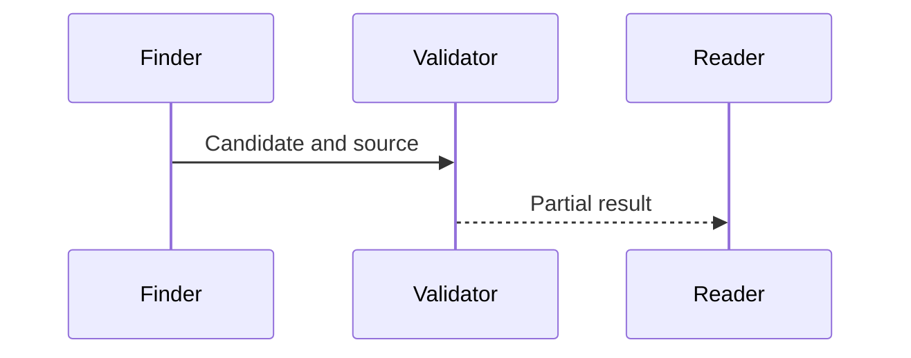

<!-- qore-spec/1 -->
# Validator example

```gherkin
Feature: Keep review uncertainty visible
  Scenario: A01 Preserve the impact of an unverified finding
    Given a high severity candidate with a checkable source
    When independent verification is unavailable
    Then the report retains its severity and partial coverage
```

Coverage: A01 -> US1 / D1.


